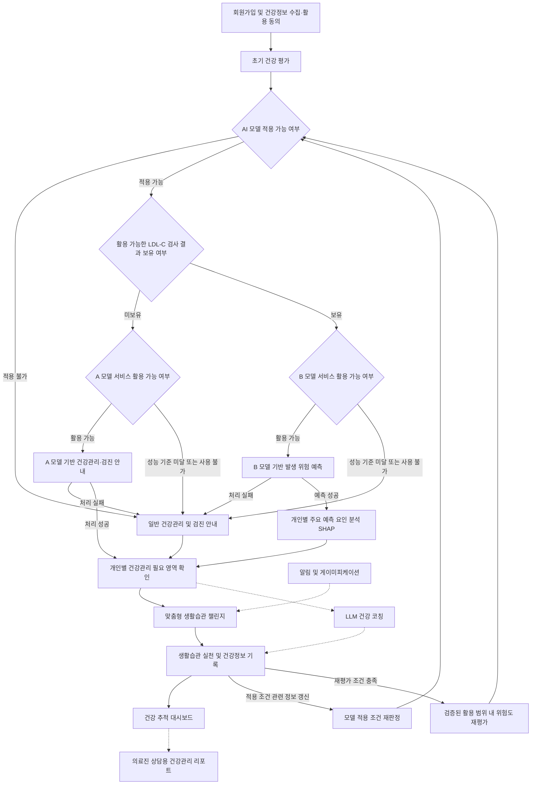
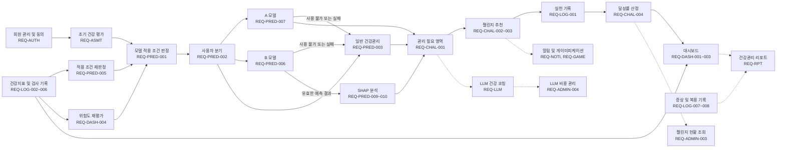

# WELLOOP 요구사항 정의서 v2.0

- 문서 버전: v2.0 (초안)
- 작성 기준일: 2026-11-24
- 기준 기획안: [`docs/service_overview.md`](../service_overview.md) (기획안 v2)
  - 기준 커밋: `d9f1abc` (`d9f1abce956c92423ccce74e5b96efbb6e9b921a`, 2026-11-23)
- 이전 문서: [`WELLOOP_요구사항정의서_v1.3.md`](./WELLOOP_요구사항정의서_v1.3.md) (보존, 참고용)

### 문서 관리 원칙

- 문서의 변경 사항은 PR을 통해 관리한다.
- 기준 기획안이 변경되면 기준 커밋을 갱신하고 변경 이력에 기록한다.
- 기존에 부여한 요구사항 ID는 가능한 한 유지하며, 삭제된 ID를 다른 의미로 재사용하지 않는다.
- TBD 사항이 결정되면 관련 요구사항의 상세 내용과 상태를 함께 갱신한다.
- 요구사항의 변경 시 ERD, API 명세서, AI 모델링 설계서, 챌린지 설계서, 와이어프레임에 미치는 영향을 확인한다.

> 본 문서는 기획안 v2를 기반으로 작성한 요구사항 정의서 초안이다.
>
> P0~P3는 기획안의 우선순위를 기반으로 분류한 것이며, 최종 구현 범위와 서비스 세부 정책은 팀 논의를 통해 확정한다.

---

## 목차

- [0. 문서 작성 기준](#0-문서-작성-기준)
- [1. 서비스 개요](#1-서비스-개요)
- [2. 기능 요구사항](#2-기능-요구사항)
- [3. 비기능 요구사항](#3-비기능-요구사항)
- [4. 데이터 및 AI 요구사항](#4-데이터-및-ai-요구사항)
- [5. 보안 및 의료 안전 요구사항](#5-보안-및-의료-안전-요구사항)
- [6. 기능 간 의존 관계](#6-기능-간-의존-관계)
- [7. 미확정 사항 및 담당자](#7-미확정-사항-및-담당자)
- [8. 향후 확장 범위](#8-향후-확장-범위)
- [9. 변경 이력](#9-변경-이력)

---

## 0. 문서 작성 기준

### 0.1 요구사항 ID 체계

| ID 형식 | 영역 | 위치 |
|---|---|---|
| REQ-AUTH-### | 회원 및 사용자 관리 | 2.1 |
| REQ-ASMT-### | 초기 건강 평가 | 2.2 |
| REQ-PRED-### | 모델 적용 조건, 사용자 분기, 예측 및 SHAP | 2.3, 2.4 |
| REQ-CHAL-### | 생활습관 챌린지 | 2.5 |
| REQ-LOG-### | 건강정보 및 실천 기록 | 2.6 |
| REQ-DASH-### | 대시보드 및 재평가 | 2.7 |
| REQ-LLM-### | LLM 및 RAG | 2.8 |
| REQ-NOTI-### | 알림 | 2.9 |
| REQ-GAME-### | 게이미피케이션 | 2.9 |
| REQ-RPT-### | 건강관리 리포트 | 2.10 |
| REQ-FOOD-### | 식단 이미지 분석 | 2.11 |
| REQ-ADMIN-### | 관리자 | 2.12 |
| REQ-BIZ-### | 향후 사업 확장 | 8 |
| NFR-### | 비기능 요구사항 | 3 |
| DR-### | 데이터 및 AI 요구사항 | 4 |
| SR-### | 보안 및 의료 안전 요구사항 | 5 |
| TBD-### | 미확정 사항 | 7 |

- 각 영역의 ID는 001부터 순차적으로 부여한다.
- NFR은 기존 v1.3의 NFR-001~017과의 충돌을 방지하기 위해 101부터 부여한다.
- 요구사항 간 중복을 최소화하고 필요한 경우 관련 ID를 참조한다.
- 세부 알고리즘, DB 스키마, API 엔드포인트, UI 레이아웃 등 구체적인 구현 방식은 각 담당자의 상세 설계 문서에서 정의한다.

### 0.2 우선순위 정의

| 우선순위 | 의미 |
|---|---|
| P0 | 핵심 필수 기능 |
| P1 | 우선 확장 기능 |
| P2 | 선택 확장 기능 |
| P3 | 향후 사업 확장 |
| TBD | 우선순위 미확정 |
| 필수* | 관련 기능 또는 개발 과정에서 반드시 충족해야 하는 요구사항 |

- 개인정보 보호, 데이터 검증, 의료 및 AI 안전 요구사항은 관련 기능을 구현할 때 반드시 적용한다.
- `필수*`는 독립적인 사용자 기능의 구현 우선순위가 아니라 관련 기능이 충족해야 할 필수 조건을 의미한다.
- 적용 대상은 요구사항의 상세 내용, 관련 ID 또는 해당 섹션의 범위에 따른다.
- P0~P3 분류는 최종 MVP 구현 범위의 확정을 의미하지 않는다.

### 0.3 상태 정의

| 상태 | 정의 |
|---|---|
| 확정 | 기획안 또는 기존 합의 기준에 따라 요구사항의 내용이 정리된 상태 |
| 세부 TBD | 요구사항의 필요성은 인정되었으나 세부 조건, 수치, 문항, 정책 등이 미확정인 상태 |
| 검토 필요 | 요구사항의 채택 여부 또는 적용 범위에 대한 추가 검토가 필요한 상태 |

- 상태와 우선순위는 독립적으로 관리한다.
- `P0 + 세부 TBD`는 핵심 기능이지만 세부 구현 기준이 아직 확정되지 않았음을 의미한다.
- `확정`은 본 초안에서 요구사항이 정리되었다는 의미이며, 팀의 최종 승인이나 구현 완료를 의미하지 않는다.
- `검토 필요` 상태의 신규 제안은 팀 합의 없이 최종 요구사항으로 확정하지 않는다.
- 세부 TBD 상태의 요구사항에는 관련 TBD ID를 연결한다.

### 0.4 근거 표기

| 표기 | 의미 |
|---|---|
| [명시] | 기준 기획안에 명시된 사항 |
| [추론] | 기획안의 내용과 서비스 흐름으로부터 도출한 사항 |
| [재사용] | 기존 v1.3에서 참고하거나 가져온 사항 |
| [제안] | 추가 검토가 필요한 신규 제안 |
| [팀 규칙] | 프로젝트 내 기존 개발 및 협업 규칙 |

- `SO`는 `docs/service_overview.md`를 의미한다.
- 근거 표기는 초안 검토 과정에서 요구사항의 출처와 신규 제안 여부를 구분하기 위해 사용한다.
- 하나의 요구사항에 기존 기획안 내용과 신규 제안이 함께 포함된 경우 이를 구분하여 표시한다.
- 팀 검토 및 요구사항 확정 이후 반복적인 근거 표기는 간소화할 수 있다.
- 임상적 근거, 데이터 이용 조건, 관련 요구사항 ID 및 미해결 TBD는 필요한 범위에서 유지한다.

### 0.5 기존 v1.3과의 관계

v1.3은 고혈압·당뇨·이상지질혈증 등 다질환 위험 예측을 기반으로 작성되었다. v2.0은 폐경 이행기 여성의 고LDL콜레스테롤혈증 예방적 건강관리를 중심으로 변경된 기획안 v2를 기준으로 새롭게 정의한다.

#### 기존 문서 재사용 원칙

- 기존 회원 관리, 인증, 기록, 운영 및 보안 요구사항은 서비스 적합성을 검토하여 재사용한다.
- 기존 문서의 구체적인 수치, 정책 및 구현 방식은 별도의 검토 없이 그대로 적용하지 않는다.
- 기존 v1.3 파일은 수정하거나 삭제하지 않는다.

#### v2.0 기본 범위에서 제외된 기존 기능

| 제외 기능 | 기존 ID | 제외 사유 |
|---|---|---|
| 다질환 위험 예측 및 기진단 질환 관리 평가 | REQ-006, REQ-035 | 서비스 대상 질환 및 목적 변경 |
| 함께 관리 그룹, 가족 문구 추천 | REQ-017, REQ-036 | 기획안 v2에 미포함 |
| 건강정보 변경에 따른 가상 위험도 시뮬레이션 | REQ-008 | 기획안 v2에 미포함, 인과적 해석 및 예방 효과 오인 위험 |
| 날씨 맞춤 알림, 흡연 SOS, 참여 유형 분류 | REQ-013, REQ-016, REQ-020 | 기획안 v2에 미포함 |
| 큰 글씨 자동 적용, 식품 영양 API, 수면·기분 체크인, 감정 메모 | REQ-024, REQ-025, REQ-027, REQ-034 | 기획안 v2에 미포함 |
| KNHANES 중심 학습 및 기존 baseline | NFR-006, NFR-009 | SWAN 종단 코호트 중심으로 모델링 방향 변경 |

#### 관련 문서의 참조 갱신

다음 문서는 기존 v1.3 요구사항 ID를 참조하고 있으므로 담당자별 갱신 검토가 필요하다.

- `WELLOOP_API명세서_v0.1.md`
- `welloop_erd_v1.3.dbml`
- `WELLOOP_AI모델링_설계_v0.1.md`
- `PR_GUIDE.md` 및 PR 템플릿의 요구사항 ID 예시

기존 문서의 참조 ID는 본 문서 작성 과정에서 직접 수정하지 않는다.

---

## 1. 서비스 개요

### 1.1 서비스 목적

[명시] SO §1, §4

WELLOOP은 폐경 이행기 여성을 대상으로 고LDL콜레스테롤혈증 발생 위험의 조기 확인과 예방적 생활습관 관리를 지원하는 AI 기반 건강관리 서비스이다.

- 고LDL콜레스테롤혈증 발생 위험 예측
- 개인별 주요 예측 요인 및 건강관리 필요 영역 확인
- 임상적 근거 기반 맞춤형 생활습관 개선 지원
- 지속적인 실천 동기 부여 및 건강 상태 모니터링
- 정기검진 및 의료진 상담 지원
- 예방 중심의 건강관리 경험 제공

### 1.2 서비스 이용 대상 및 AI 모델 적용 대상

[명시] SO §3, §13.3

| 구분 | 내용 |
|---|---|
| 서비스 이용 대상 | 폐경을 앞두고 있거나 폐경 이행기에 있는 여성, 현재 고LDL콜레스테롤혈증이 없으나 예방적 관리가 필요한 여성 |
| AI 모델 적용 대상 | 서비스 이용자 중 학습·검증 데이터의 특성과 모델 적용 조건을 충족하는 사용자 |
| 향후 기업 고객 | 여성 특화 보험상품을 운영하는 보험사 및 헬스케어 기업(P3) |

- 서비스 이용 대상과 AI 모델 적용 대상을 구분한다.
- 모델 적용 조건을 충족하지 않는 사용자에게도 일반 건강관리, 생활습관 챌린지, 건강 기록 및 검진 안내를 제공한다.
- 구체적인 모델 적용·제외 조건은 AI 모델링 및 SWAN EDA 결과에 따라 확정한다(TBD-002).
- 서비스 가입 대상과 가입 제한 정책은 별도로 결정한다(TBD-027).

### 1.3 주요 기능 및 요구사항 대응

| 상위 기능 | 기획안 우선순위 | 관련 요구사항 ID |
|---|---|---|
| 회원가입 및 로그인 | P0 | REQ-AUTH-001~005 |
| 초기 건강 평가 | P0 | REQ-ASMT-001~007 |
| AI 모델 적용 조건 확인 및 A/B 분기 | P0 | REQ-PRED-001~005 |
| AI 발생 위험 예측 | P0 | REQ-PRED-006~008, REQ-PRED-011~012 |
| 개인별 주요 예측 요인 분석 | P0 | REQ-PRED-009~010 |
| 맞춤형 생활습관 챌린지 | P0 | REQ-CHAL-001~004 |
| 일일 건강 기록 | P0 | REQ-LOG-001~006 |
| 폐경 관련 증상 기록 | P1 | REQ-LOG-007 |
| 복용 이력 기록 | 미지정 | REQ-LOG-008 |
| 건강 추적 대시보드 | P0 | REQ-DASH-001~004 |
| LLM 건강 코칭 및 RAG | P1, P2 | REQ-LLM-001~002 |
| 맞춤형 알림 | P1, P2 | REQ-NOTI-001~005 |
| 게이미피케이션 | P1, P2 | REQ-GAME-001~003 |
| 의료진 상담용 건강관리 리포트 | P1, P2 | REQ-RPT-001~003 |
| 식단 이미지 분석 | P2 | REQ-FOOD-001 |
| 관리자 기능 | P1 | REQ-ADMIN-001~005 |
| 보험사 연계 및 사업 확장 | P3 | REQ-BIZ-001~002 |

> 본 표의 우선순위는 기획안의 상위 기능을 기준으로 한다. 개별 요구사항의 우선순위는 각 요구사항 상세 표를 따른다.

### 1.4 사용자 분기 및 서비스 이용 흐름

[명시] SO §5.2, §8 기반

#### 분기별 서비스 제공 범위

| 구분 | 적용 조건 | 주요 제공 기능 |
|---|---|---|
| 일반 건강관리 | AI 모델 적용 조건 미충족 또는 모델 사용 불가 | 건강관리 필요 영역 확인, 챌린지, 기록, 검진 안내 |
| A 모델 | 모델 적용 가능, 활용 가능한 LDL-C 검사 결과 미보유 | 건강관리 및 검진 안내 지원, 맞춤형 챌린지, 기록 |
| B 모델 | 모델 적용 가능, 활용 가능한 LDL-C 검사 결과 보유 | 발생 위험 예측, SHAP 분석, 맞춤형 챌린지, 기록 |

- 모델의 서비스 활용 가능 여부는 사전에 수행한 학습 및 성능 검증 결과를 기준으로 결정한다.
- 개별 사용자의 예측 요청마다 모델 성능을 새롭게 평가하는 방식이 아니다.
- 검사 결과의 활용 가능 여부와 A/B 분기 세부 기준은 TBD-002, TBD-005에서 결정한다.
- A 모델의 실제 서비스 적용 여부는 성능 검증 결과에 따라 결정한다.
- A 모델의 SHAP 제공 여부는 미확정이다(TBD-006).
- 모델 성능 미달과 실제 예측 처리 실패를 구분한다.
- 모델 사용이 불가능하거나 예측 처리에 실패하더라도 일반 건강관리 기능은 이용할 수 있도록 한다.
- 적용 조건 재판정과 위험도 재평가는 서로 다른 절차로 관리한다.
- 점선으로 표시된 기능은 P1 이상의 확장 기능이다.

> 예측 처리 실패 시 대체 경로는 신규 제안(REQ-PRED-012)이며, 적용 조건 재판정 및 위험도 재평가는 기획안의 설명을 구체화한 것이다. 세부 동작은 담당자 검토 후 확정한다.

---

## 2. 기능 요구사항

### 2.1 회원 및 사용자 관리

| ID | 요구사항명 | 상세 요구사항 | 우선순위 | 상태 | 근거 및 비고 |
|---|---|---|---|---|---|
| REQ-AUTH-001 | 회원가입 | 사용자는 서비스 계정을 생성할 수 있다. 가입 시 필요한 최소한의 정보만 수집한다. | P0 | 세부 TBD | [명시] SO §5.3 · TBD-027 · SR-002 |
| REQ-AUTH-002 | 로그인 및 로그아웃 | 사용자는 로그인과 로그아웃을 할 수 있다. 시스템은 인증된 사용자만 개인 기능에 접근하도록 한다. | P0 | 확정 | [명시] SO §5.3 · SR-008 |
| REQ-AUTH-003 | 건강정보 수집·활용 동의 | 건강정보 수집 및 활용 전에 필요한 사용자 동의를 확보하고, 동의 여부와 시점을 기록한다. 필요한 동의가 확보되지 않은 경우 해당 건강정보를 수집하지 않는다. | P0 | 세부 TBD | [명시] SO §13.3 · TBD-030 · SR-001 |
| REQ-AUTH-004 | 회원정보 수정 | 사용자는 본인의 회원정보 및 서비스 설정을 수정할 수 있다. | TBD | 검토 필요 | [재사용] v1.3 REQ-003 · TBD-028 |
| REQ-AUTH-005 | 회원 탈퇴 및 건강정보 처리 | 사용자는 서비스에서 탈퇴할 수 있다. 시스템은 관련 법적 요건과 확정된 정책에 따라 개인정보 및 건강정보를 삭제하거나 처리한다. | TBD | 검토 필요 | [재사용] v1.3 REQ-003 · TBD-028, TBD-030 |

### 2.2 초기 건강 평가

| ID | 요구사항명 | 상세 요구사항 | 우선순위 | 상태 | 근거 및 비고 |
|---|---|---|---|---|---|
| REQ-ASMT-001 | 기본 건강정보 및 신체계측 수집 | 시스템은 초기 건강 평가에 필요한 기본 건강정보와 신체계측 정보를 수집한다. | P0 | 세부 TBD | [명시] SO §5.1 · TBD-005 |
| REQ-ASMT-002 | 폐경 단계 확인 | 검증된 연구 기준을 참고하여 사용자의 폐경 단계를 확인한다. | P0 | 세부 TBD | [명시] SO §5.1, §13.3, §14.2 · TBD-010 |
| REQ-ASMT-003 | 생활습관 정보 수집 | 사용자의 생활습관 정보를 수집하고 건강관리 필요 영역 도출에 활용한다. | P0 | 세부 TBD | [명시] SO §5.1 · TBD-005 · REQ-CHAL-001 |
| REQ-ASMT-004 | 검사 결과 입력 | 사용자가 보유한 검사 결과를 입력받고 LDL-C 검사 결과 보유 여부를 확인한다. 검사 결과가 없어도 초기 평가를 완료할 수 있다. | P0 | 세부 TBD | [명시] SO §5.1, §5.2 · TBD-005 · REQ-LOG-004 |
| REQ-ASMT-005 | 수술 및 호르몬 요법 정보 확인 | 자궁절제, 난소절제 여부 및 수술 시기, 호르몬 요법 관련 정보를 확인한다. | P0 | 세부 TBD | [명시] SO §5.1, §13.3 · TBD-002 |
| REQ-ASMT-006 | 모델 적용 조건 확인용 진단·복약 정보 | 기존 고LDL콜레스테롤혈증 진단 여부, 지질저하제 복용 여부 등 모델 적용 조건 판정에 필요한 정보를 확인한다. 지속적인 복용 이력 기록과 구분한다. | P0 | 세부 TBD | [명시] SO §13.3 · TBD-002 · REQ-LOG-008 |
| REQ-ASMT-007 | 초기 평가 중간 저장 | 사용자는 초기 건강 평가 진행 내용을 중간에 저장하고 이후 이어서 작성할 수 있다. | TBD | 검토 필요 | [제안] v1.3 REQ-004 참고 · TBD-028 |

### 2.3 AI 모델 적용 조건 및 사용자 분기

| ID | 요구사항명 | 상세 요구사항 | 우선순위 | 상태 | 근거 및 비고 |
|---|---|---|---|---|---|
| REQ-PRED-001 | 모델 적용 조건 판정 | 초기 건강 평가 결과를 바탕으로 AI 모델 적용 가능 여부를 판정한다. 학습 및 검증 범위를 벗어나거나 제외 조건에 해당하는 경우 개별 위험 예측을 제공하지 않는다. | P0 | 세부 TBD | [명시] SO §5.1, §5.2, §13.3 · TBD-002 |
| REQ-PRED-002 | 사용자 분기 | 모델 적용 가능 여부와 활용 가능한 LDL-C 검사 결과 보유 여부에 따라 일반 건강관리, A 모델, B 모델로 분기한다. | P0 | 확정 | [명시] SO §5.2, §8 · 세부 적용 기준 REQ-PRED-001 |
| REQ-PRED-003 | 기본 검진 안내 | 일반 건강관리 분기 사용자에게 정기검진 및 의료진 상담 안내를 제공한다. A/B 모델 분기를 포함한 모든 사용자에게 공통 검진 안내를 제공하는 방안도 검토한다. | P0 | 검토 필요 | [명시] SO §5.2의 일반 건강관리 검진 안내 · [제안] 전체 분기 공통 적용 · SR-025 |
| REQ-PRED-004 | 모델 적용 불가 사유 안내 | 모델 적용 조건을 충족하지 않는 사용자에게 적용 불가 사실과 주요 사유를 건강관리 중심의 표현으로 안내하고, 이용 가능한 대체 기능을 제시한다. | TBD | 검토 필요 | [제안] TBD-023, TBD-028 · SR-012 |
| REQ-PRED-005 | 모델 적용 조건 재판정 | 검사 결과 또는 적용 조건과 관련된 건강정보가 갱신되면 모델 적용 가능 여부를 다시 판정한다. 결과에 따라 일반 건강관리, A 모델, B 모델 간 분기가 변경될 수 있다. | P0 | 세부 TBD | [명시] SO §5.2, §8 · TBD-007 |

> 모델 적용 조건 재판정은 사용자가 해당 모델을 이용할 수 있는지 확인하는 절차이며, 새로운 발생 위험도 산출을 의미하는 위험도 재평가(REQ-DASH-004)와 구분한다.

### 2.4 AI 위험 예측 및 SHAP 분석

| ID | 요구사항명 | 상세 요구사항 | 우선순위 | 상태 | 근거 및 비고 |
|---|---|---|---|---|---|
| REQ-PRED-006 | B 모델 발생 위험 예측 | 문진, 신체계측 및 LDL-C 정보를 기반으로 고LDL콜레스테롤혈증 발생 위험을 예측한다. 모델 활용 기준을 충족하는 경우에만 검증된 형태의 개인별 결과를 제공한다. | P0 | 세부 TBD | [명시] SO §5.2 · TBD-001, TBD-004, TBD-009 |
| REQ-PRED-007 | A 모델 건강관리 및 검진 안내 지원 | 문진과 신체계측 정보를 기반으로 건강관리 및 검진 안내를 지원한다. 개별 발생 확률 제공보다 안내 지원을 우선하며, 활용 기준 미달 시 일반 건강관리로 대체한다. | P0 | 세부 TBD | [명시] SO §5.2, §13.3 · TBD-003 |
| REQ-PRED-008 | 성능 기준 미달 시 결과 제공 제한 | A/B 모델이 서비스 활용 기준에 미달하는 경우 개별 발생 확률을 제공하지 않는다. 해당 분기에서는 일반 건강관리 및 검진 안내를 제공한다. | P0 | 세부 TBD | [명시] SO §5.2, §13.3 · TBD-003, TBD-004 |
| REQ-PRED-009 | SHAP 기반 주요 예측 요인 제공 | B 모델의 유효한 예측 결과에 대해 SHAP 기반 개인별 주요 예측 요인을 제공한다. A 모델의 SHAP 제공 여부는 별도로 검토한다. | P0 | 세부 TBD | [명시] SO §5.1, §7 · TBD-006 · SR-027 |
| REQ-PRED-010 | 변경 가능 요인과 개인 특성 구분 | 생활습관 등 변경 가능한 건강관리 영역과 연령 등 변경하기 어려운 개인 특성을 구분하여 안내한다. | P0 | 확정 | [명시] SO §13.2 · 세부 분류 TBD-006 |
| REQ-PRED-011 | 예측 이력 저장 | 예측 결과, 예측 시점, 모델 버전 및 결과 재현·추적에 필요한 입력 정보를 저장한다. 저장 범위는 최소 수집 원칙과 데이터 보안 요구사항을 따른다. | P0 | 검토 필요 | [제안] v1.3 REQ-007 참고 · TBD-018 · DR-013 |
| REQ-PRED-012 | 예측 실패 시 대체 경로 | 예측 처리 중 오류가 발생하면 오류 사실을 안내하고, 일반 건강관리, 챌린지, 기록 및 검진 안내 기능을 계속 이용할 수 있도록 한다. 실패한 결과를 정상적인 예측 결과로 제공하지 않는다. | P0 | 검토 필요 | [제안] · [추론] SO §3 · TBD-023 |

### 2.5 맞춤형 생활습관 챌린지

#### 건강관리 영역

[명시] SO §6

| 영역 | 주요 관리 방향 |
|---|---|
| 영양 및 식습관 | LDL 관리에 적합한 식습관 개선 |
| 신체활동 및 운동 | 건강 상태에 적합한 신체활동 증진 |
| 체중 및 복부비만 | 적정 체중 및 복부비만 관리 |
| 금연 및 절주 | 흡연 및 음주 관련 생활습관 개선 |
| 비타민 D 및 야외활동 | 보조적 건강관리 |
| 폐경 관련 증상 | 폐경 특화 증상 관리 및 모니터링 |
| 건강지표 모니터링 | 검사 결과 및 건강지표 추적 |

건강관리 영역과 실제 챌린지 수행 영역은 구분한다. 모든 건강관리 영역을 챌린지 또는 달성률 산정 대상으로 설정하지 않는다.

| ID | 요구사항명 | 상세 요구사항 | 우선순위 | 상태 | 근거 및 비고 |
|---|---|---|---|---|---|
| REQ-CHAL-001 | 건강관리 필요 영역 도출 | 초기 건강 평가, 이용 가능한 AI 예측 결과 및 임상 지침을 종합하여 개인별 건강관리 필요 영역을 도출한다. | P0 | 세부 TBD | [명시] SO §6, §8, §13.2 · TBD-011, TBD-012 |
| REQ-CHAL-002 | 맞춤형 챌린지 추천 | 사용자의 건강 상태와 관리 필요 영역을 기반으로 일간·주간 생활습관 챌린지를 추천한다. 추천은 임상 지침에 기반하며 일률적인 목표를 강제하지 않는다. | P0 | 세부 TBD | [명시] SO §5.1, §6, §7 · TBD-011, TBD-012 · SR-017~026 |
| REQ-CHAL-003 | SHAP 미제공 사용자 챌린지 추천 | 일반 건강관리 분기와 A 모델 분기 등 SHAP 결과가 없는 사용자에게도 초기 건강 평가 및 임상 지침 기반 챌린지를 제공한다. | P0 | 세부 TBD | [추론] SO §3, §5.2, §8 · TBD-014 |
| REQ-CHAL-004 | 챌린지 달성률 산정 | 챌린지 실천 기록을 기반으로 달성률을 산정한다. 건강지표 수치나 폐경 증상 기록 자체를 챌린지 달성률에 포함하지 않는다. | P0 | 세부 TBD | [명시] SO §6, §13.2 · TBD-013 · REQ-LOG-001 |

> 구체적인 챌린지 목록, 추천 조건, 목표 수치, 수행 주기, 달성 기준은 별도의 챌린지 설계 문서에서 정의한다.

### 2.6 건강정보 및 실천 기록

#### 기록 유형

| 기록 유형 | 관련 요구사항 |
|---|---|
| 생활습관 실천 기록 | REQ-LOG-001 |
| 건강지표 및 검사 결과 기록 | REQ-LOG-002~006 |
| 폐경 관련 증상 기록 | REQ-LOG-007 |
| 복용 이력 기록 | REQ-LOG-008 |

| ID | 요구사항명 | 상세 요구사항 | 우선순위 | 상태 | 근거 및 비고 |
|---|---|---|---|---|---|
| REQ-LOG-001 | 생활습관 실천 기록 | 사용자는 추천받은 챌린지의 실천 여부를 기록할 수 있다. | P0 | 확정 | [명시] SO §5.1, §6 |
| REQ-LOG-002 | 건강지표 기록 | 사용자는 체중, 허리둘레, 혈압 등 주요 건강지표를 기록할 수 있다. | P0 | 확정 | [명시] SO §5.1, §6 · NFR-103 |
| REQ-LOG-003 | 혈중 지질검사 결과 추가 입력 | 초기 건강 평가 이후에도 LDL-C, HDL-C, 총콜레스테롤, 중성지방 등 혈중 지질검사 결과를 추가로 입력할 수 있다. 모델 적용 조건과 관련된 검사 결과는 재판정에 활용한다. | P0 | 확정 | [명시] SO §5.2, §6 · REQ-PRED-005 |
| REQ-LOG-004 | 검사일 및 검사 단위 기록 | 검사 결과 입력 시 검사일과 측정 단위를 함께 기록한다. 검사 결과의 활용 가능 여부는 확정된 변수 정의 및 모델 적용 기준에 따라 판단한다. | P0 | 검토 필요 | [제안] · REQ-ASMT-004, REQ-LOG-003 · TBD-005, TBD-021 |
| REQ-LOG-005 | 검사 결과 수정 및 변경 관리 | 사용자는 입력한 검사 결과를 수정할 수 있으며, 시스템은 결과 추적에 필요한 변경 내역을 관리한다. | TBD | 검토 필요 | [제안] TBD-018, TBD-028 |
| REQ-LOG-006 | 실제 검사값과 예측 결과 구분 | 사용자가 입력한 실제 검사값과 AI 예측 결과를 서로 구분하여 저장하고 표시한다. | P0 | 확정 | [명시] SO §13.1 · 데이터 구조 TBD-017 |
| REQ-LOG-007 | 폐경 증상 기록 | 안면홍조, 야간발한, 수면 장애 등 폐경 관련 증상의 발생 여부, 빈도 및 불편 정도를 기록할 수 있다. | P1 | 세부 TBD | [명시] SO §5.1, §5.3, §6 · TBD-032 · SR-024 |
| REQ-LOG-008 | 복용 이력 기록 | 기존 복용약, 호르몬제, 영양제 등의 복용 정보를 지속적으로 기록할 수 있다. 서비스는 복용 시작·중단·용량 변경을 임의로 권장하지 않는다. | TBD | 세부 TBD | [명시] SO §6, §13.1 · TBD-017, TBD-028 · SR-026 |

### 2.7 대시보드 및 재평가

| ID | 요구사항명 | 상세 요구사항 | 우선순위 | 상태 | 근거 및 비고 |
|---|---|---|---|---|---|
| REQ-DASH-001 | 건강지표 및 검사값 추이 | 사용자가 기록한 건강지표와 실제 검사값의 변화 추이를 시각화한다. | P0 | 확정 | [명시] SO §5.1, §6 · 화면 구성 TBD-024 |
| REQ-DASH-002 | 챌린지 달성률 추이 | 챌린지 달성률과 변화 추이를 시각화한다. 건강지표 및 증상 기록과 구분하여 표시한다. | P0 | 확정 | [명시] SO §5.1, §6, §13.2 |
| REQ-DASH-003 | 예측 결과 및 이력 표시 | 사용자 분기에 적합한 예측 또는 건강관리 안내 결과와 제공 가능한 이력을 표시한다. 실제 검사 결과 및 예측 결과를 구분한다. | P0 | 세부 TBD | [명시] SO §5.1 · TBD-009 · SR-012 |
| REQ-DASH-004 | 위험도 재평가 | 모델 학습 변수의 정의와 일치하는 최신 정보를 바탕으로 검증된 활용 범위 내에서 위험도를 재평가한다. 챌린지 달성률을 근거로 위험도를 임의로 조정하지 않는다. 적용 조건 재판정과 구분하며, 적용 조건을 충족하는 경우에만 새로운 위험 예측 결과를 제공한다. | P0 | 세부 TBD | [명시] SO §8, §13.2 · TBD-007 · DR-014 · SR-028 |

### 2.8 LLM 건강 코칭 및 RAG

| ID | 요구사항명 | 상세 요구사항 | 우선순위 | 상태 | 근거 및 비고 |
|---|---|---|---|---|---|
| REQ-LLM-001 | LLM 건강 코칭 | 검증된 임상 지침과 사용자 정보를 기반으로 개인 맞춤형 생활습관 안내 및 피드백을 제공한다. 관련 의료 및 AI 안전장치를 반드시 적용한다. | P1 | 세부 TBD | [명시] SO §5.1, §5.3, §13.2 · TBD-029, TBD-031 · SR-030~033 |
| REQ-LLM-002 | RAG 기반 응답 근거 보완 | 검증된 임상 지침 및 건강관리 자료를 검색하여 LLM 응답의 근거를 보완한다. | P2 | 세부 TBD | [명시] SO §5.3, §7 · TBD-029 |

### 2.9 알림 및 게이미피케이션

| ID | 요구사항명 | 상세 요구사항 | 우선순위 | 상태 | 근거 및 비고 |
|---|---|---|---|---|---|
| REQ-NOTI-001 | 웹 내부 알림 | 챌린지 실천 독려와 건강 기록 알림을 웹 서비스 내부에서 제공한다. | P1 | 확정 | [명시] SO §5.1, §5.3 · SR-034 |
| REQ-NOTI-002 | 알림 사용자 설정 | 사용자는 알림 활성화 여부, 시간 및 빈도를 설정할 수 있다. 시스템은 사용자 설정을 반영하여 알림을 제공한다. | P1 | 확정 | [명시] SO §13.2 |
| REQ-NOTI-003 | 자동 검진 알림 | 개인의 건강 상태와 의료진 권고에 따른 정기검진 시기 안내 알림을 제공한다. | P1 | 검토 필요 | [제안] SO §5.1 검진 안내 구체화 · SR-025 |
| REQ-NOTI-004 | 주간 리포트 알림 | 사용자에게 주간 건강관리 요약 알림을 제공한다. | TBD | 세부 TBD | [명시] SO §5.1 · TBD-028 |
| REQ-NOTI-005 | 외부 Push 알림 | 웹 서비스 외부로 Push 알림을 제공한다. | P2 | 세부 TBD | [명시] SO §5.3 · TBD-029 |
| REQ-GAME-001 | 연속 실천 기록 | 사용자의 챌린지 연속 실천 기록을 표시한다. | P1 | 세부 TBD | [명시] SO §5.1, §5.3 · TBD-016 |
| REQ-GAME-002 | 주간 목표 | 사용자별 주간 목표와 목표 달성 여부를 제공한다. | TBD | 세부 TBD | [명시] SO §5.1 · TBD-016, TBD-028 |
| REQ-GAME-003 | 성취 배지 | 설정된 목표를 달성한 사용자에게 성취 배지를 제공한다. | P2 | 세부 TBD | [명시] SO §5.1, §5.3 · TBD-016 |

### 2.10 의료진 상담용 건강관리 리포트

| ID | 요구사항명 | 상세 요구사항 | 우선순위 | 상태 | 근거 및 비고 |
|---|---|---|---|---|---|
| REQ-RPT-001 | 기간별 건강관리 리포트 | 사용자가 선택한 기간의 검사 결과, 건강지표, 폐경 증상, 복용 이력 및 생활습관 기록을 요약하여 제공한다. 리포트는 의료진 상담을 위한 참고 자료임을 명시한다. | P1 | 세부 TBD | [명시] SO §5.1, §5.3, §13.3 · TBD-024 · SR-015 |
| REQ-RPT-002 | 보유 기록 기반 부분 리포트 | 모든 기록 유형의 입력을 필수로 요구하지 않는다. 사용자가 보유한 기록을 기반으로 리포트를 생성하고 미입력 항목을 구분하여 표시한다. | P1 | 검토 필요 | [제안] · REQ-RPT-001 |
| REQ-RPT-003 | 리포트 PDF 다운로드 | 사용자는 건강관리 리포트를 PDF로 다운로드할 수 있다. | P2 | 세부 TBD | [명시] SO §5.3 · TBD-024 |

### 2.11 식단 이미지 분석

| ID | 요구사항명 | 상세 요구사항 | 우선순위 | 상태 | 근거 및 비고 |
|---|---|---|---|---|---|
| REQ-FOOD-001 | 식단 이미지 기반 식품 인식 및 피드백 | 사용자가 업로드한 식단 이미지에서 식품을 인식하고 LDL 관리에 적합한 식습관 개선 방향을 안내한다. 이미지에만 근거한 정밀한 영양소 섭취량 계산은 제공하지 않는다. | P2 | 세부 TBD | [명시] SO §5.1, §7, §13.2 · TBD-029 |

### 2.12 관리자 기능

| ID | 요구사항명 | 상세 요구사항 | 우선순위 | 상태 | 근거 및 비고 |
|---|---|---|---|---|---|
| REQ-ADMIN-001 | 관리자 역할 및 접근 제한 | 일반 사용자와 관리자 역할을 구분하고 관리자 기능에 대한 접근을 제한한다. 개인 건강정보 접근은 관련 보안 요구사항을 따른다. | P1 | 검토 필요 | [추론] SO §5.1 · [재사용] v1.3 REQ-030 · SR-009 |
| REQ-ADMIN-002 | 사용자 현황 조회 | 관리자는 사용자 현황을 집계 형태로 조회할 수 있다. | P1 | 확정 | [명시] SO §5.1 |
| REQ-ADMIN-003 | 챌린지 참여율 및 달성률 조회 | 관리자는 사용자 챌린지 참여율 및 달성률을 집계 형태로 조회할 수 있다. | P1 | 확정 | [명시] SO §5.1 |
| REQ-ADMIN-004 | LLM 사용량 및 비용 조회 | LLM 기능 구현 시 관리자는 LLM 사용량 및 비용을 조회할 수 있다. | P1 | 확정 | [명시] SO §5.1 · REQ-LLM-001 · NFR-108 |
| REQ-ADMIN-005 | 시스템 운영 현황 모니터링 | 관리자는 시스템 오류 및 운영 현황을 모니터링할 수 있다. 구체적인 운영 지표는 상세 설계에서 정의한다. | P1 | 확정 | [명시] SO §5.1 · NFR-105 |

---

## 3. 비기능 요구사항

> 동기·비동기 처리, 큐, 캐시 등 구체적인 기술 구현 방식은 요구사항에서 강제하지 않으며 담당자의 상세 설계에 위임한다.

### 3.1 성능 및 안정성

| ID | 요구사항명 | 상세 요구사항 | 우선순위 | 상태 | 근거 및 비고 |
|---|---|---|---|---|---|
| NFR-101 | 주요 기능 응답 시간 | 로그인, 기록 저장, 대시보드 조회, 예측 요청 등 주요 기능의 응답 시간 목표를 정의하고 측정한다. | TBD | 검토 필요 | [재사용] v1.3 NFR-001 · TBD-019, TBD-034 |
| NFR-102 | 외부 서비스 장애 시 핵심 기능 유지 | LLM 등 외부 서비스 장애가 발생하더라도 초기 평가, 건강 기록, 챌린지, 대시보드 등 외부 서비스에 의존하지 않는 핵심 기능은 계속 이용할 수 있어야 한다. | 필수* | 검토 필요 | [제안] · REQ-LLM, REQ-FOOD-001 |
| NFR-103 | 입력값 유효성 검증 | 건강정보 및 검사값 입력 시 데이터 형식, 단위, 필수 항목, 허용 범위 등을 검증한다. 입력 오류, 실제 의학적 이상 소견 및 모델 검증 범위 초과를 구분하여 처리한다. | 필수* | 세부 TBD | [재사용] v1.3 REQ-005, REQ-029 · [제안] 처리 기준 구분 · TBD-021 |

#### 입력값 검증 및 처리 원칙

| 구분 | 처리 원칙 |
|---|---|
| 입력 형식 또는 단위 오류 | 올바른 형식과 단위로 수정하도록 안내한다. 유효하지 않은 값은 정상 데이터로 처리하지 않는다. |
| 입력값 재확인이 필요한 경우 | 사용자에게 해당 값의 재확인을 요청한다. |
| 실제 의학적 이상 소견 | 단순 입력 오류로 간주하지 않으며, 유효한 기록으로 처리하고 관련 의료 안전 안내를 제공한다. |
| 모델 학습·검증 범위를 벗어난 정보 | 건강정보 기록과 모델 적용 여부를 구분한다. 필요한 경우 모델 적용 조건을 재판정하고 개별 위험 예측을 제한한다. |

- 임상적으로 비정상적인 검사값이라는 이유만으로 저장을 제한하지 않는다.
- 데이터 유효성 검증 기준, 임상적 이상 소견 판단 기준, 모델 적용 가능 범위는 서로 구분하여 정의한다.
- 구체적인 허용 범위와 처리 방식은 ERD·API, AI 모델링 및 관련 임상 기준 검토를 통해 확정한다.
- 의료기관 방문 및 상담 안내는 SR-014를 따른다.

### 3.2 사용성

| ID | 요구사항명 | 상세 요구사항 | 우선순위 | 상태 | 근거 및 비고 |
|---|---|---|---|---|---|
| NFR-104 | 주요 기능 접근성 | 사용자는 건강 기록, 대시보드, 결과 확인 등 주요 기능에 불필요하게 복잡한 절차 없이 접근할 수 있어야 한다. | TBD | 검토 필요 | [재사용] v1.3 NFR-011 · TBD-022~024 |

### 3.3 시스템 운영 및 유지보수

| ID | 요구사항명 | 상세 요구사항 | 우선순위 | 상태 | 근거 및 비고 |
|---|---|---|---|---|---|
| NFR-105 | 운영 로그 및 모니터링 | 시스템 오류와 운영 현황을 확인할 수 있는 로그를 관리한다. 로그에는 불필요한 개인정보 및 건강정보가 포함되지 않도록 한다. | P1 | 검토 필요 | [추론] SO §5.1 · REQ-ADMIN-005 · SR-004 |
| NFR-106 | 프로젝트 구조 및 개발 규칙 준수 | 프로젝트에서 합의한 개발 환경, 계층 구조, 코드 작성 및 협업 규칙을 준수한다. | 필수* | 확정 | [팀 규칙] README.md, CONTRIBUTING.md, PR_GUIDE.md |
| NFR-107 | 운영 기준 변경 및 이력 관리 | 모델 적용 조건, 의료·AI 안전 기준 등 주요 운영 기준의 변경 이력을 추적할 수 있도록 관리한다. 기준 변경 시 검증 결과 및 서비스에 미치는 영향을 검토하며, 기존 검증 범위를 벗어나는 변경은 필요한 재검증 후 적용한다. | TBD | 검토 필요 | [제안] v1.3 REQ-032 참고 · REQ-PRED-001 · SR-033 |

### 3.4 비용 관리

| ID | 요구사항명 | 상세 요구사항 | 우선순위 | 상태 | 근거 및 비고 |
|---|---|---|---|---|---|
| NFR-108 | LLM 사용량 및 비용 관리 | LLM 기능 구현 시 호출 횟수 및 사용량을 기록하고, 과도한 비용 발생을 방지할 수 있도록 사용량 및 비용 관리 기준을 마련한다. | 필수* | 검토 필요 | [추론] SO §5.1 · [재사용] v1.3 NFR-010 · REQ-ADMIN-004 |

### 3.5 배포 및 운영 환경

| ID | 요구사항명 | 상세 요구사항 | 우선순위 | 상태 | 근거 및 비고 |
|---|---|---|---|---|---|
| NFR-109 | 컨테이너 기반 배포 | 프로젝트에서 사용하는 컨테이너 기반 환경(Docker Compose)을 활용하여 서비스를 배포하고, 배포 환경에서 확정된 핵심 기능의 정상 동작을 확인한다. | P0 | 검토 필요 | [재사용] v1.3 NFR-012 · [팀 규칙] README.md |

---

## 4. 데이터 및 AI 요구사항

> 예측 기간, 신규 발생 정의, 학습 데이터 제외 및 중도절단 기준, 평가 지표, 성능 목표 등 세부 모델링 기준은 AI 모델링 설계 문서에서 정의한다.

### 4.1 학습 및 참고 분석 데이터

| ID | 요구사항명 | 상세 요구사항 | 우선순위 | 상태 | 근거 및 비고 |
|---|---|---|---|---|---|
| DR-001 | 핵심 학습 데이터 | SWAN(Study of Women's Health Across the Nation) 종단 코호트 데이터를 발생 위험 예측 모델의 핵심 학습 데이터로 사용한다. | 필수* | 확정 | [명시] SO §7, §14.5 · REQ-PRED-006~007 |
| DR-002 | 참고 분석 데이터 | KNHANES와 NHANES는 국내외 여성의 특성 및 분포 비교를 위한 참고 분석 데이터로 활용하며, 예측 모델 학습 데이터와 구분한다. | 필수* | 확정 | [명시] SO §13.3, §14.5 |

### 4.2 데이터 적합성 및 임상적 근거 검증

| ID | 요구사항명 | 상세 요구사항 | 우선순위 | 상태 | 근거 및 비고 |
|---|---|---|---|---|---|
| DR-003 | SWAN 데이터 적합성 확인 | Visit별 변수 구성, 결측치, 추적 기간, 신규 발생 표본 수 등을 확인하여 예측 모델 개발에 적합한지 검토한다. | 필수* | 확정 | [명시] SO §13.3 |
| DR-004 | 예측 기간 및 신규 발생 정의 | 임상적 근거를 바탕으로 예측 기간과 신규 발생 정의 후보를 설정하고, 후보별 발생자 수, 추적 기간 및 중도탈락 등을 검토하여 최종 기준을 결정한다. | 필수* | 세부 TBD | [명시] SO §13.3 · TBD-001 |
| DR-005 | 학습 데이터 제외 및 중도절단 기준 | 모델의 목적과 데이터 특성을 고려하여 학습 데이터의 제외 기준 및 중도절단 기준을 정의한다. | 필수* | 세부 TBD | [명시] SO §13.3 · TBD-008 |
| DR-020 | 임상적 근거의 적합성 검증 | 모델 설계, 신규 발생 정의 및 건강관리 기준에 활용하는 참고 문헌의 연구 대상, 연구 설계, 평가 변수, 주요 수치를 확인한다. 고LDL콜레스테롤혈증 관련 연구와 이상지질혈증 전체를 다룬 연구를 구분하여 해석하고, 연구 결과의 적용 범위와 한계를 검토한다. | 필수* | 검토 필요 | [명시] SO §13.3의 임상적 근거 검증 · 기존 초안 누락 항목 보완 |

### 4.3 데이터 누수 방지

| ID | 요구사항명 | 상세 요구사항 | 우선순위 | 상태 | 근거 및 비고 |
|---|---|---|---|---|---|
| DR-006 | 참여자 단위 데이터 분리 | 동일 참여자의 데이터가 학습 데이터와 평가 데이터에 중복 포함되지 않도록 참여자 단위로 분리한다. | 필수* | 확정 | [명시] SO §13.3 |
| DR-018 | 시간적 데이터 누수 방지 | 예측 기준 시점 이후에 수집된 검사 결과, 질환 발생 정보 및 미래 정보를 해당 시점의 예측 입력 변수로 사용하지 않는다. 입력 변수 생성 시 실제 예측 시점에 이용 가능한 정보인지 확인한다. | 필수* | 검토 필요 | [제안] 종단 코호트 기반 미래 발생 예측의 검증 원칙 · DR-004 |
| DR-019 | 전처리 및 모델 평가 과정의 데이터 누수 방지 | 결측치 대체 기준 학습, 스케일링, 데이터 기반 변수 선택 등 학습이 필요한 전처리는 학습 데이터 내에서 수행한다. 교차검증 시 각 학습 Fold에서 독립적으로 적합하며, 평가 데이터는 모델 및 전처리 학습에 사용하지 않는다. 최종 평가 데이터는 모델 선택이나 하이퍼파라미터 조정에 사용하지 않는다. | 필수* | 검토 필요 | [제안] 모델 학습 및 평가의 독립성 확보 |

### 4.4 모델 성능 및 검증

| ID | 요구사항명 | 상세 요구사항 | 우선순위 | 상태 | 근거 및 비고 |
|---|---|---|---|---|---|
| DR-007 | A/B 모델 성능 비교 | LDL-C 검사 결과 보유 여부에 따른 A/B 모델의 예측 성능과 서비스 활용 가능성을 검토한다. | 필수* | 확정 | [명시] SO §13.3 |
| DR-008 | 기저 LDL-C 단독 모델 비교 | 기저 LDL-C 단독 예측 모델과 B 모델의 성능을 비교하여 추가 변수가 예측 성능 개선에 기여하는지 확인한다. | 필수* | 확정 | [명시] SO §13.3 |
| DR-009 | LDL-C 구간별 성능 평가 | 기저 LDL-C 구간별로 모델 성능 및 예측 결과의 신뢰성을 평가한다. | 필수* | 확정 | [명시] SO §13.3 |
| DR-010 | 평가 지표 및 서비스 활용 기준 | 모델별 평가 지표, 성능 목표 및 서비스 활용 기준을 정의한다. 개별 발생 확률을 제공하는 경우 확률 예측의 신뢰성 및 보정 적절성에 대한 평가 기준도 검토한다. | 필수* | 세부 TBD | [명시] SO §5.2, §13.3 · [제안] 확률 보정 검토 · TBD-003, TBD-004 |

### 4.5 모델 일반화 가능성

| ID | 요구사항명 | 상세 요구사항 | 우선순위 | 상태 | 근거 및 비고 |
|---|---|---|---|---|---|
| DR-011 | 횡단면 데이터 비교의 해석 제한 | KNHANES 및 NHANES 기반 특성 비교를 미래 발생 위험 예측 모델의 직접적인 외부 검증으로 해석하지 않는다. | 필수* | 확정 | [명시] SO §13.3 |
| DR-012 | 국내 여성 대상 적용 한계 | SWAN이 미국 기반 다인종 코호트임을 고려하여 결과를 해석한다. 국내 대상자에 대한 외부 검증 없이 한국 여성 대상 모델의 임상적 유효성을 단정하지 않는다. | 필수* | 확정 | [명시] SO §13.3 · 사용자 고지 TBD-030 |

### 4.6 모델 버전 및 예측 결과 추적성

| ID | 요구사항명 | 상세 요구사항 | 우선순위 | 상태 | 근거 및 비고 |
|---|---|---|---|---|---|
| DR-013 | 모델 버전 관리 | 서비스에 적용되는 모델에 버전을 부여하고, 예측 결과와 해당 모델 버전을 연결할 수 있도록 관리한다. | 필수* | 검토 필요 | [제안] · REQ-PRED-011 · TBD-018 |
| DR-014 | 초기 평가 문항 및 학습 변수 정의 일치 | 초기 평가 문항과 기록 항목 중 모델 입력으로 활용하는 정보는 학습 변수의 정의, 단위 및 측정 기준과 일치하도록 매핑한다. | 필수* | 세부 TBD | [추론] SO §13.2 · TBD-005 |

### 4.7 데이터 이용 조건

| ID | 요구사항명 | 상세 요구사항 | 우선순위 | 상태 | 근거 및 비고 |
|---|---|---|---|---|---|
| DR-015 | SWAN 이용 약관 준수 | SWAN 데이터의 연구 목적 이용, 재배포 제한, 상업적 이용 관련 약관을 확인하고 준수한다. 원자료 및 가공 데이터의 공유는 데이터 제공기관의 이용 조건을 따른다. | 필수* | 확정 | [명시] SO §13.3 |
| DR-016 | 원자료 및 가공 데이터 보안 | SWAN, KNHANES, NHANES 등의 원자료와 재배포가 제한된 가공 데이터를 공개 레포지토리에 업로드하지 않는다. 의료 원자료 및 개인 식별 가능 데이터는 외부 AI 서비스에 입력하지 않으며 팀의 데이터 보안 규칙을 준수한다. | 필수* | 확정 | [팀 규칙] README.md, .gitignore, 데이터 보안 지침 · [재사용] v1.3 NFR-015 |
| DR-017 | 상용화 시 데이터 이용 허가 검토 | 서비스 상용화 또는 보험사 연계 추진 시 별도의 데이터 이용 허가가 필요한지 검토한다. | P3 | 세부 TBD | [명시] SO §9, §13.3 · TBD-030 |

---

## 5. 보안 및 의료 안전 요구사항

> 본 섹션의 요구사항은 독립적인 기능 구현 우선순위와 관계없이 관련 기능의 개발 및 운영 시 반드시 고려해야 하는 안전 기준이다.
>
> 구체적인 의료 판단 기준, 법적 요건 및 사용자 안내 문구는 관련 근거 검토와 팀 합의를 통해 확정한다.

### 5.1 개인정보 및 민감정보 보호

| ID | 요구사항명 | 상세 요구사항 | 우선순위 | 상태 | 근거 및 비고 |
|---|---|---|---|---|---|
| SR-001 | 적절한 사용자 동의 확보 | 건강정보 수집 및 활용에 필요한 사용자 동의를 확보한다. 동의 방식과 절차는 관련 법적 요건 검토 후 확정한다. | 필수* | 세부 TBD | [명시] SO §13.3 · REQ-AUTH-003 · TBD-030 |
| SR-002 | 개인정보 최소 수집 | 서비스 제공에 필요한 범위 내에서 개인정보 및 건강정보를 수집한다. | 필수* | 확정 | [명시] SO §13.3 |
| SR-003 | 사용자별 데이터 접근 제어 | 일반 사용자는 본인의 건강정보에만 접근할 수 있어야 한다. 시스템은 다른 사용자의 민감정보에 대한 비인가 조회 및 수정을 차단한다. | 필수* | 세부 TBD | [명시] SO §13.3 · [제안] 사용자 단위 접근 제어 구체화 · TBD-020 |
| SR-004 | 로그 내 민감정보 보호 | 운영 로그 및 오류 메시지에 개인정보와 건강정보가 불필요하게 노출되지 않도록 한다. 필요한 경우 적절한 비식별화 또는 마스킹을 적용한다. | 필수* | 세부 TBD | [재사용] v1.3 NFR-005 · NFR-105 · TBD-020 |
| SR-005 | 사용자 불이익 목적 활용 금지 | 개인 건강정보 및 예측 결과가 보험 가입 심사, 보험료 산정 등 사용자에게 불이익을 주는 목적으로 사용되지 않도록 설계한다. | 필수* | 확정 | [명시] SO §9, §13.3 |
| SR-006 | 보험사 연계 시 접근 범위 제한 | 향후 보험사 연계 시 개인 건강정보 및 예측 결과에 대한 보험사의 접근 범위를 제한한다. | 필수* | 세부 TBD | [명시] SO §9, §13.3 · REQ-BIZ-001 · TBD-030 |
| SR-007 | 보험상품 직접 권유 및 판매 금지 | 서비스 내에서 보험상품을 직접 권유하거나 판매하지 않는다. | 필수* | 확정 | [명시] SO §9 · REQ-BIZ-001 |

### 5.2 인증 및 접근 권한

| ID | 요구사항명 | 상세 요구사항 | 우선순위 | 상태 | 근거 및 비고 |
|---|---|---|---|---|---|
| SR-008 | 인증 및 계정 보호 | 사용자 인증을 통해 개인 기능 접근을 제어한다. 비밀번호는 복원할 수 없는 안전한 방식으로 저장하며, 배포 환경에서의 통신은 암호화한다. | 필수* | 검토 필요 | [재사용] v1.3 NFR-003 · REQ-AUTH-001~002 |
| SR-009 | 관리자 개인 건강정보 접근 제한 | 관리자 기능은 집계 정보 중심으로 제공한다. 개인별 건강정보 열람은 필요한 범위와 권한이 확인된 경우로 제한한다. | 필수* | 검토 필요 | [추론] SO §13.3 · [재사용] v1.3 NFR-016 · TBD-020 |
| SR-010 | 인증정보 및 API 키 관리 | API 키 등 민감한 인증정보는 서버 측의 승인된 환경변수 및 비밀정보 관리 방식으로 관리하며, 레포지토리와 클라이언트 코드에 포함하지 않는다. | 필수* | 확정 | [팀 규칙] README.md · [재사용] v1.3 NFR-004 |

### 5.3 의료적 표현 및 서비스 활용 범위

| ID | 요구사항명 | 상세 요구사항 | 우선순위 | 상태 | 근거 및 비고 |
|---|---|---|---|---|---|
| SR-011 | 비의료 건강관리 서비스 명시 | 서비스가 의료적 진단 및 치료를 대체하지 않는 건강관리 지원 서비스임을 명확하게 안내한다. | 필수* | 확정 | [명시] SO §13.3 · 배치 TBD-025 |
| SR-012 | 사용자 노출 표현 | 내부 문서에서는 발생 위험 예측이라는 표현을 사용하되, 사용자 화면에서는 LDL 관리 필요 신호, 검진 권장 단계 등 건강관리 중심의 표현을 우선 검토한다. | 필수* | 세부 TBD | [명시] SO §13.3 · TBD-009, TBD-030 |
| SR-013 | 진단 오인 방지 | AI 예측 결과 및 건강관리 안내가 의료적 진단이나 확정적인 질환 발생 판단으로 오인되지 않도록 한다. | 필수* | 확정 | [명시] SO §13.3 |
| SR-014 | 이상 소견 시 의료기관 안내 | 입력한 검사값 등에서 검토가 필요한 이상 소견이 확인되면 의료기관 방문 및 전문가 상담을 안내한다. 구체적인 이상 소견 판단 기준은 임상적 근거를 확인한 후 적용한다. | 필수* | 세부 TBD | [명시] SO §13.3 · TBD-030 |
| SR-015 | 리포트 참고 자료 명시 | 건강관리 리포트는 사용자 기록을 요약한 의료진 상담용 참고 자료로 제공하며 의료적 진단 결과로 표현하지 않는다. | 필수* | 확정 | [명시] SO §13.3 · REQ-RPT |
| SR-016 | 관련 법령 및 가이드라인 검토 | 실제 서비스 제공 범위, 건강정보 활용 방식 및 사용자 안내 문구는 관련 법령과 비의료 건강관리서비스 가이드라인을 검토한 후 확정한다. | 필수* | 세부 TBD | [명시] SO §13.3 · TBD-030 |

### 5.4 챌린지 관련 임상적 안전 기준

본 섹션은 건강관리 영역 도출, 생활습관 챌린지 추천 및 LLM 건강 코칭 중 관련 영역을 다루는 기능에 적용한다.

주요 적용 대상: REQ-CHAL-001, REQ-CHAL-002, REQ-CHAL-003, REQ-LLM-001

| ID | 요구사항명 | 상세 요구사항 | 우선순위 | 상태 | 근거 및 비고 |
|---|---|---|---|---|---|
| SR-017 | 임상 지침 기반 목표 설정 | 건강관리 및 챌린지 목표는 검증된 임상 지침을 기반으로 설정한다. 관찰 연구에서 확인된 연관성을 직접적인 질환 예방 효과로 해석하지 않는다. | 필수* | 확정 | [명시] SO §13.1, §13.3 |
| SR-018 | 영양 및 식습관 관리 원칙 | 단순한 칼로리 제한보다 포화지방 감소, 불포화지방 대체, 식이섬유 섭취 증진 등 LDL 관리에 적합한 식습관 개선을 중심으로 안내한다. | 필수* | 확정 | [명시] SO §13.1 |
| SR-019 | 오메가-3 관련 안내 | 오메가-3 보충제 복용을 고LDL콜레스테롤혈증 예방을 위한 필수 챌린지로 설정하지 않으며, 식품을 통한 섭취를 우선 고려한다. | 필수* | 확정 | [명시] SO §13.1 |
| SR-020 | 운동 강도 차등 적용 | 사용자의 건강 상태와 운동 능력을 고려하여 운동 강도 및 목표를 차등 설정한다. | 필수* | 세부 TBD | [명시] SO §13.1 · TBD-015 |
| SR-021 | 체중 및 복부비만 관리 기준 | 한국인 기준 BMI 및 복부비만 기준을 참고하여 관리 목표를 설정한다. 정상 체중 사용자에게 불필요한 체중 감량을 권장하지 않는다. | 필수* | 세부 TBD | [명시] SO §13.1 · TBD-015 |
| SR-022 | 비타민 D 관련 안내 | 비타민 D는 보조적 건강관리 항목으로 다루며, 일률적인 혈중 농도 목표나 보충제 복용을 권장하지 않는다. | 필수* | 확정 | [명시] SO §13.1 |
| SR-023 | 야외활동 안전 기준 | 비타민 D 합성을 목적으로 자외선차단제 미사용을 권장하지 않는다. | 필수* | 확정 | [명시] SO §13.1 |
| SR-024 | 폐경 증상 관리 원칙 | 폐경 관련 증상은 LDL-C의 직접적인 개선 항목이 아닌 폐경 특화 보조 관리 항목으로 활용한다. 증상의 빈도와 불편 정도를 함께 고려한다. | 필수* | 확정 | [명시] SO §13.1 · REQ-LOG-007 |
| SR-025 | 검사 주기 안내 원칙 | 검사 주기는 개인의 건강 상태와 의료진 권고를 고려하여 안내한다. 낮은 예측 위험도를 근거로 정기검진의 필요성을 부정하지 않는다. | 필수* | 확정 | [명시] SO §13.1 · [추론] 진단 오인 방지 · REQ-PRED-003, REQ-NOTI-003 |
| SR-026 | 복용 변경 권장 금지 | 기존 복용약, 호르몬제 및 영양제의 복용 시작, 중단, 용량 변경을 서비스에서 임의로 권장하지 않는다. | 필수* | 확정 | [명시] SO §13.1 · REQ-LOG-008, REQ-LLM-001 |

### 5.5 AI 및 LLM 안전장치

| ID | 요구사항명 | 상세 요구사항 | 우선순위 | 상태 | 근거 및 비고 |
|---|---|---|---|---|---|
| SR-027 | SHAP 결과 해석 제한 | 모델의 주요 예측 요인을 실제 질환 발생의 인과적 위험요인으로 해석하거나 안내하지 않는다. 건강관리 추천 시 SHAP 결과와 임상 지침을 함께 고려한다. | 필수* | 확정 | [명시] SO §13.2 · REQ-PRED-009, REQ-CHAL-001 |
| SR-028 | 달성률 기반 위험도 조정 금지 | 챌린지 달성률에 따라 예측 위험도를 임의로 낮추지 않는다. | 필수* | 확정 | [명시] SO §13.2 · REQ-DASH-004 |
| SR-029 | 위험도 감소의 해석 제한 | 예측 위험도의 감소를 실제 LDL-C 감소, 치료 효과 또는 질환 예방 효과로 해석하거나 안내하지 않는다. | 필수* | 확정 | [명시] SO §13.2 · REQ-DASH-003~004 |
| SR-030 | LLM 의료 행위 제한 | LLM은 의료적 진단, 약물 처방 및 복용 변경을 권고하지 않는다. 질환 예방을 목적으로 호르몬 요법의 시작·중단·변경을 권고하지 않는다. | 필수* | 확정 | [명시] SO §13.2 · REQ-LLM-001 |
| SR-031 | LLM 근거 기반 안내 | LLM은 검증된 임상 지침을 기반으로 생활습관 개선 방향을 안내한다. | 필수* | 확정 | [명시] SO §13.2 · REQ-LLM-001 |
| SR-032 | 부정확한 의학 정보 생성 방지 | LLM의 부정확하거나 근거가 부족한 의학 정보 생성(Hallucination)을 최소화할 수 있는 안전장치를 마련한다. | 필수* | 세부 TBD | [명시] SO §13.2 · REQ-LLM-001 · TBD-031 |
| SR-033 | 응급상황 우선 안내 | 흉통, 호흡곤란 등 응급상황이 의심되는 경우 일반 건강 코칭보다 119 신고 및 응급실 방문 안내를 우선 제공한다. LLM의 판단에만 의존하지 않고 별도의 규칙 기반 안전장치를 적용한다. | 필수* | 세부 TBD | [명시] SO §13.2 · REQ-LLM-001 · TBD-031 |
| SR-034 | 알림 및 게이미피케이션 표현 원칙 | 과도한 실천 압박이나 죄책감을 유발하는 표현을 사용하지 않는다. 사용자 간 경쟁보다 개인의 성취감과 건강한 습관 형성에 집중한다. | 필수* | 확정 | [명시] SO §13.2 · REQ-NOTI, REQ-GAME |

- LLM 안전장치는 관련 LLM 기능을 구현할 때 필수로 적용한다.
- 별도의 독립적인 응급 감지 서비스를 P0 범위에 추가하는 것을 의미하지 않는다.
- 응급상황 판단 규칙, 근거 검증 방식 및 담당자는 TBD-031에서 결정한다.

---

## 6. 기능 간 의존 관계

### 6.1 주요 기능 의존 관계

### 6.2 상세 의존 관계

| 요구사항 | 관련 선행 요구사항 및 기준 | 비고 |
|---|---|---|
| REQ-PRED-001 | REQ-ASMT-001~006, TBD-002 | 모델 적용 조건에 따라 초기 평가 문항, 화면, 데이터 구조가 결정됨 |
| REQ-PRED-006~007 | REQ-PRED-002, DR-001~010, DR-018~019 | 모델 검증 결과에 따라 실제 서비스 활용 여부 결정 |
| REQ-PRED-009 | REQ-PRED-006 | A 모델 SHAP 제공 여부는 TBD-006 |
| REQ-CHAL-001~003 | REQ-ASMT-003, 선택적으로 REQ-PRED-009 | SHAP 결과 없이도 챌린지 제공 가능 |
| REQ-CHAL-004 | REQ-LOG-001 | 실제 생활습관 실천 기록 기반 산정 |
| REQ-PRED-005 | 관련 초기 평가 및 건강정보 갱신 기능 | 모델 적용 조건 관련 정보 변경 시 재판정 |
| REQ-DASH-001~003 | REQ-LOG, REQ-CHAL-004, 제공 가능한 예측 결과 | 구현된 기록 및 예측 기능에 따라 표시 범위 결정 |
| REQ-DASH-004 | REQ-PRED-001, REQ-PRED-011, DR-013, DR-014 | 적용 조건, 변수 정의 및 재평가 가능 범위 검토 필요 |
| REQ-RPT-001 | 구현된 REQ-LOG 기능 | REQ-RPT-002 채택 시 보유 기록 기반 부분 리포트 제공 |
| REQ-LLM-001 | REQ-CHAL-001, SR-030~033, NFR-102, NFR-108 | LLM 구현 시 관련 안전장치 함께 적용 |
| REQ-ADMIN-003 | REQ-CHAL-004 | 챌린지 달성률 산정 기준 확정 필요 |
| REQ-ADMIN-004 | REQ-LLM-001, NFR-108 | LLM 기능 구현 시 적용 |
| REQ-NOTI-003 | REQ-PRED-003, SR-025 | 검사 주기 및 안내 기준 필요 |
| REQ-BIZ-001 | 서비스 핵심 기능, SR-005~007, DR-017 | P3 사업 확장 검토 대상 |

### 6.3 설계 간 주요 연결 기준

| 설계 문서 | 요구사항 정의서와의 연결 사항 |
|---|---|
| AI 모델링 설계서 | 타깃 정의, 예측 기간, 적용 조건, 모델 입력 변수, 성능 기준, SHAP, 재평가 기준 |
| 챌린지 설계서 | 건강관리 영역, 추천 조건, 목표, 수행 주기, 달성률, 임상 안전 기준 |
| ERD | 회원 및 동의, 초기 평가, 건강정보, 예측 결과, 검사 이력, 챌린지 및 실천 기록 |
| API 명세서 | 입력 검증, 모델 적용 조건 판정, 예측 요청 및 결과, 기록 관리, 대시보드 및 권한 제어 |
| 와이어프레임 | 온보딩, 초기 평가, 사용자 분기, 예측·안내 결과, 챌린지, 기록 및 대시보드 |

- 각 담당자는 관련 요구사항 ID를 상세 설계 문서에서 참조한다.
- 세부 설계 과정에서 요구사항의 변경이 필요하면 관련 담당자와 협의하고 본 문서에 반영한다.
- 확정되지 않은 세부 사항 때문에 다른 독립적인 설계 작업이 불필요하게 중단되지 않도록 TBD를 활용한다.

---

## 7. 미확정 사항 및 담당자

### TBD 관리 원칙

| 상태 | 의미 |
|---|---|
| 미결 | 검토 또는 결정이 필요한 상태 |
| 결정됨(반영 대기) | 결정되었으나 관련 문서에 아직 반영되지 않은 상태 |
| 반영 완료 | 결정 사항이 관련 요구사항 및 설계 문서에 반영된 상태 |

- 담당자는 해당 영역의 검토 및 상세 설계를 주관한다.
- 여러 영역에 영향을 미치는 사항은 관련 담당자와 협의하여 결정한다.
- 기존 담당자 배정은 팀 공지를 기준으로 하며, 공지에서 정해지지 않은 업무는 임의로 배정하지 않는다.
- 문서 및 타깃 정의 확정 목표일은 2026-11-27이다.
- 모든 TBD가 반드시 해당 날짜에 해결되어야 한다는 의미는 아니다. 미해결 사항은 구현 범위 및 관련 설계에 미치는 영향을 확인하여 관리한다.

### 7.1 AI 모델링 및 SWAN EDA 담당

| TBD ID | 관련 요구사항 ID | 미확정 사항 | 확인 담당 | 결정 필요 내용 | 상태 |
|---|---|---|---|---|---|
| TBD-001 | REQ-PRED-006, DR-004 | 예측 기간 및 신규 발생 정의 | AI 모델링·SWAN EDA | 예측 기간, 신규 발생 판정 기준 및 후보별 EDA 결과 | 미결 |
| TBD-002 | REQ-PRED-001, REQ-ASMT-005, REQ-ASMT-006 | 모델 적용 및 제외 조건 | AI 모델링·SWAN EDA | 연령 범위, 기존 고LDL 진단 및 지질저하제 복용자 처리, 수술 및 호르몬 요법 대상자 처리, LDL-C 검사 결과 활용 조건 | 미결 |
| TBD-003 | REQ-PRED-007~008, DR-010 | A 모델 활용 가능성 및 성능 기준 | AI 모델링·SWAN EDA | A 모델의 실제 서비스 적용 여부 및 활용 기준 | 미결 |
| TBD-004 | REQ-PRED-006, REQ-PRED-008, DR-010 | B 모델 평가 지표 및 성능 기준 | AI 모델링·SWAN EDA | 평가 지표, 성능 목표, 개별 발생 확률 제공 기준, 확률 보정 평가 필요성 | 미결 |
| TBD-005 | REQ-ASMT-001, REQ-ASMT-003~004, REQ-LOG-004, DR-014 | 초기 평가 문항 및 모델 입력 변수 | AI 모델링·SWAN EDA | 입력 변수 목록, 문항 매핑, 단위 및 측정 기준 | 미결 |
| TBD-006 | REQ-PRED-009~010 | SHAP 제공 범위 및 출력 형태 | AI 모델링·SWAN EDA | 주요 요인 수, 결과 형태, 변경 가능 요인 분류, A 모델 제공 여부 | 미결 |
| TBD-007 | REQ-PRED-005, REQ-DASH-004 | 적용 조건 재판정 및 위험도 재평가 | AI 모델링·SWAN EDA | 재판정 트리거, 재평가 조건 및 주기, 검증된 활용 범위 | 미결 |
| TBD-008 | DR-005 | 학습 데이터 제외 및 중도절단 기준 | AI 모델링·SWAN EDA | 학습 데이터 제외 기준, 중도절단 처리 방식 | 미결 |
| TBD-009 | REQ-PRED-006, REQ-DASH-003, SR-012 | 예측 결과 표현 형식 | AI 모델링·SWAN EDA, 와이어프레임 협의 | 확률 또는 단계 등 결과 제공 형식, 단계 구분 기준 | 미결 |
| TBD-010 | REQ-ASMT-002 | 폐경 단계 확인 문항 | AI 모델링·SWAN EDA | 참고할 검증 기준, 초기 평가 문항 및 모델 변수 대응 | 미결 |

### 7.2 챌린지 설계 담당

| TBD ID | 관련 요구사항 ID | 미확정 사항 | 확인 담당 | 결정 필요 내용 | 상태 |
|---|---|---|---|---|---|
| TBD-011 | REQ-CHAL-001~002 | 관리 영역별 챌린지 목록 | 챌린지 설계 | 실제 챌린지 목록, 챌린지로 운영하지 않는 관리 영역 | 미결 |
| TBD-012 | REQ-CHAL-001~002 | 추천 조건 및 규칙 | 챌린지 설계 | 관리 필요 영역 도출 및 임상 지침과 예측 결과 결합 방식 | 미결 |
| TBD-013 | REQ-CHAL-004, REQ-DASH-002 | 목표 수치, 수행 주기, 달성 기준 | 챌린지 설계 | 챌린지별 목표 및 주기, 달성률 산정 기준 | 미결 |
| TBD-014 | REQ-CHAL-003 | SHAP 미제공 사용자 추천 기준 | 챌린지 설계 | 일반 건강관리 및 A 모델 사용자 추천 기준 | 미결 |
| TBD-015 | SR-020~021 | 임상 안전 기준 세부 적용 | 챌린지 설계 | 운동 강도 차등 기준, BMI 및 복부비만 기준값과 출처 | 미결 |
| TBD-016 | REQ-GAME-001~003 | 게이미피케이션 기준 | 챌린지 설계 | 연속 실천, 주간 목표 및 배지 기준 | 미결 |

### 7.3 ERD 및 API 명세서 담당

| TBD ID | 관련 요구사항 ID | 미확정 사항 | 확인 담당 | 결정 필요 내용 | 상태 |
|---|---|---|---|---|---|
| TBD-017 | REQ-LOG-001~008 | 데이터 구조 매핑 | ERD·API | 기록 유형 구분, 실제 검사값 및 예측 결과 저장 구조 | 미결 |
| TBD-018 | REQ-PRED-011, REQ-LOG-005, DR-013 | 예측 및 건강 기록 이력 관리 | ERD·API | 예측 이력, 모델 버전, 검사 결과 변경 이력, 분기 변경 시 이력 처리 | 미결 |
| TBD-019 | NFR-101, REQ-PRED-006 | API 처리 및 인터페이스 | ERD·API | 예측 요청 및 응답, LLM 등 외부 서비스 연동, 처리 방식 | 미결 |
| TBD-020 | SR-003~004, SR-009 | 접근 제어 및 민감정보 보호 | ERD·API | 사용자별 접근 제어, 관리자 접근 범위, 로그 마스킹 등 세부 구현 | 미결 |
| TBD-021 | NFR-103, REQ-LOG-004 | 입력값 허용 범위 및 검증 기준 | ERD·API, AI 모델링·챌린지 설계 협의 | 입력 형식 및 단위, 허용 범위, 재확인 기준, 이상 소견 및 모델 적용 범위 초과 처리 방식 | 미결 |

### 7.4 와이어프레임 담당

| TBD ID | 관련 요구사항 ID | 미확정 사항 | 확인 담당 | 결정 필요 내용 | 상태 |
|---|---|---|---|---|---|
| TBD-022 | REQ-ASMT-001~007, NFR-104 | 초기 건강 평가 화면 구성 | 와이어프레임 | 평가 단계 및 문항 구성, 수술 및 호르몬 관련 민감 문항 안내 방식 | 미결 |
| TBD-023 | REQ-PRED-002~004, REQ-PRED-012 | 분기별 결과 화면 | 와이어프레임 | 일반 건강관리, A/B 모델 결과, 적용 불가 및 예측 실패 안내 | 미결 |
| TBD-024 | REQ-DASH-001~003, REQ-RPT-001~003 | 대시보드 및 리포트 구성 | 와이어프레임 | 건강지표 및 달성률 시각화, 기록 및 리포트 구성 | 미결 |
| TBD-025 | SR-011~015 | 안내 및 안전 문구 배치 | 와이어프레임 | 비의료 서비스 고지 및 이상 소견 안내 위치 | 미결 |

### 7.5 전체 팀 논의 필요 사항

| TBD ID | 관련 요구사항 ID | 미확정 사항 | 확인 담당 | 결정 필요 내용 | 상태 |
|---|---|---|---|---|---|
| TBD-026 | 전체 | 최종 MVP 구현 범위 | 전체 팀 | P0~P3 중 실제 구현할 기능 및 확장 범위 | 미결 |
| TBD-027 | REQ-AUTH-001 | 가입 대상 및 가입 제한 정책 | 전체 팀 | 성별, 연령 등 서비스 가입 제한 여부 및 수집 항목 | 미결 |
| TBD-028 | REQ-AUTH-004~005, REQ-ASMT-007, REQ-PRED-004, REQ-LOG-005, REQ-LOG-008, REQ-NOTI-004, REQ-GAME-002 | 미지정 기능 우선순위 | 전체 팀 | 각 기능의 구현 필요성 및 우선순위 | 미결 |
| TBD-029 | REQ-LLM-001~002, REQ-NOTI-005, REQ-FOOD-001 | 외부 서비스 및 확장 기술 | 전체 팀 | LLM 제공사, RAG 적용 여부, CV 데이터셋 및 모델, 외부 Push 채널 | 미결 |
| TBD-030 | REQ-AUTH-003, REQ-AUTH-005, SR-001, SR-006, SR-012, SR-014, SR-016, DR-012, DR-017 | 서비스 활용 범위 및 법령 검토 | 전체 팀 | 동의 방식, 데이터 삭제·보관 정책, 사용자 노출 문구, 이상 소견 기준, 국내 적용 한계 고지, 데이터 이용 허가 | 미결 |
| TBD-031 | REQ-LLM-001, SR-032~033 | LLM 안전장치 담당 및 적용 기준 | 전체 팀(담당 지정 필요) | 담당자 지정, Hallucination 방지 방식, 응급상황 의심 규칙 | 미결 |
| TBD-032 | REQ-LOG-007 | 폐경 증상 기록 척도 | 전체 팀(담당 지정 필요) | 검증된 증상 평가 척도, 문항 및 기록 주기 | 미결 |
| TBD-033 | 관련 요구사항 | 상세 설계 간 충돌 | 전체 팀 | 담당자 간 설계 충돌 발생 시 조정 | 미결 |
| TBD-034 | NFR-101 | 주요 기능 응답 시간 목표 | 전체 팀(개발 담당 협의) | 기능별 응답 시간 목표, 측정 조건 및 평가 기준 | 미결 |

### 7.6 담당자별 주요 협의 사항

다음은 상세 설계 과정에서 협의가 필요한 영역이며, 별도의 담당자 배정을 확정하는 것이 아니다.

| 협의 사항 | 관련 담당 영역 | 주요 확인 내용 |
|---|---|---|
| 초기 건강 평가 문항 | AI 모델링, 챌린지 설계, 와이어프레임, ERD·API | 모델과 챌린지에 필요한 문항의 통합 및 변수 매핑 |
| 모델 적용 조건 | AI 모델링, ERD·API, 와이어프레임 | 제외 조건, 분기 처리 및 사용자 안내 방식 |
| 예측 결과 표현 | AI 모델링, 와이어프레임, 의료 안전 검토 | 모델 성능에 적합한 결과 형식과 진단 오인 방지 |
| 건강정보 입력 검증 | ERD·API, AI 모델링, 챌린지 설계 | 데이터 유효성 및 임상적 이상 소견 기준 구분 |
| 챌린지 recommendation | AI 모델링, 챌린지 설계 | SHAP의 활용 범위 및 임상 지침 결합 방식 |
| 폐경 증상 기록 | 담당자 지정 후 관련 영역 협의 | 평가 척도, 기록 구조 및 화면 구성 |
| LLM 안전장치 | 담당자 지정 후 관련 영역 협의 | 응답 근거, 의료 행위 제한 및 응급 대응 기준 |

### 7.7 신규 제안 검토 사항

기획안 또는 기존 문서를 구체화하며 추가된 다음 사항은 팀 검토를 거쳐 채택 여부와 적용 범위를 결정한다.

| 관련 ID | 검토 사항 |
|---|---|
| REQ-PRED-003 | 모든 사용자 분기에 기본 검진 및 의료진 상담 안내를 공통으로 제공할지 여부 |
| REQ-PRED-004 | 모델 적용 불가 사유 및 대체 기능 안내 |
| REQ-PRED-011, DR-013 | 예측 이력과 모델 버전 및 입력 정보의 추적 범위 |
| REQ-PRED-012 | 예측 실패 시 일반 건강관리 기능으로 대체 |
| REQ-LOG-004~005 | 검사일, 측정 단위 및 검사 결과 변경 이력 관리 |
| REQ-RPT-002 | 보유 기록 기반 부분 리포트 제공 |
| NFR-102 | 외부 서비스 장애 시 핵심 기능 유지 |
| NFR-103 | 입력 오류, 실제 이상 소견, 모델 검증 범위 초과의 구분 처리 |
| NFR-107 | 모델 적용 및 안전 기준의 변경 이력 관리 |
| DR-010 | 개별 발생 확률 제공 시 확률 보정 평가 기준 |
| DR-018~019 | 시간적 데이터 누수 및 전처리·평가 과정 데이터 누수 방지 |
| DR-020 | 임상적 근거 검증을 독립 요구사항으로 관리할지 여부 |
| SR-025 | 낮은 예측 위험도를 근거로 검진 필요성을 부정하지 않는 안내 원칙 |

> 위 표는 주요 검토 사항의 요약이며, 각 요구사항의 우선순위와 상태는 본문 상세 표를 따른다.

---

## 8. 향후 확장 범위

### 8.1 사업 확장(P3)

| ID | 요구사항명 | 상세 요구사항 | 우선순위 | 상태 | 근거 및 비고 |
|---|---|---|---|---|---|
| REQ-BIZ-001 | 보험사 연계 B2B2C | 여성 특화 보험상품 가입 고객에게 WELLOOP을 예방적 건강관리 부가 서비스로 제공하는 사업 모델을 검토한다. 보험사 연계 시 개인정보 보호 및 데이터 이용 조건을 준수한다. | P3 | 세부 TBD | [명시] SO §3, §9 · SR-005~007 · DR-017 · TBD-030 |
| REQ-BIZ-002 | B2C 프리미엄 | 일반 사용자를 대상으로 심화 건강관리 기능을 제공하는 사업 확장 방안을 검토한다. 구체적인 기능과 수익모델은 별도로 정의한다. | P3 | 검토 필요 | [명시] SO §9의 수익모델 후보 |

- 보험사 연계 및 수익모델은 향후 사업 확장 범위이며 현재 MVP의 필수 구현 대상이 아니다.
- 보험금 지급 감소 및 장기적인 건강 개선 효과는 별도의 검증이 필요하다.
- 서비스의 예측 결과를 보험 가입 심사, 보험료 산정 등 사용자에게 불이익을 주는 목적으로 활용하지 않는다.
- 사업 확장 전 데이터 이용 허가 및 관련 법령을 검토한다.

### 8.2 선택 확장 기능(P2)

| ID | 요구사항명 |
|---|---|
| REQ-LLM-002 | RAG 기반 응답 근거 보완 |
| REQ-NOTI-005 | 외부 Push 알림 |
| REQ-GAME-003 | 성취 배지 |
| REQ-RPT-003 | 리포트 PDF 다운로드 |
| REQ-FOOD-001 | 식단 이미지 기반 식품 인식 및 피드백 |

> RAG, Computer Vision 등 선택 확장 기술의 적용 여부는 개발 일정, 데이터 확보 가능성, 모델 성능, 구현 범위를 고려하여 결정한다.

---

## 9. 변경 이력

| 버전 | 날짜 | 변경 내용 |
|---|---|---|
| v2.0 (초안) | 2026-11-24 | 기획안 v2(`docs/service_overview.md` @ `d9f1abc`)를 기반으로 요구사항 전면 재정의. 영역별 ID 도입, 기능·비기능·데이터 및 AI·보안 및 의료 안전 요구사항 분리, 담당자별 TBD 정리, 기존 v1.3 보존 |
| v2.0 (초안 보완) | 2026-11-24 | 상태 정의 및 우선순위 표기 정리, A/B 모델 성능 미달 및 예측 실패 경로 보완, 검진 안내 범위 구분, 입력값 검증 원칙 보완, 데이터 누수 방지(DR-018~019), 임상적 근거 검증(DR-020), 운영 기준 변경 이력 관리, 응답 시간 목표 TBD-034 추가, 문서 가독성 및 설계 간 의존 관계 개선 |

<!--
초안 보완 및 검증 메모

1. 변경 범위
   - 기존 요구사항 ID 및 TBD ID 유지
   - 기존 요구사항 삭제 없음
   - DR-018, DR-019, DR-020 신규 추가
   - TBD-034 신규 추가
   - 기존 ID 보존을 위해 신규 DR은 해당 주제 섹션에 배치하되
     기존 DR-001~017의 번호를 변경하지 않음
   - 우선순위 표기 "필수 (관련 기능)"을 "필수*"로 간소화
   - 상태 표기 "세부 기준 TBD"를 "세부 TBD"로 간소화
   - 기존 근거 표기 체계 유지 및 반복 설명 축소
   - 신규 제안에 대한 팀 검토 절차 유지
   - 담당자 미정 업무는 임의로 배정하지 않음
   - 확률 보정 평가 및 검진 관련 오인 방지 원칙은 추가 검토 사항으로 기록

2. 수정본 기준 요구사항 수
   - 기능 요구사항: 61개
   - 비기능 요구사항: 9개
   - 데이터 및 AI 요구사항: 20개
   - 보안 및 의료 안전 요구사항: 34개
   - 전체 요구사항: 124개
   - 별도 TBD: 34개

3. 추가 검증 필요
   - 본 수정본은 최초 v2.0 초안, Claude Code 작업 완료 보고 및
     팀 공지를 기반으로 보완함.
   - 기준 커밋의 기획안 원문과 수정본 전체를 독립적으로 대조하는
     검증은 아직 수행하지 않음.
   - 요구사항 수, ID 중복, 참조 무결성 및 상태별 집계는
     실제 파일 반영 후 다시 검증해야 함.
   - GitHub Markdown 미리보기 및 Mermaid 렌더링 확인 필요.
   - 신규 제안 및 미확정 정책은 팀 검토 후 확정해야 함.
   - 본 메모는 검토 과정의 확인 사항이며 최종 문서 확정 후
     필요에 따라 제거할 수 있음.
-->

---

[목차로 돌아가기](#목차)