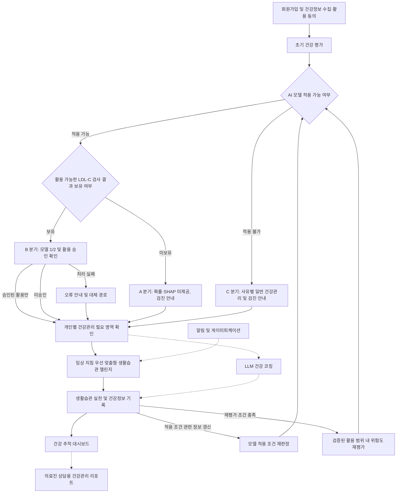
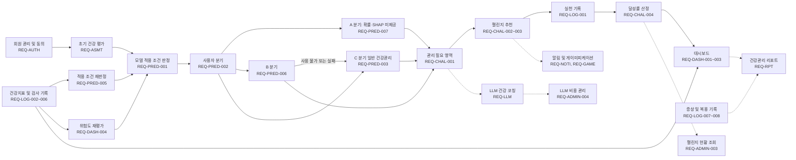

# WELLOOP 요구사항 정의서 v2.0

- 문서 버전: v2.0 (2026-11-25 팀 결정 및 PR #41·#42 반영)

- 작성 기준일: 2026-11-25

- 기준 기획안: [`docs/service_overview.md`](../service_overview.md) (기획안 v2)

  - 기준 커밋: `d9f1abc` (`d9f1abce956c92423ccce74e5b96efbb6e9b921a`, 2026-11-23)

### 문서 관리 원칙

- 문서의 변경 사항은 PR을 통해 관리한다.

- 기준 기획안이 변경되면 기준 커밋을 갱신하고 변경 이력에 기록한다.

- 기존에 부여한 요구사항 ID는 가능한 한 유지하며, 삭제된 ID를 다른 의미로 재사용하지 않는다.

- TBD 사항이 결정되면 관련 요구사항의 상세 내용과 상태를 함께 갱신한다.

- 요구사항의 변경 시 ERD, API 명세서, AI 모델링 설계서, 챌린지 설계서, 와이어프레임에 미치는 영향을 확인한다.

> 본 문서는 기획안 v2를 기반으로 작성한 요구사항 정의서 초안이다.

>

> P0~P3는 기획안의 우선순위를 기반으로 분류한 것이며, 최종 구현 범위와 서비스 세부 정책은 팀 논의를 통해 확정한다.

---

## 목차

- [0. 문서 작성 기준](#0-문서-작성-기준)

- [1. 서비스 개요](#1-서비스-개요)

- [2. 기능 요구사항](#2-기능-요구사항)

- [3. 비기능 요구사항](#3-비기능-요구사항)

- [4. 데이터 및 AI 요구사항](#4-데이터-및-ai-요구사항)

- [5. 보안 및 의료 안전 요구사항](#5-보안-및-의료-안전-요구사항)

- [6. 기능 간 의존 관계](#6-기능-간-의존-관계)

- [7. 미확정 사항 및 담당자](#7-미확정-사항-및-담당자)

- [8. 향후 확장 범위](#8-향후-확장-범위)

- [9. 변경 이력](#9-변경-이력)

---

## 0. 문서 작성 기준

### 0.1 요구사항 ID 체계

| ID 형식 | 영역 | 위치 |
|---|---|---|
| REQ-AUTH-### | 회원 및 사용자 관리 | 2.1 |
| REQ-ASMT-### | 초기 건강 평가 | 2.2 |
| REQ-PRED-### | 모델 적용 조건, 사용자 분기, 예측 및 SHAP | 2.3, 2.4 |
| REQ-CHAL-### | 생활습관 챌린지 | 2.5 |
| REQ-LOG-### | 건강정보 및 실천 기록 | 2.6 |
| REQ-DASH-### | 대시보드 및 재평가 | 2.7 |
| REQ-LLM-### | LLM 및 RAG | 2.8 |
| REQ-NOTI-### | 알림 | 2.9 |
| REQ-GAME-### | 게이미피케이션 | 2.9 |
| REQ-RPT-### | 건강관리 리포트 | 2.10 |
| REQ-FOOD-### | 식단 이미지 분석 | 2.11 |
| REQ-ADMIN-### | 관리자 | 2.12 |
| REQ-BIZ-### | 향후 사업 확장 | 8 |
| NFR-### | 비기능 요구사항 | 3 |
| DR-### | 데이터 및 AI 요구사항 | 4 |
| SR-### | 보안 및 의료 안전 요구사항 | 5 |
| TBD-### | 미확정 사항 | 7 |

- 각 영역의 ID는 001부터 순차적으로 부여한다.

- NFR은 101부터 순차적으로 부여한다.

- 요구사항 간 중복을 최소화하고 필요한 경우 관련 ID를 참조한다.

- 세부 알고리즘, DB 스키마, API 엔드포인트, UI 레이아웃 등 구체적인 구현 방식은 각 담당자의 상세 설계 문서에서 정의한다.

### 0.2 우선순위 정의

| 우선순위 | 의미 |
|---|---|
| P0 | 핵심 필수 기능 |
| P1 | 우선 확장 기능 |
| P2 | 선택 확장 기능 |
| P3 | 향후 사업 확장 |
| TBD | 우선순위 미확정 |
| 필수\* | 관련 기능 또는 개발 과정에서 반드시 충족해야 하는 요구사항 |

- 개인정보 보호, 데이터 검증, 의료 및 AI 안전 요구사항은 관련 기능을 구현할 때 반드시 적용한다.

- `필수\*`는 독립적인 사용자 기능의 구현 우선순위가 아니라 관련 기능이 충족해야 할 필수 조건을 의미한다.

- 적용 대상은 요구사항의 상세 내용, 관련 ID 또는 해당 섹션의 범위에 따른다.

- P0~P3 분류는 최종 MVP 구현 범위의 확정을 의미하지 않는다.

### 0.3 상태 정의

| 상태 | 정의 |
|---|---|
| 확정 | 기획안 또는 기존 합의 기준에 따라 요구사항의 내용이 정리된 상태 |
| 세부 TBD | 요구사항의 필요성은 인정되었으나 세부 조건, 수치, 문항, 정책 등이 미확정인 상태 |
| 검토 필요 | 요구사항의 채택 여부 또는 적용 범위에 대한 추가 검토가 필요한 상태 |

- 상태와 우선순위는 독립적으로 관리한다.

- `P0 + 세부 TBD`는 핵심 기능이지만 세부 구현 기준이 아직 확정되지 않았음을 의미한다.

- `확정`은 본 초안에서 요구사항이 정리되었다는 의미이며, 팀의 최종 승인이나 구현 완료를 의미하지 않는다.

- `검토 필요` 상태의 신규 제안은 팀 합의 없이 최종 요구사항으로 확정하지 않는다.

- 세부 TBD 상태의 요구사항에는 관련 TBD ID를 연결한다.

### 0.4 근거 표기

| 표기 | 의미 |
|---|---|
| [명시] | 기준 기획안에 명시된 사항 |
| [추론] | 기획안의 내용과 서비스 흐름으로부터 도출한 사항 |
| [제안] | 추가 검토가 필요한 신규 제안 |
| [팀 규칙] | 프로젝트 내 기존 개발 및 협업 규칙 |
| [AI 설계] | AI 모델링 설계 v0.2 및 PR #29의 결정 사항 또는 검토 결과 |

- `SO`는 `docs/service_overview.md`를 의미한다.

- 근거 표기는 초안 검토 과정에서 요구사항의 출처와 신규 제안 여부를 구분하기 위해 사용한다.

- 하나의 요구사항에 기존 기획안 내용과 신규 제안이 함께 포함된 경우 이를 구분하여 표시한다.

- 팀 검토 및 요구사항 확정 이후 반복적인 근거 표기는 간소화할 수 있다.

- 임상적 근거, 데이터 이용 조건, 관련 요구사항 ID 및 미해결 TBD는 필요한 범위에서 유지한다.

---

## 1. 서비스 개요

### 1.1 서비스 목적

[명시] SO §1, §4

WELLOOP은 폐경 이행기 여성을 대상으로 고LDL콜레스테롤혈증 발생 위험의 조기 확인과 예방적 생활습관 관리를 지원하는 AI 기반 건강관리 서비스이다.

- 고LDL콜레스테롤혈증 발생 위험 예측

- 개인별 주요 예측 요인 및 건강관리 필요 영역 확인

- 임상적 근거 기반 맞춤형 생활습관 개선 지원

- 지속적인 실천 동기 부여 및 건강 상태 모니터링

- 정기검진 및 의료진 상담 지원

- 예방 중심의 건강관리 경험 제공

### 1.2 서비스 이용 대상 및 AI 모델 적용 대상

[명시] SO §3, §13.3

| 구분 | 내용 |
|---|---|
| 핵심 타깃 | 폐경을 앞두고 있거나 폐경 이행기에 있는 여성, 현재 고LDL콜레스테롤혈증이 없으나 예방적 관리가 필요한 여성 |
| 서비스 가입 대상 | 성별·연령 일반 제한 없음. 미성년자 동의 및 가입 절차는 TBD-027, 030에서 검토 |
| AI 모델 적용 대상 | 서비스 이용자 중 학습·검증 데이터의 특성과 모델 적용 조건을 충족하는 사용자 |
| 향후 기업 고객 | 여성 특화 보험상품을 운영하는 보험사 및 헬스케어 기업(P3) |

- 서비스 이용 대상과 AI 모델 적용 대상을 구분한다.

- 모델 적용 조건을 충족하지 않는 사용자에게도 일반 건강관리, 생활습관 챌린지, 건강 기록 및 검진 안내를 제공한다.

- 구체적인 모델 적용·제외 조건은 AI 모델링 및 SWAN EDA 결과에 따라 확정한다(TBD-002).

- 모델 1은 폐경 전·이행기 초기, 모델 2는 이행기 후기 대상 추가 개발 모델로 구분한다. 모델 2 검증 및 활용 승인 전에는 후기 사용자를 C 분기로 안내한다. 폐경 후 적용은 미확정이다.

- 가입 대상과 모델 적용 대상은 별개이며 불필요한 폐경 관련 문진을 최소화한다.

### 1.3 주요 기능 및 요구사항 대응

| 상위 기능 | 기획안 우선순위 | 관련 요구사항 ID |
|---|---|---|
| 회원가입 및 로그인 | P0 | REQ-AUTH-001~005 |
| 초기 건강 평가 | P0 | REQ-ASMT-001~007 |
| AI 모델 적용 조건 확인 및 A/B/C 분기 | P0 | REQ-PRED-001~005 |
| AI 발생 위험 예측 | P0 | REQ-PRED-006~008, REQ-PRED-011~012 |
| 개인별 주요 예측 요인 분석 | 기존 P0 / MVP 서비스 활용 제외 | REQ-PRED-009~010 |
| 맞춤형 생활습관 챌린지 | P0 | REQ-CHAL-001~004 |
| 일일 건강 기록 | P0 | REQ-LOG-001~006 |
| 폐경 관련 증상 기록 | P1 | REQ-LOG-007 |
| 복용 이력 기록 | 지질강하제 최소 기록 P0 / 기타 TBD | REQ-LOG-008 |
| 건강 추적 대시보드 | P0 | REQ-DASH-001~004 |
| LLM 건강 코칭 및 RAG | P1, P2 | REQ-LLM-001~002 |
| 맞춤형 알림 | P1, P2 | REQ-NOTI-001~005 |
| 게이미피케이션 | P1, P2 | REQ-GAME-001~003 |
| 의료진 상담용 건강관리 리포트 | P1, P2 | REQ-RPT-001~003 |
| 식단 이미지 분석 | P2 | REQ-FOOD-001 |
| 관리자 기능 | P1 | REQ-ADMIN-001~005 |
| 보험사 연계 및 사업 확장 | P3 | REQ-BIZ-001~002 |

> 본 표의 우선순위는 기획안의 상위 기능을 기준으로 한다. 개별 요구사항의 우선순위는 각 요구사항 상세 표를 따른다.

### 1.4 사용자 분기 및 서비스 이용 흐름

[명시] SO §5.2, §8 기반

#### 분기별 서비스 제공 범위

| 구분 | 적용 조건 | 주요 제공 기능 |
|---|---|---|
| C 분기 | AI 모델 적용 조건 미충족 또는 모델 사용 불가 | 건강관리 필요 영역 확인, 챌린지, 기록, 검진 안내 |
| A 분기 | 모델 적용 조건 충족, 활용 가능한 LDL-C 검사 결과 미보유 | 개별 발생 확률·SHAP 미제공, 건강관리 및 검진 안내, 챌린지, 기록 |
| B 분기 | 모델 적용 조건 및 검증 기준 충족, 활용 가능한 LDL-C 보유 | 승인 범위 내 모델 활용, MVP 확률·SHAP 미제공, 챌린지, 기록 |

- 모델의 서비스 활용 가능 여부는 사전에 수행한 학습 및 성능 검증 결과를 기준으로 결정한다.

- 개별 사용자의 예측 요청마다 모델 성능을 새롭게 평가하는 방식이 아니다.

- 검사 결과의 활용 가능 여부와 A/B/C 분기 세부 기준은 TBD-002, TBD-005에서 결정한다.

- 현재 A 모델은 활용 기준 미달로 확률을 제공하지 않는다(PR #29).

- 현재 A 모델은 SHAP을 제공하지 않는다. B 모델은 홀드아웃 평가를 수행했으나 보정 기준 및 평가 독립성 검토와 팀 승인 전에는 개별 발생 확률을 제공하지 않는다(PR #38 머지본).

- 모델 성능 미달과 실제 예측 처리 실패를 구분한다.

- 모델 사용이 불가능하거나 예측 처리에 실패하더라도 일반 건강관리 기능은 이용할 수 있도록 한다.

- 적용 조건 재판정과 위험도 재평가는 서로 다른 절차로 관리한다.

- 점선으로 표시된 기능은 P1 이상의 확장 기능이다.

> 예측 처리 실패 시 대체 경로는 신규 제안(REQ-PRED-012)이며, 적용 조건 재판정 및 위험도 재평가는 기획안의 설명을 구체화한 것이다. 세부 동작은 담당자 검토 후 확정한다.

---

## 2. 기능 요구사항

### 2.1 회원 및 사용자 관리

| ID | 요구사항명 | 상세 요구사항 | 우선순위 | 상태 | 근거 및 비고 |
|---|---|---|---|---|---|
| REQ-AUTH-001 | 회원가입 | 사용자는 서비스 계정을 생성할 수 있다. 가입 시 필요한 최소한의 정보만 수집한다. 성별·연령에 따른 일반 가입 제한 없이 계정을 생성할 수 있다. 미성년자 가입 및 동의 세부 절차는 법적 검토 후 확정한다. | P0 | 세부 TBD | [명시] SO §5.3 · TBD-027 · SR-002 |
| REQ-AUTH-002 | 로그인 및 로그아웃 | 사용자는 로그인과 로그아웃을 할 수 있다. 시스템은 인증된 사용자만 개인 기능에 접근하도록 한다. | P0 | 확정 | [명시] SO §5.3 · SR-008 |
| REQ-AUTH-003 | 건강정보 수집·활용 동의 | 건강정보 수집 및 활용 전에 필요한 사용자 동의를 확보하고, 동의 여부와 시점을 기록한다. 필요한 동의가 확보되지 않은 경우 해당 건강정보를 수집하지 않는다. | P0 | 세부 TBD | [명시] SO §13.3 · TBD-030 · SR-001 |
| REQ-AUTH-004 | 회원정보 수정 | 사용자는 본인의 회원정보 및 서비스 설정을 수정할 수 있다. | TBD | 검토 필요 | TBD-028 |
| REQ-AUTH-005 | 회원 탈퇴 및 건강정보 처리 | 사용자는 서비스에서 탈퇴할 수 있다. 시스템은 관련 법적 요건과 확정된 정책에 따라 개인정보 및 건강정보를 삭제하거나 처리한다. | TBD | 검토 필요 | TBD-028, TBD-030 |

### 2.2 초기 건강 평가

| ID | 요구사항명 | 상세 요구사항 | 우선순위 | 상태 | 근거 및 비고 |
|---|---|---|---|---|---|
| REQ-ASMT-001 | 기본 건강정보 및 신체계측 수집 | 시스템은 초기 건강 평가에 필요한 기본 건강정보와 신체계측 정보를 수집한다. 사용자 유형별 필요한 문항만 제공하며 모델 입력과 일반 건강관리 입력을 구분한다. | P0 | 세부 TBD | [명시] SO §5.1 · TBD-005 |
| REQ-ASMT-002 | 폐경 단계 확인 | 검증된 연구 기준을 참고하여 사용자의 폐경 단계를 확인한다. 폐경 단계는 폐경 전·초기·후기·폐경 후·판정 불가로 구분하되 STRAW+10과 SWAN 매핑은 TBD-010에서 확정한다. | P0 | 세부 TBD | [명시] SO §5.1, §13.3, §14.2 · TBD-010 |
| REQ-ASMT-003 | 생활습관 정보 수집 | 사용자의 생활습관 정보를 수집하고 건강관리 필요 영역 도출에 활용한다. 추천 전용 문항 후보: 식습관, 운동 일수·시간·강도·좌식 시간·의료진 허용 활동 범위, 금연 의향·간접흡연, 음주, 야외활동, 증상 불편도. 홍조·야간발한 빈도는 각각 모델 입력용으로 수집하고 SWAN 1~5 빈도 척도와 일치하도록 매핑한다. 증상 불편도는 챌린지 추천용으로 구분한다. 세부 문항 및 측정 기준은 TBD-005의 후속 매핑표 검토 후 확정한다. 모델 1의 홍조·야간발한 빈도는 지난 2주 기준 없음/1~5일/6~8일/9~13일/매일 구간을 유지한다. 불편도는 별도 추천용이다. | P0 | 세부 TBD | [명시] SO §5.1 · TBD-005 · REQ-CHAL-001 · [챌린지] PR #39 §4.2~4.3 · [와이어프레임 v2] 04 |
| REQ-ASMT-004 | 검사 결과 입력 | 사용자가 보유한 검사 결과를 입력받고 LDL-C 검사 결과 보유 여부를 확인한다. 검사 결과가 없어도 초기 평가를 완료할 수 있다. 모델 1의 LDL-C 입력은 중성지방 400 mg/dL 이상이면 제한한다. 중성지방 미확인 및 직접측정 LDL 활용 기준은 TBD-005이다. | P0 | 세부 TBD | [명시] SO §5.1, §5.2 · TBD-005 · REQ-LOG-004 |
| REQ-ASMT-005 | 수술 및 호르몬 요법 정보 확인 | 자궁절제, 난소절제 여부 및 수술 시기, 호르몬 요법 관련 정보를 확인한다. | P0 | 세부 TBD | [명시] SO §5.1, §13.3 · TBD-002 |
| REQ-ASMT-006 | 모델 적용 조건 확인용 진단·복약 정보 | 기존 고LDL콜레스테롤혈증 진단 여부, 지질저하제 복용 여부 등 모델 적용 조건 판정에 필요한 정보를 확인한다. 지속적인 복용 이력 기록과 구분한다. 지질강하제 시작·중단 시점 및 모름 여부를 확인하고 변경 시 재판정과 연결한다. | P0 | 세부 TBD | [명시] SO §13.3 · TBD-002 · REQ-LOG-008 · [챌린지] PR #39 §4.4 |
| REQ-ASMT-007 | 초기 평가 중간 저장 | 사용자는 초기 건강 평가 진행 내용을 중간에 저장하고 이후 이어서 작성할 수 있다. | TBD | 검토 필요 | [제안] · TBD-028 |

### 2.3 AI 모델 적용 조건 및 사용자 분기

| ID | 요구사항명 | 상세 요구사항 | 우선순위 | 상태 | 근거 및 비고 |
|---|---|---|---|---|---|
| REQ-PRED-001 | 모델 적용 조건 판정 | 초기 건강 평가 결과를 바탕으로 AI 모델 적용 가능 여부를 판정한다. 학습 및 검증 범위를 벗어나거나 제외 조건에 해당하는 경우 개별 위험 예측을 제공하지 않는다. 기존 진단 또는 지질강하제 복용자는 일반 건강관리 내 관리 흐름으로 안내한다. LDL-C ≥160이면 진단하지 않고 상담 안내 및 신규 발생 예측 보류를 적용하며 최신 검사로 적용 조건을 재판정한다. ≥190이면 가까운 시일 내 진료 권유를 강화한다. 모델 1은 폐경 전·초기, 모델 2는 후기 대상이며 별도 검증 및 승인 전 적용하지 않는다. 모델 1 학습 연령은 42~53세이며 최종 적용 조건은 TBD-002이다. | P0 | 세부 TBD | [명시] SO §5.1, §5.2, §13.3 · TBD-002 · [챌린지] PR #39 §4.4 |
| REQ-PRED-002 | 사용자 분기 | A/B/C 서비스 분기를 판정한다. A는 기타 적용 조건을 충족하나 LDL-C 미보유, B는 활용 가능한 LDL-C 보유 및 해당 모델 적용·검증 조건 충족, C는 적용 불가 또는 검증 기준 미충족이다. 관리 흐름은 C의 하위 안내 규칙이다. 모델 결과의 목적별 활용 승인은 분기 판정과 구분한다. | P0 | 확정 | [명시] SO §5.2, §8 · 세부 적용 기준 REQ-PRED-001 · [챌린지] PR #39 §4.4 |
| REQ-PRED-003 | 기본 검진 안내 | A/B/C 모두 건강 상태와 임상 지침에 따른 검진 및 상담 안내를 제공한다. A의 모델 적용 목적 검사 안내와 C의 일반 검진 안내를 구분한다. | P0 | 검토 필요 | [명시] SO §5.2의 일반 건강관리 검진 안내 · [제안] 전체 분기 공통 적용 · SR-025 |
| REQ-PRED-004 | 모델 적용 불가 사유 안내 | 모델 적용 조건을 충족하지 않는 사용자에게 적용 불가 사실과 주요 사유를 건강관리 중심의 표현으로 안내하고, 이용 가능한 대체 기능을 제시한다. C 분기 사유별 안내를 구분하며 일반 정기검진과 모델 예측 목적 검사 안내를 혼동하지 않는다. | TBD | 검토 필요 | [제안] TBD-023, TBD-028 · SR-012 |
| REQ-PRED-005 | 모델 적용 조건 재판정 | 검사 결과 또는 적용 조건과 관련된 건강정보가 갱신되면 모델 적용 가능 여부를 다시 판정한다. 결과에 따라 일반 건강관리, A 모델, B 모델 간 분기가 변경될 수 있다. LDL 입력·변경, 폐경 단계, 진단·복약 변경 시 전체 조건을 재판정하며 자동 A→B 또는 모델 전환을 보장하지 않는다. | P0 | 세부 TBD | [명시] SO §5.2, §8 · TBD-007 |

> 모델 적용 조건 재판정은 사용자가 해당 모델을 이용할 수 있는지 확인하는 절차이며, 새로운 발생 위험도 산출을 의미하는 위험도 재평가(REQ-DASH-004)와 구분한다.

### 2.4 AI 위험 예측 및 SHAP 분석

| ID | 요구사항명 | 상세 요구사항 | 우선순위 | 상태 | 근거 및 비고 |
|---|---|---|---|---|---|
| REQ-PRED-006 | B 모델 발생 위험 예측 | 기준 시점부터 5년 이내 LDL-C 160 mg/dL 이상 또는 지질강하제 시작의 신규 발생 위험을 예측한다. 모델 1 C3 검증 구성은 8개 변수이며 모델 2를 추가 개발한다. MVP 개별 발생 확률은 미제공하며 단계형 결과는 별도 검증 및 승인 전 제공하지 않는다. | P0 | 세부 TBD | [명시] SO §5.2 · TBD-001, TBD-004, TBD-009 · [AI 설계] §3, §6, §10 · [홀드아웃] PR #38 §2~4 |
| REQ-PRED-007 | A 모델 건강관리 및 검진 안내 지원 | 현재 A 모델은 활용 기준에 미달하므로 개별 발생 확률 및 SHAP을 제공하지 않고 초기 건강 평가와 임상 지침 기반 건강관리 및 검진 안내를 제공한다. | P0 | 확정 | [명시] SO §5.2, §13.3 · TBD-003 · [AI 설계] §6 |
| REQ-PRED-008 | 성능 기준 미달 시 결과 제공 제한 | 모델별 검증 기준 미달 또는 불확실 시 C 분기로 안내한다. B 분기라도 결과 활용 미승인 시 임상 지침 기반 안내만 제공한다. 모델 적용 불가·활용 미승인·처리 실패를 구분한다. ECE 기준 충족은 활용 승인과 별개이다. | P0 | 세부 TBD | [명시] SO §5.2, §13.3 · TBD-003, TBD-004 · [AI 설계] §6, §6.1 · [홀드아웃] PR #38 §4.4 · [와이어프레임 v2] 26~27 |
| REQ-PRED-009 | SHAP 기반 주요 예측 요인 제공 | MVP에서는 SHAP 외부 요인 이름·순위·방향·기여값 표시 및 내부 추천 가산점을 모두 제외한다. 이하 기존 활용 조건은 향후 검증·승인 시에만 적용한다. 유효한 B 모델 예측 결과의 검증된 SHAP을 활용 목적별로 구분한다. 개별 확률 제공 승인 전에는 SHAP 기여값 및 SHAP 근거의 요인 표시를 제공하지 않는다. 승인 후에도 외부 표시 범위와 표현 방식은 별도 검토한다. 내부 요인 순위는 확률 제공 여부와 독립적으로 검토·승인된 경우에만 추천 가산점으로 활용한다. 임상 지침 근거의 관리 안내는 확률 승인과 무관하게 제공한다. 임상적 해석이 어려운 변수는 노출하지 않는다. 현재 A 모델에는 SHAP을 제공하지 않으며 B 모델의 최종 노출 범위는 TBD-006에서 결정한다. 허리둘레·현재 흡연을 변경 가능 요인 표시 후보로 제한한다. 수축기 혈압·홍조·야간발한은 내부 입력과 외부 출력의 범위를 분리하고 화면 노출을 제외하는 설계안을 검토한다. | 기존 P0 / MVP 제외 | 확정 | [명시] SO §5.1, §7 · TBD-006 · SR-027 · [AI 설계] §5.5, §10 · [홀드아웃] PR #38 §5 |
| REQ-PRED-010 | 변경 가능 요인과 개인 특성 구분 | MVP에서는 SHAP 외부 요인 이름·순위·방향·기여값 표시 및 내부 추천 가산점을 모두 제외한다. 이하 기존 활용 조건은 향후 검증·승인 시에만 적용한다. 변경 가능한 예측 요인과 그 외 예측 요인을 구분하여 표시한다. C3에서 변경 가능 요인 후보는 허리둘레와 현재 흡연 두 개이며, 검증 및 외부 표시가 승인된 항목만 별도로 표시한다. 확률 제공 승인 전에는 SHAP을 근거로 요인을 표시하지 않는다. 항목 수를 임의로 채우지 않으며 실제 예방 효과로 해석하지 않는다. | 기존 P0 / MVP 제외 | 확정 | [명시] SO §13.2 · TBD-006 · PR #38 §5 |
| REQ-PRED-011 | 예측 이력 저장 | 분기·모델·사유 코드와 판정 일시·정책 버전의 이력 관리 구조를 검토한다. 판정 이력과 정상 예측 이력을 구분한다. 예측 결과, 예측 시점, 모델 버전 및 결과 재현·추적에 필요한 입력 정보를 저장한다. 저장 범위는 최소 수집 원칙과 데이터 보안 요구사항을 따른다. | P0 | 검토 필요 | [제안] · TBD-018 · DR-013 |
| REQ-PRED-012 | 예측 실패 시 대체 경로 | 예측 처리 중 오류가 발생하면 오류 사실을 안내하고, 일반 건강관리, 챌린지, 기록 및 검진 안내 기능을 계속 이용할 수 있도록 한다. 실패한 결과를 정상적인 예측 결과로 제공하지 않는다. 실패한 결과는 새 예측 이력으로 표시하지 않는다. 기존 입력을 유지하는 재시도 정책은 TBD-023에서 검토한다. | P0 | 검토 필요 | [제안] · [추론] SO §3 · TBD-023 · [와이어프레임 v2] 27 |

### 2.5 맞춤형 생활습관 챌린지

#### 건강관리 영역

[명시] SO §6

| 영역 | 주요 관리 방향 |
|---|---|
| 영양 및 식습관 | LDL 관리에 적합한 식습관 개선 |
| 신체활동 및 운동 | 건강 상태에 적합한 신체활동 증진 |
| 체중 및 복부비만 | 적정 체중 및 복부비만 관리 |
| 금연 및 절주 | 흡연 및 음주 관련 생활습관 개선 |
| 비타민 D 및 야외활동 | 보조적 건강관리 |
| 폐경 관련 증상 | 폐경 특화 증상 관리 및 모니터링 |
| 건강지표 모니터링 | 검사 결과 및 건강지표 추적 |

건강관리 영역과 실제 챌린지 수행 영역은 구분한다. 모든 건강관리 영역을 챌린지 또는 달성률 산정 대상으로 설정하지 않는다.

| ID | 요구사항명 | 상세 요구사항 | 우선순위 | 상태 | 근거 및 비고 |
|---|---|---|---|---|---|
| REQ-CHAL-001 | 건강관리 필요 영역 도출 | 초기 건강 평가와 임상 지침을 우선하여 개인별 건강관리 필요 영역을 도출한다. MVP에서는 SHAP을 추천에 활용하지 않는다. 안전 제외 → 추천 조건 → 우선순위 → 사용자 선택 순으로 처리한다. 흡연자 금연 우선, 관리 흐름에서 식습관 우선(금연 다음), MVP SHAP 가산점은 제외한다. | P0 | 세부 TBD | [명시] SO §6, §8, §13.2 · TBD-011, TBD-012 · [AI 설계] §5.5, §10 · [챌린지] PR #39 §4.1~4.4 |
| REQ-CHAL-002 | 맞춤형 챌린지 추천 | 사용자의 건강 상태와 관리 필요 영역을 기반으로 일간·주간 생활습관 챌린지를 추천한다. MVP에서는 SHAP 없이 임상 지침을 적용하며 일률적인 목표를 강제하지 않는다. 7개 카테고리 28개 설계안과 1~3단계 목표를 참조한다. 처음 2주 최대 3개(핵심 2·보조 1), 이후 최대 5개 및 카테고리당 2개는 검토안으로 유지한다. 주간 결과에 따라 단계 변경·유지·휴식 제안을 제공하고 사용자 수락 후 다음 주 적용한다. 직접 선택에도 안전 제외 조건을 동일 적용하고 제외 이유를 표시한다. | P0 | 세부 TBD | [명시] SO §5.1, §6, §7 · TBD-011, TBD-012 · SR-017~026 · [AI 설계] §10 · [챌린지] PR #39 §4.1, §5, §7, §10 |
| REQ-CHAL-003 | SHAP 미제공 사용자 챌린지 추천 | A/B/C 모두 임상 지침 기반 동일 추천 원칙을 적용한다. 실제 건강 상태 및 안전 조건에 따라 추천을 구분하고 SHAP 가산점은 MVP에서 제외한다. 관리 흐름은 진료지침 기반 안내로 제공한다. | P0 | 세부 TBD | [추론] SO §3, §5.2, §8 · TBD-014 · [챌린지] PR #39 §4.1~4.4 |
| REQ-CHAL-004 | 챌린지 달성률 산정 | 챌린지 실천 기록을 기반으로 달성률을 산정한다. 건강지표 수치나 폐경 증상 기록 자체를 챌린지 달성률에 포함하지 않는다. WEEKLY_DAYS·WEEKLY_COUNT·WEEKLY_TOTAL·EVENT_RATIO는 목표 대비 실적을 최대 100%로 산정한다. ONCE·TOOL 및 전부 미기록 EVENT_RATIO는 전체 평균에서 제외한다. EVENT_RATIO는 상황 없음·지킴·못 지킴·미기록을 구분하며 미기록은 분자·분모 제외, 상황 없음만 기록된 주는 100%로 산정하는 안이다. 시작·종료 시 목표 일할 조정은 일수·횟수·시간 유형에만 적용한다. 부분 미기록 최소 관측 기준 및 빈 평균 처리는 TBD-013에서 확정한다. | P0 | 세부 TBD | [명시] SO §6, §13.2 · TBD-013 · REQ-LOG-001 · [챌린지] PR #39 §6 |

> 구체적인 챌린지 목록, 추천 조건, 목표 수치, 수행 주기, 달성 기준은 별도의 챌린지 설계 문서에서 정의한다.

### 2.6 건강정보 및 실천 기록

#### 기록 유형

| 기록 유형 | 관련 요구사항 |
|---|---|
| 생활습관 실천 기록 | REQ-LOG-001 |
| 건강지표 및 검사 결과 기록 | REQ-LOG-002~006 |
| 폐경 관련 증상 기록 | REQ-LOG-007 |
| 복용 이력 기록 | REQ-LOG-008 |
| ID | 요구사항명 | 상세 요구사항 | 우선순위 | 상태 | 근거 및 비고 |
|---|---|---|---|---|---|
| REQ-LOG-001 | 생활습관 실천 기록 | 사용자는 추천받은 챌린지의 실천 여부를 기록할 수 있다. 운동 종목·시간·체감 강도·실외·식후 여부 및 메모를 기록하고 해당 챌린지 실적에 자동 반영한다. 유산소 합산은 10분 이상 중·고강도, 고강도 2배 환산을 적용하는 설계안이며 10분 미만 기록도 보존한다. 당일·전날 입력 및 수정 허용안은 TBD-013에서 확정한다. | P0 | 확정 | [명시] SO §5.1, §6 · [챌린지] PR #39 §5.2.1, §6.1 |
| REQ-LOG-002 | 건강지표 기록 | 사용자는 체중, 허리둘레, 혈압 등 주요 건강지표를 기록할 수 있다. 가정혈압 측정 방법(초기 양팔, 이후 높은 팔, 5분 휴식, 아침·저녁 1분 간격 2회)을 안내한다. 초기 7일 권장, 이후 주 5일 이상 측정 시 첫 측정일 제외 평균을 표시하는 설계안을 적용 검토한다. 평균 기준선 135/85는 진단이 아니며 고혈압 의심 응급 안내는 SR-020 및 신규 안전 요구사항 SR-035를 따른다. 측정값은 모두 보존한다. | P0 | 확정 | [명시] SO §5.1, §6 · NFR-103 · [챌린지] PR #39 §8 |
| REQ-LOG-003 | 혈중 지질검사 결과 추가 입력 | 초기 건강 평가 이후에도 LDL-C, HDL-C, 총콜레스테롤, 중성지방 등 혈중 지질검사 결과를 추가로 입력할 수 있다. 모델 적용 조건과 관련된 검사 결과는 재판정에 활용한다. | P0 | 확정 | [명시] SO §5.2, §6 · REQ-PRED-005 |
| REQ-LOG-004 | 검사일 및 검사 단위 기록 | 검사 결과 입력 시 검사일과 측정 단위를 함께 기록한다. 검사 결과의 활용 가능 여부는 확정된 변수 정의 및 모델 적용 기준에 따라 판단한다. | P0 | 검토 필요 | [제안] · REQ-ASMT-004, REQ-LOG-003 · TBD-005, TBD-021 |
| REQ-LOG-005 | 검사 결과 수정 및 변경 관리 | 사용자는 입력한 검사 결과를 수정할 수 있으며, 시스템은 결과 추적에 필요한 변경 내역을 관리한다. | TBD | 검토 필요 | [제안] TBD-018, TBD-028 |
| REQ-LOG-006 | 실제 검사값과 예측 결과 구분 | 사용자가 입력한 실제 검사값과 AI 예측 결과를 서로 구분하여 저장하고 표시한다. | P0 | 확정 | [명시] SO §13.1 · 데이터 구조 TBD-017 |
| REQ-LOG-007 | 폐경 증상 기록 | 안면홍조, 야간발한, 수면 장애 등 폐경 관련 증상의 발생 여부, 빈도 및 불편 정도를 기록할 수 있다. | P1 | 세부 TBD | [명시] SO §5.1, §5.3, §6 · TBD-032 · SR-024 |
| REQ-LOG-008 | 복용 이력 기록 | 지질강하제 복용 여부 및 시작·중단 시점을 기록하고 변경 시 모델 적용 조건을 재판정한다(최소 범위 P0, 세부 TBD). 일반 약물·호르몬제·영양제의 상세 복용 이력은 우선순위 TBD로 분리 관리한다. 복용 시작·중단·용량 변경을 권장하지 않으며 복용 자체를 챌린지 점수로 사용하지 않는다. | P0(최소 범위) | 세부 TBD | [명시] SO §6, §13.1 · TBD-017, TBD-028 · SR-026 · [챌린지] PR #39 §4.4, §9 |

### 2.7 대시보드 및 재평가

| ID | 요구사항명 | 상세 요구사항 | 우선순위 | 상태 | 근거 및 비고 |
|---|---|---|---|---|---|
| REQ-DASH-001 | 건강지표 및 검사값 추이 | 사용자가 기록한 건강지표와 실제 검사값의 변화 추이를 시각화한다. 가정혈압 주간 평균·허리둘레 기준선·주간 운동 시간 및 사용자가 입력한 의료진 목표 LDL-C(직접 입력임을 표기)를 표시하는 안을 검토한다. | P0 | 확정 | [명시] SO §5.1, §6 · 화면 구성 TBD-024 · [챌린지] PR #39 §8 · [와이어프레임 v2] 10,16 |
| REQ-DASH-002 | 챌린지 달성률 추이 | 챌린지 달성률과 변화 추이를 시각화한다. 건강지표 및 증상 기록과 구분하여 표시한다. | P0 | 확정 | [명시] SO §5.1, §6, §13.2 |
| REQ-DASH-003 | 예측 결과 및 이력 표시 | 사용자 분기에 적합한 예측 또는 건강관리 안내 결과와 제공 가능한 이력을 표시한다. 실제 검사 결과 및 예측 결과를 구분한다. MVP 개별 확률 및 SHAP 표시 금지. 단계형 결과는 별도 승인 전 미제공. | P0 | 세부 TBD | [명시] SO §5.1 · TBD-009 · SR-012 |
| REQ-DASH-004 | 위험도 재평가 | 모델 학습 변수의 정의와 일치하는 최신 정보를 바탕으로 검증된 활용 범위 내에서 위험도를 재평가한다. 챌린지 달성률을 근거로 위험도를 임의로 조정하지 않는다. 적용 조건 재판정과 구분하며, 적용 조건을 충족하는 경우에만 새로운 위험 예측 결과를 제공한다. 최신 정보 → 적용 조건 재판정 → 모델 가용성 및 검증된 재평가 조건 확인 → 충족 시에만 새 예측을 요청한다. | P0 | 세부 TBD | [명시] SO §8, §13.2 · TBD-007 · DR-014 · SR-028 · [와이어프레임 v2] 17,29 |

### 2.8 LLM 건강 코칭 및 RAG

| ID | 요구사항명 | 상세 요구사항 | 우선순위 | 상태 | 근거 및 비고 |
|---|---|---|---|---|---|
| REQ-LLM-001 | LLM 건강 코칭 | 검증된 임상 지침과 사용자 정보를 기반으로 개인 맞춤형 생활습관 안내 및 피드백을 제공한다. 관련 의료 및 AI 안전장치를 반드시 적용한다. | P1 | 세부 TBD | [명시] SO §5.1, §5.3, §13.2 · TBD-029, TBD-031 · SR-030~033 |
| REQ-LLM-002 | RAG 기반 응답 근거 보완 | 검증된 임상 지침 및 건강관리 자료를 검색하여 LLM 응답의 근거를 보완한다. | P2 | 세부 TBD | [명시] SO §5.3, §7 · TBD-029 |

### 2.9 알림 및 게이미피케이션

| ID | 요구사항명 | 상세 요구사항 | 우선순위 | 상태 | 근거 및 비고 |
|---|---|---|---|---|---|
| REQ-NOTI-001 | 웹 내부 알림 | 챌린지 실천 독려와 건강 기록 알림을 웹 서비스 내부에서 제공한다. | P1 | 확정 | [명시] SO §5.1, §5.3 · SR-034 |
| REQ-NOTI-002 | 알림 사용자 설정 | 사용자는 알림 활성화 여부, 시간 및 빈도를 설정할 수 있다. 시스템은 사용자 설정을 반영하여 알림을 제공한다. | P1 | 확정 | [명시] SO §13.2 |
| REQ-NOTI-003 | 자동 검진 알림 | 개인의 건강 상태와 의료진 권고에 따른 정기검진 시기 안내 알림을 제공한다. | P1 | 검토 필요 | [제안] SO §5.1 검진 안내 구체화 · SR-025 |
| REQ-NOTI-004 | 주간 리포트 알림 | 사용자에게 주간 건강관리 요약 알림을 제공한다. | TBD | 세부 TBD | [명시] SO §5.1 · TBD-028 |
| REQ-NOTI-005 | 외부 Push 알림 | 웹 서비스 외부로 Push 알림을 제공한다. | P2 | 세부 TBD | [명시] SO §5.3 · TBD-029 |
| REQ-GAME-001 | 연속 실천 기록 | 사용자의 챌린지 연속 실천 기록을 표시한다. 전체 주간 달성률 60% 이상 연속 주를 기본안으로 하고 연속 일 및 휴식일 정책은 TBD로 유지한다. | P1 | 세부 TBD | [명시] SO §5.1, §5.3 · TBD-016 · [챌린지] PR #39 §5.5, §6.4 |
| REQ-GAME-002 | 주간 목표 | 사용자별 주간 목표와 목표 달성 여부를 제공한다. 주간 실적과 목표를 구분하며 현재 단계와 다음 주 목표 변경을 표시한다. | TBD | 세부 TBD | [명시] SO §5.1 · TBD-016, TBD-028 · [챌린지] PR #39 §5.5, §6.4 |
| REQ-GAME-003 | 성취 배지 | 설정된 목표를 달성한 사용자에게 성취 배지를 제공한다. 연속 주 2·4·8·12주, 카테고리 첫 3단계 및 금연 1·4·12주 이정표는 설계안이다. 사용자 간 순위는 제공하지 않는다. | P2 | 세부 TBD | [명시] SO §5.1, §5.3 · TBD-016 · [챌린지] PR #39 §5.5, §6.4 |

### 2.10 의료진 상담용 건강관리 리포트

| ID | 요구사항명 | 상세 요구사항 | 우선순위 | 상태 | 근거 및 비고 |
|---|---|---|---|---|---|
| REQ-RPT-001 | 기간별 건강관리 리포트 | 사용자가 선택한 기간의 검사 결과, 건강지표, 폐경 증상, 복용 이력 및 생활습관 기록을 요약하여 제공한다. 리포트는 의료진 상담을 위한 참고 자료임을 명시한다. | P1 | 세부 TBD | [명시] SO §5.1, §5.3, §13.3 · TBD-024 · SR-015 |
| REQ-RPT-002 | 보유 기록 기반 부분 리포트 | 모든 기록 유형의 입력을 필수로 요구하지 않는다. 사용자가 보유한 기록을 기반으로 리포트를 생성하고 미입력 항목을 구분하여 표시한다. | P1 | 검토 필요 | [제안] · REQ-RPT-001 |
| REQ-RPT-003 | 리포트 PDF 다운로드 | 사용자는 건강관리 리포트를 PDF로 다운로드할 수 있다. | P2 | 세부 TBD | [명시] SO §5.3 · TBD-024 |

### 2.11 식단 이미지 분석

| ID | 요구사항명 | 상세 요구사항 | 우선순위 | 상태 | 근거 및 비고 |
|---|---|---|---|---|---|
| REQ-FOOD-001 | 식단 이미지 기반 식품 인식 및 피드백 | 사용자가 업로드한 식단 이미지에서 식품을 인식하고 LDL 관리에 적합한 식습관 개선 방향을 안내한다. 이미지에만 근거한 정밀한 영양소 섭취량 계산은 제공하지 않는다. | P2 | 세부 TBD | [명시] SO §5.1, §7, §13.2 · TBD-029 |

### 2.12 관리자 기능

| ID | 요구사항명 | 상세 요구사항 | 우선순위 | 상태 | 근거 및 비고 |
|---|---|---|---|---|---|
| REQ-ADMIN-001 | 관리자 역할 및 접근 제한 | 일반 사용자와 관리자 역할을 구분하고 관리자 기능에 대한 접근을 제한한다. 개인 건강정보 접근은 관련 보안 요구사항을 따른다. | P1 | 검토 필요 | [추론] SO §5.1 · SR-009 |
| REQ-ADMIN-002 | 사용자 현황 조회 | 관리자는 사용자 현황을 집계 형태로 조회할 수 있다. | P1 | 확정 | [명시] SO §5.1 |
| REQ-ADMIN-003 | 챌린지 참여율 및 달성률 조회 | 관리자는 사용자 챌린지 참여율 및 달성률을 집계 형태로 조회할 수 있다. | P1 | 확정 | [명시] SO §5.1 |
| REQ-ADMIN-004 | LLM 사용량 및 비용 조회 | LLM 기능 구현 시 관리자는 LLM 사용량 및 비용을 조회할 수 있다. | P1 | 확정 | [명시] SO §5.1 · REQ-LLM-001 · NFR-108 |
| REQ-ADMIN-005 | 시스템 운영 현황 모니터링 | 관리자는 시스템 오류 및 운영 현황을 모니터링할 수 있다. 구체적인 운영 지표는 상세 설계에서 정의한다. | P1 | 확정 | [명시] SO §5.1 · NFR-105 |

---

## 3. 비기능 요구사항

> 동기·비동기 처리, 큐, 캐시 등 구체적인 기술 구현 방식은 요구사항에서 강제하지 않으며 담당자의 상세 설계에 위임한다.

### 3.1 성능 및 안정성

| ID | 요구사항명 | 상세 요구사항 | 우선순위 | 상태 | 근거 및 비고 |
|---|---|---|---|---|---|
| NFR-101 | 주요 기능 응답 시간 | 로그인, 기록 저장, 대시보드 조회, 예측 요청 등 주요 기능의 응답 시간 목표를 정의하고 측정한다. | TBD | 검토 필요 | TBD-019, TBD-034 |
| NFR-102 | 외부 서비스 장애 시 핵심 기능 유지 | LLM 등 외부 서비스 장애가 발생하더라도 초기 평가, 건강 기록, 챌린지, 대시보드 등 외부 서비스에 의존하지 않는 핵심 기능은 계속 이용할 수 있어야 한다. | 필수\* | 검토 필요 | [제안] · REQ-LLM, REQ-FOOD-001 |
| NFR-103 | 입력값 유효성 검증 | 건강정보 및 검사값 입력 시 데이터 형식, 단위, 필수 항목, 허용 범위 등을 검증한다. 입력 오류, 실제 의학적 이상 소견 및 모델 검증 범위 초과를 구분하여 처리한다. | 필수\* | 세부 TBD | [제안] 처리 기준 구분 · TBD-021 |

#### 입력값 검증 및 처리 원칙

| 구분 | 처리 원칙 |
|---|---|
| 입력 형식 또는 단위 오류 | 올바른 형식과 단위로 수정하도록 안내한다. 유효하지 않은 값은 정상 데이터로 처리하지 않는다. |
| 입력값 재확인이 필요한 경우 | 사용자에게 해당 값의 재확인을 요청한다. |
| 실제 의학적 이상 소견 | 단순 입력 오류로 간주하지 않으며, 유효한 기록으로 처리하고 관련 의료 안전 안내를 제공한다. |
| 모델 학습·검증 범위를 벗어난 정보 | 건강정보 기록과 모델 적용 여부를 구분한다. 필요한 경우 모델 적용 조건을 재판정하고 개별 위험 예측을 제한한다. |

- 임상적으로 비정상적인 검사값이라는 이유만으로 저장을 제한하지 않는다.

- 데이터 유효성 검증 기준, 임상적 이상 소견 판단 기준, 모델 적용 가능 범위는 서로 구분하여 정의한다.

- 구체적인 허용 범위와 처리 방식은 ERD·API, AI 모델링 및 관련 임상 기준 검토를 통해 확정한다.

- 의료기관 방문 및 상담 안내는 SR-014를 따른다.

### 3.2 사용성

| ID | 요구사항명 | 상세 요구사항 | 우선순위 | 상태 | 근거 및 비고 |
|---|---|---|---|---|---|
| NFR-104 | 주요 기능 접근성 | 사용자는 건강 기록, 대시보드, 결과 확인 등 주요 기능에 불필요하게 복잡한 절차 없이 접근할 수 있어야 한다. | TBD | 검토 필요 | TBD-022~024 |

### 3.3 시스템 운영 및 유지보수

| ID | 요구사항명 | 상세 요구사항 | 우선순위 | 상태 | 근거 및 비고 |
|---|---|---|---|---|---|
| NFR-105 | 운영 로그 및 모니터링 | 시스템 오류와 운영 현황을 확인할 수 있는 로그를 관리한다. 로그에는 불필요한 개인정보 및 건강정보가 포함되지 않도록 한다. | P1 | 검토 필요 | [추론] SO §5.1 · REQ-ADMIN-005 · SR-004 |
| NFR-106 | 프로젝트 구조 및 개발 규칙 준수 | 프로젝트에서 합의한 개발 환경, 계층 구조, 코드 작성 및 협업 규칙을 준수한다. | 필수\* | 확정 | [팀 규칙] README.md, CONTRIBUTING.md, PR_GUIDE.md |
| NFR-107 | 운영 기준 변경 및 이력 관리 | 모델 적용 조건, 의료·AI 안전 기준 등 주요 운영 기준의 변경 이력을 추적할 수 있도록 관리한다. 기준 변경 시 검증 결과 및 서비스에 미치는 영향을 검토하며, 기존 검증 범위를 벗어나는 변경은 필요한 재검증 후 적용한다. | TBD | 검토 필요 | [제안] · REQ-PRED-001 · SR-033 |

### 3.4 비용 관리

| ID | 요구사항명 | 상세 요구사항 | 우선순위 | 상태 | 근거 및 비고 |
|---|---|---|---|---|---|
| NFR-108 | LLM 사용량 및 비용 관리 | LLM 기능 구현 시 호출 횟수 및 사용량을 기록하고, 과도한 비용 발생을 방지할 수 있도록 사용량 및 비용 관리 기준을 마련한다. | 필수\* | 검토 필요 | [추론] SO §5.1 · REQ-ADMIN-004 |

### 3.5 배포 및 운영 환경

| ID | 요구사항명 | 상세 요구사항 | 우선순위 | 상태 | 근거 및 비고 |
|---|---|---|---|---|---|
| NFR-109 | 컨테이너 기반 배포 | 프로젝트에서 사용하는 컨테이너 기반 환경(Docker Compose)을 활용하여 서비스를 배포하고, 배포 환경에서 확정된 핵심 기능의 정상 동작을 확인한다. | P0 | 검토 필요 | [팀 규칙] README.md |

---

## 4. 데이터 및 AI 요구사항

> 예측 기간, 신규 발생 정의, 학습 데이터 제외 및 중도절단 기준, 평가 지표, 성능 목표 등 세부 모델링 기준은 AI 모델링 설계 문서에서 정의한다.

### 4.1 학습 및 참고 분석 데이터

| ID | 요구사항명 | 상세 요구사항 | 우선순위 | 상태 | 근거 및 비고 |
|---|---|---|---|---|---|
| DR-001 | 핵심 학습 데이터 | SWAN(Study of Women's Health Across the Nation) 종단 코호트 데이터를 발생 위험 예측 모델의 핵심 학습 데이터로 사용한다. | 필수\* | 확정 | [명시] SO §7, §14.5 · REQ-PRED-006~007 |
| DR-002 | 참고 분석 데이터 | KNHANES와 NHANES는 국내외 여성의 특성 및 분포 비교를 위한 참고 분석 데이터로 활용하며, 예측 모델 학습 데이터와 구분한다. | 필수\* | 확정 | [명시] SO §13.3, §14.5 |

### 4.2 데이터 적합성 및 임상적 근거 검증

| ID | 요구사항명 | 상세 요구사항 | 우선순위 | 상태 | 근거 및 비고 |
|---|---|---|---|---|---|
| DR-003 | SWAN 데이터 적합성 확인 | Visit별 변수 구성, 결측치, 추적 기간, 신규 발생 표본 수 등을 확인하여 예측 모델 개발에 적합한지 검토한다. 모델 2 후속 방문 코호트의 표본 수·사건 수·변수 정의 차이 및 참여자 중복을 확인한다. | 필수\* | 확정 | [명시] SO §13.3 |
| DR-004 | 예측 기간 및 신규 발생 정의 | 예측 기간은 기준 시점부터 5년으로 설정하고 신규 발생은 LDL-C 160 mg/dL 이상 또는 지질강하제 시작으로 정의한다. 세부 라벨링은 AI 모델링 설계서를 따른다. | 필수\* | 확정 | [명시] SO §13.3 · TBD-001 · [AI 설계] §3 · PR #29 |
| DR-005 | 학습 데이터 제외 및 중도절단 기준 | SWAN 학습 코호트의 7단계 제외 기준 및 관찰 가능 방문 기준을 적용한다. 예측 기간 내 판정 가능 방문이 없거나 사건 없이 추적이 부족한 사례는 제외하고, 단순 제외로 인한 선택편향을 점검한다. 서비스 사용자 적용 조건과 학습 데이터 제외 기준은 구분한다. | 필수\* | 확정 | [명시] SO §13.3 · TBD-008 · [AI 설계] §2~3 · 코호트 2,471명, 최종 분석 2,059명, 제외 412명, 발생 364건(17.7%) |
| DR-020 | 임상적 근거의 적합성 검증 | 모델 설계, 신규 발생 정의 및 건강관리 기준에 활용하는 참고 문헌의 연구 대상, 연구 설계, 평가 변수, 주요 수치를 확인한다. 고LDL콜레스테롤혈증 관련 연구와 이상지질혈증 전체를 다룬 연구를 구분하여 해석하고, 연구 결과의 적용 범위와 한계를 검토한다. | 필수\* | 검토 필요 | [명시] SO §13.3의 임상적 근거 검증 · 기존 초안 누락 항목 보완 |

### 4.3 데이터 누수 방지

| ID | 요구사항명 | 상세 요구사항 | 우선순위 | 상태 | 근거 및 비고 |
|---|---|---|---|---|---|
| DR-006 | 참여자 단위 데이터 분리 | 동일 참여자의 데이터가 학습 데이터와 평가 데이터에 중복 포함되지 않도록 참여자 단위로 분리한다. 후속 방문 사용 시 참여자 단위 분리 및 모델 간 평가 독립성 한계를 확인한다. | 필수\* | 확정 | [명시] SO §13.3 |
| DR-018 | 시간적 데이터 누수 방지 | 예측 기준 시점 이후에 수집된 검사 결과, 질환 발생 정보 및 미래 정보를 해당 시점의 예측 입력 변수로 사용하지 않는다. 입력 변수 생성 시 실제 예측 시점에 이용 가능한 정보인지 확인한다. | 필수\* | 검토 필요 | [제안] 종단 코호트 기반 미래 발생 예측의 검증 원칙 · DR-004 |
| DR-019 | 전처리 및 모델 평가 과정의 데이터 누수 방지 | 결측치 대체 기준 학습, 스케일링, 데이터 기반 변수 선택 등 학습이 필요한 전처리는 학습 데이터 내에서 수행한다. 교차검증 시 각 학습 Fold에서 독립적으로 적합하며, 평가 데이터는 모델 및 전처리 학습에 사용하지 않는다. 최종 평가 데이터는 모델 선택이나 하이퍼파라미터 조정에 사용하지 않는다. PR #42 후기 후보 V1 78명(19건), V3 150명(38건), 기존 코호트 중복 각각 63명·138명은 탐색 결과이다. 독립 검증으로 간주하지 않으며 모델 2의 검증 계획을 별도로 수립한다. | 필수\* | 검토 필요 | [제안] 모델 학습 및 평가의 독립성 확보 · PR #38 §1.2: 70:30 분할 및 학습 세트 내부 반복 교차검증, 홀드아웃 평가 수행. 1차 평가 소진 후 동일 코호트 재분할로 대상자 일부 중복 및 사전 탐색 영향 존재. 완전한 평가 독립성 충족 여부 미확정 |

### 4.4 모델 성능 및 검증

| ID | 요구사항명 | 상세 요구사항 | 우선순위 | 상태 | 근거 및 비고 |
|---|---|---|---|---|---|
| DR-007 | A/B 모델 성능 비교 | LDL-C 검사 결과 보유 여부에 따른 A/B 모델의 예측 성능과 서비스 활용 가능성을 검토한다. 기존 A/B 실험 결과는 보존하고 폐경 단계별 모델 1/2는 별도로 검증한다. | 필수\* | 확정 | [명시] SO §13.3 |
| DR-008 | 기저 LDL-C 단독 모델 비교 | 기저 LDL-C 단독 예측 모델과 B 모델의 성능을 비교하여 추가 변수가 예측 성능 개선에 기여하는지 확인한다. | 필수\* | 확정 | [명시] SO §13.3 · PR #38 §4.2-1: C3의 성능·보정 우위는 확인되지 않음. LDL 단독 대비 우월성 주장 금지. 요인 설명 요구사항 충족 여부와 성능을 구분하여 판단 |
| DR-009 | LDL-C 구간별 성능 평가 | 기저 LDL-C 구간별로 모델 성능 및 예측 결과의 신뢰성을 평가한다. | 필수\* | 확정 | [명시] SO §13.3 |
| DR-010 | 평가 지표 및 서비스 활용 기준 | 기존 B 모델(모델 1) AUROC ≥0.75 유지, ECE ≤5% 채택. C3 홀드아웃 AUROC 0.838(95% CI 0.801~0.874), 10분위 ECE 3.5%, 최대 편차 11.2%p. 기존 최대 편차 ≤5%p 기준 미충족, 변경 기준 수치상 충족. 최대 편차 및 신뢰구간 보조 보고. 홀드아웃 확인 후 기준 변경으로 독립 검증 통과를 의미하지 않는다. ECE 산출 방식과 모델 2 기준 및 독립 검증 계획은 TBD-004이며 활용 승인과 별개이다. | 필수\* | 세부 TBD | [명시] SO §5.2, §13.3 · [제안] PR #38 §4 · TBD-003, TBD-004, DR-019 · [홀드아웃] PR #38 §4.3~4.5 |

### 4.5 모델 일반화 가능성

| ID | 요구사항명 | 상세 요구사항 | 우선순위 | 상태 | 근거 및 비고 |
|---|---|---|---|---|---|
| DR-011 | 횡단면 데이터 비교의 해석 제한 | KNHANES 및 NHANES 기반 특성 비교를 미래 발생 위험 예측 모델의 직접적인 외부 검증으로 해석하지 않는다. | 필수\* | 확정 | [명시] SO §13.3 |
| DR-012 | 국내 여성 대상 적용 한계 | SWAN이 미국 기반 다인종 코호트임을 고려하여 결과를 해석한다. 국내 대상자에 대한 외부 검증 없이 한국 여성 대상 모델의 임상적 유효성을 단정하지 않는다. | 필수\* | 확정 | [명시] SO §13.3 · 사용자 고지 TBD-030 |

### 4.6 모델 버전 및 예측 결과 추적성

| ID | 요구사항명 | 상세 요구사항 | 우선순위 | 상태 | 근거 및 비고 |
|---|---|---|---|---|---|
| DR-013 | 모델 버전 관리 | 서비스에 적용되는 모델에 버전을 부여하고, 예측 결과와 해당 모델 버전을 연결할 수 있도록 관리한다. | 필수\* | 검토 필요 | [제안] · REQ-PRED-011 · TBD-018 |
| DR-014 | 초기 평가 문항 및 학습 변수 정의 일치 | 초기 평가 문항과 기록 항목 중 모델 입력으로 활용하는 정보는 학습 변수의 정의, 단위 및 측정 기준과 일치하도록 매핑한다. PR #42 기준 C3 8개 입력을 참조한다. 모델 혈압과 가정혈압 출처를 구분하고 임의 환산 금지. 허리둘레 측정법·필수 여부, 결측 정책은 TBD-005. 적용 조건 판정용 값은 대치하지 않는다. 미응답을 실제값으로 저장하지 않는다. | 필수\* | 세부 TBD | [추론] SO §13.2 · TBD-005 · PR #38 §2: C3 8개 변수 선정, BMI·운동·포화지방 제외. 홍조·야간발한 빈도와 불편도 구분, 빈도는 SWAN 1~5 척도에 매핑. 수축기 혈압·허리둘레 필수 여부와 세부 문항·측정 기준은 후속 매핑표 검토 후 확정 필요 |

### 4.7 데이터 이용 조건

| ID | 요구사항명 | 상세 요구사항 | 우선순위 | 상태 | 근거 및 비고 |
|---|---|---|---|---|---|
| DR-015 | SWAN 이용 약관 준수 | SWAN 데이터의 연구 목적 이용, 재배포 제한, 상업적 이용 관련 약관을 확인하고 준수한다. 원자료 및 가공 데이터의 공유는 데이터 제공기관의 이용 조건을 따른다. | 필수\* | 확정 | [명시] SO §13.3 |
| DR-016 | 원자료 및 가공 데이터 보안 | SWAN, KNHANES, NHANES 등의 원자료와 재배포가 제한된 가공 데이터를 공개 레포지토리에 업로드하지 않는다. 의료 원자료 및 개인 식별 가능 데이터는 외부 AI 서비스에 입력하지 않으며 팀의 데이터 보안 규칙을 준수한다. | 필수\* | 확정 | [팀 규칙] README.md, .gitignore, 데이터 보안 지침 |
| DR-017 | 상용화 시 데이터 이용 허가 검토 | 서비스 상용화 또는 보험사 연계 추진 시 별도의 데이터 이용 허가가 필요한지 검토한다. | P3 | 세부 TBD | [명시] SO §9, §13.3 · TBD-030 |

---

## 5. 보안 및 의료 안전 요구사항

> 본 섹션의 요구사항은 독립적인 기능 구현 우선순위와 관계없이 관련 기능의 개발 및 운영 시 반드시 고려해야 하는 안전 기준이다.

>

> 구체적인 의료 판단 기준, 법적 요건 및 사용자 안내 문구는 관련 근거 검토와 팀 합의를 통해 확정한다.

### 5.1 개인정보 및 민감정보 보호

| ID | 요구사항명 | 상세 요구사항 | 우선순위 | 상태 | 근거 및 비고 |
|---|---|---|---|---|---|
| SR-001 | 적절한 사용자 동의 확보 | 건강정보 수집 및 활용에 필요한 사용자 동의를 확보한다. 동의 방식과 절차는 관련 법적 요건 검토 후 확정한다. | 필수\* | 세부 TBD | [명시] SO §13.3 · REQ-AUTH-003 · TBD-030 |
| SR-002 | 개인정보 최소 수집 | 서비스 제공에 필요한 범위 내에서 개인정보 및 건강정보를 수집한다. | 필수\* | 확정 | [명시] SO §13.3 |
| SR-003 | 사용자별 데이터 접근 제어 | 일반 사용자는 본인의 건강정보에만 접근할 수 있어야 한다. 시스템은 다른 사용자의 민감정보에 대한 비인가 조회 및 수정을 차단한다. | 필수\* | 세부 TBD | [명시] SO §13.3 · [제안] 사용자 단위 접근 제어 구체화 · TBD-020 |
| SR-004 | 로그 내 민감정보 보호 | 운영 로그 및 오류 메시지에 개인정보와 건강정보가 불필요하게 노출되지 않도록 한다. 필요한 경우 적절한 비식별화 또는 마스킹을 적용한다. | 필수\* | 세부 TBD | NFR-105 · TBD-020 |
| SR-005 | 사용자 불이익 목적 활용 금지 | 개인 건강정보 및 예측 결과가 보험 가입 심사, 보험료 산정 등 사용자에게 불이익을 주는 목적으로 사용되지 않도록 설계한다. | 필수\* | 확정 | [명시] SO §9, §13.3 |
| SR-006 | 보험사 연계 시 접근 범위 제한 | 향후 보험사 연계 시 개인 건강정보 및 예측 결과에 대한 보험사의 접근 범위를 제한한다. | 필수\* | 세부 TBD | [명시] SO §9, §13.3 · REQ-BIZ-001 · TBD-030 |
| SR-007 | 보험상품 직접 권유 및 판매 금지 | 서비스 내에서 보험상품을 직접 권유하거나 판매하지 않는다. | 필수\* | 확정 | [명시] SO §9 · REQ-BIZ-001 |

### 5.2 인증 및 접근 권한

| ID | 요구사항명 | 상세 요구사항 | 우선순위 | 상태 | 근거 및 비고 |
|---|---|---|---|---|---|
| SR-008 | 인증 및 계정 보호 | 사용자 인증을 통해 개인 기능 접근을 제어한다. 비밀번호는 복원할 수 없는 안전한 방식으로 저장하며, 배포 환경에서의 통신은 암호화한다. | 필수\* | 검토 필요 | REQ-AUTH-001~002 |
| SR-009 | 관리자 개인 건강정보 접근 제한 | 관리자 기능은 집계 정보 중심으로 제공한다. 개인별 건강정보 열람은 필요한 범위와 권한이 확인된 경우로 제한한다. | 필수\* | 검토 필요 | [추론] SO §13.3 · TBD-020 |
| SR-010 | 인증정보 및 API 키 관리 | API 키 등 민감한 인증정보는 서버 측의 승인된 환경변수 및 비밀정보 관리 방식으로 관리하며, 레포지토리와 클라이언트 코드에 포함하지 않는다. | 필수\* | 확정 | [팀 규칙] README.md |

### 5.3 의료적 표현 및 서비스 활용 범위

| ID | 요구사항명 | 상세 요구사항 | 우선순위 | 상태 | 근거 및 비고 |
|---|---|---|---|---|---|
| SR-011 | 비의료 건강관리 서비스 명시 | 서비스가 의료적 진단 및 치료를 대체하지 않는 건강관리 지원 서비스임을 명확하게 안내한다. | 필수\* | 확정 | [명시] SO §13.3 · 배치 TBD-025 |
| SR-012 | 사용자 노출 표현 | 내부 문서에서는 발생 위험 예측이라는 표현을 사용하되, 사용자 화면에서는 LDL 관리 필요 신호, 검진 권장 단계 등 건강관리 중심의 표현을 우선 검토한다. MVP 개별 확률 미제공. 모델 기반 관리 필요 신호 단계는 11/26 멘토링 이후 별도 결정하며 승인 전 제공하지 않는다. | 필수\* | 세부 TBD | [명시] SO §13.3 · TBD-009, TBD-030 |
| SR-013 | 진단 오인 방지 | AI 예측 결과 및 건강관리 안내가 의료적 진단이나 확정적인 질환 발생 판단으로 오인되지 않도록 한다. 구간별 보정의 정밀한 보증이 불가능함을 고지하고 개인별 신뢰구간이 검증되지 않은 상태에서 임의 위험 범위를 표시하지 않는다. | 필수\* | 확정 | [명시] SO §13.3 · [홀드아웃] PR #38 §4.4 |
| SR-014 | 이상 소견 시 의료기관 안내 | 입력한 검사값 등에서 검토가 필요한 이상 소견이 확인되면 의료기관 방문 및 전문가 상담을 안내한다. 구체적인 이상 소견 판단 기준은 임상적 근거를 확인한 후 적용한다. | 필수\* | 세부 TBD | [명시] SO §13.3 · TBD-030 |
| SR-015 | 리포트 참고 자료 명시 | 건강관리 리포트는 사용자 기록을 요약한 의료진 상담용 참고 자료로 제공하며 의료적 진단 결과로 표현하지 않는다. | 필수\* | 확정 | [명시] SO §13.3 · REQ-RPT |
| SR-016 | 관련 법령 및 가이드라인 검토 | 실제 서비스 제공 범위, 건강정보 활용 방식 및 사용자 안내 문구는 관련 법령과 비의료 건강관리서비스 가이드라인을 검토한 후 확정한다. | 필수\* | 세부 TBD | [명시] SO §13.3 · TBD-030 |

### 5.4 챌린지 관련 임상적 안전 기준

본 섹션은 건강관리 영역 도출, 생활습관 챌린지 추천 및 LLM 건강 코칭 중 관련 영역을 다루는 기능에 적용한다.

주요 적용 대상: REQ-CHAL-001, REQ-CHAL-002, REQ-CHAL-003, REQ-LLM-001

| ID | 요구사항명 | 상세 요구사항 | 우선순위 | 상태 | 근거 및 비고 |
|---|---|---|---|---|---|
| SR-017 | 임상 지침 기반 목표 설정 | 건강관리 및 챌린지 목표는 검증된 임상 지침을 기반으로 설정한다. 관찰 연구에서 확인된 연관성을 직접적인 질환 예방 효과로 해석하지 않는다. | 필수\* | 확정 | [명시] SO §13.1, §13.3 |
| SR-018 | 영양 및 식습관 관리 원칙 | 단순한 칼로리 제한보다 포화지방 감소, 불포화지방 대체, 식이섬유 섭취 증진 등 LDL 관리에 적합한 식습관 개선을 중심으로 안내한다. | 필수\* | 확정 | [명시] SO §13.1 |
| SR-019 | 오메가-3 관련 안내 | 오메가-3 보충제 복용을 고LDL콜레스테롤혈증 예방을 위한 필수 챌린지로 설정하지 않으며, 식품을 통한 섭취를 우선 고려한다. | 필수\* | 확정 | [명시] SO §13.1 |
| SR-020 | 운동 강도 차등 적용 | 사용자의 건강 상태와 운동 능력을 고려하여 운동 강도 및 목표를 차등 설정한다. 의료진 허용 범위를 확인한다. 가벼운 걷기 허용 시 ACT-02·04·06·07, 앉아서만 가능 시 ACT-04만 허용하는 설계안이다. 운동 금지·모름이면 직접 선택과 자동 추천 모두 차단한다. 제한 사용자는 VIGOROUS·ACT-05(high_volume)·ACTIVITY 3단계를 제외한다. 야외활동 등 다른 카테고리의 신체활동에도 허용 범위 적용 여부를 구현 전 확인한다. | 필수\* | 세부 TBD | [명시] SO §13.1 · TBD-015 · [챌린지] PR #39 §4.3 |
| SR-021 | 체중 및 복부비만 관리 기준 | 한국인 기준 BMI 및 복부비만 기준을 참고하여 관리 목표를 설정한다. 정상 체중 사용자에게 불필요한 체중 감량을 권장하지 않는다. BMI 23·25, 여성 허리둘레 85cm를 참고한다. 정상 BMI 복부비만은 감량보다 식습관·활동 우선, 저체중 BMI <18.5는 WST-01·02 및 ACT-05 자동·직접 선택 제외안을 따른다. | 필수\* | 세부 TBD | [명시] SO §13.1 · TBD-015 · [챌린지] PR #39 §4.3 |
| SR-022 | 비타민 D 관련 안내 | 비타민 D는 보조적 건강관리 항목으로 다루며, 일률적인 혈중 농도 목표나 보충제 복용을 권장하지 않는다. | 필수\* | 확정 | [명시] SO §13.1 |
| SR-023 | 야외활동 안전 기준 | 비타민 D 합성을 목적으로 자외선차단제 미사용을 권장하지 않는다. | 필수\* | 확정 | [명시] SO §13.1 |
| SR-024 | 폐경 증상 관리 원칙 | 폐경 관련 증상은 LDL-C의 직접적인 개선 항목이 아닌 폐경 특화 보조 관리 항목으로 활용한다. 증상의 빈도와 불편 정도를 함께 고려한다. | 필수\* | 확정 | [명시] SO §13.1 · REQ-LOG-007 |
| SR-025 | 검사 주기 안내 원칙 | 검사 주기는 개인의 건강 상태와 의료진 권고를 고려하여 안내한다. 낮은 예측 위험도를 근거로 정기검진의 필요성을 부정하지 않는다. | 필수\* | 확정 | [명시] SO §13.1 · [추론] 진단 오인 방지 · REQ-PRED-003, REQ-NOTI-003 |
| SR-026 | 복용 변경 권장 금지 | 기존 복용약, 호르몬제 및 영양제의 복용 시작, 중단, 용량 변경을 서비스에서 임의로 권장하지 않는다. | 필수\* | 확정 | [명시] SO §13.1 · REQ-LOG-008, REQ-LLM-001 |
| SR-035 | 응급 의심 증상 및 매우 높은 혈압 대응 | 응급 의심 증상이 어느 기록 경로에서든 확인되면 혈압과 무관하게 즉시 119 안내를 제공하고 재측정을 기다리지 않는다. 증상 없이 SBP ≥180 또는 DBP ≥110이면 바른 자세로 5분 휴식 후 1분 이상 간격으로 재측정 안내, 동일 기준 지속 시 즉시 의료진 연락, 낮아지면 두 수치 기록 및 상담 안내. 재측정 중 증상 발생 시 즉시 119. 규칙 기반으로 동작하며 LLM 판단·진단에 의존하지 않는다. 의료진 연락 불가 시 대체 경로 및 혈압 평균 첫날 제외와 고값 보존 규칙의 정합성은 구현 전 확정한다. | 필수\* | 세부 TBD | [제안] 챌린지 설계 §4.3, §8 (G9~G11, G14~G18) · TBD-015, TBD-025, TBD-031 |

### 5.5 AI 및 LLM 안전장치

| ID | 요구사항명 | 상세 요구사항 | 우선순위 | 상태 | 근거 및 비고 |
|---|---|---|---|---|---|
| SR-027 | SHAP 결과 해석 제한 | 모델의 주요 예측 요인을 실제 질환 발생의 인과적 위험요인으로 해석하거나 안내하지 않는다. 로지스틱 회귀 SHAP 로그오즈 기여값을 실제 발생 확률 감소량이나 예방 효과로 표현하지 않는다. 건강관리 추천은 임상 지침을 우선하며 MVP SHAP 내부 가산점 및 외부 표시는 제외한다. | 필수\* | 확정 | [명시] SO §13.2 · REQ-PRED-009, REQ-CHAL-001 · [AI 설계] §5.5, §10 |
| SR-028 | 달성률 기반 위험도 조정 금지 | 챌린지 달성률에 따라 예측 위험도를 임의로 낮추지 않는다. | 필수\* | 확정 | [명시] SO §13.2 · REQ-DASH-004 |
| SR-029 | 위험도 감소의 해석 제한 | 예측 위험도의 감소를 실제 LDL-C 감소, 치료 효과 또는 질환 예방 효과로 해석하거나 안내하지 않는다. | 필수\* | 확정 | [명시] SO §13.2 · REQ-DASH-003~004 |
| SR-030 | LLM 의료 행위 제한 | LLM은 의료적 진단, 약물 처방 및 복용 변경을 권고하지 않는다. 질환 예방을 목적으로 호르몬 요법의 시작·중단·변경을 권고하지 않는다. | 필수\* | 확정 | [명시] SO §13.2 · REQ-LLM-001 |
| SR-031 | LLM 근거 기반 안내 | LLM은 검증된 임상 지침을 기반으로 생활습관 개선 방향을 안내한다. | 필수\* | 확정 | [명시] SO §13.2 · REQ-LLM-001 |
| SR-032 | 부정확한 의학 정보 생성 방지 | LLM의 부정확하거나 근거가 부족한 의학 정보 생성(Hallucination)을 최소화할 수 있는 안전장치를 마련한다. | 필수\* | 세부 TBD | [명시] SO §13.2 · REQ-LLM-001 · TBD-031 |
| SR-033 | 응급상황 우선 안내 | 흉통, 호흡곤란 등 응급상황이 의심되는 경우 일반 건강 코칭보다 119 신고 및 응급실 방문 안내를 우선 제공한다. LLM의 판단에만 의존하지 않고 별도의 규칙 기반 안전장치를 적용한다. | 필수\* | 세부 TBD | [명시] SO §13.2 · REQ-LLM-001 · TBD-031 |
| SR-034 | 알림 및 게이미피케이션 표현 원칙 | 과도한 실천 압박이나 죄책감을 유발하는 표현을 사용하지 않는다. 사용자 간 경쟁보다 개인의 성취감과 건강한 습관 형성에 집중한다. | 필수\* | 확정 | [명시] SO §13.2 · REQ-NOTI, REQ-GAME |

- LLM 안전장치는 관련 LLM 기능을 구현할 때 필수로 적용한다.

- 별도의 독립적인 응급 감지 서비스를 P0 범위에 추가하는 것을 의미하지 않는다.

- 응급상황 판단 규칙, 근거 검증 방식 및 담당자는 TBD-031에서 결정한다.

---

## 6. 기능 간 의존 관계

### 6.1 주요 기능 의존 관계

### 6.2 상세 의존 관계

| 요구사항 | 관련 선행 요구사항 및 기준 | 비고 |
|---|---|---|
| REQ-PRED-001 | REQ-ASMT-001~006, TBD-002 | 모델 적용 조건에 따라 초기 평가 문항, 화면, 데이터 구조가 결정됨 |
| REQ-PRED-006~007 | REQ-PRED-002, DR-001~010, DR-018~019 | 모델 검증 결과에 따라 실제 서비스 활용 여부 결정 |
| REQ-PRED-009 | REQ-PRED-006 | MVP SHAP 내부·외부 활용 제외, 향후 별도 검토(TBD-006) |
| REQ-CHAL-001~003 | REQ-ASMT-003, 선택적으로 REQ-PRED-009 | MVP 임상 지침 기반 추천, SHAP 제외 |
| REQ-CHAL-004 | REQ-LOG-001 | 실제 생활습관 실천 기록 기반 산정 |
| REQ-PRED-005 | 관련 초기 평가 및 건강정보 갱신 기능 | 모델 적용 조건 관련 정보 변경 시 재판정 |
| REQ-DASH-001~003 | REQ-LOG, REQ-CHAL-004, 제공 가능한 예측 결과 | 구현된 기록 및 예측 기능에 따라 표시 범위 결정 |
| REQ-DASH-004 | REQ-PRED-001, REQ-PRED-011, DR-013, DR-014 | 적용 조건, 변수 정의 및 재평가 가능 범위 검토 필요 |
| REQ-RPT-001 | 구현된 REQ-LOG 기능 | REQ-RPT-002 채택 시 보유 기록 기반 부분 리포트 제공 |
| REQ-LLM-001 | REQ-CHAL-001, SR-030~033, NFR-102, NFR-108 | LLM 구현 시 관련 안전장치 함께 적용 |
| REQ-ADMIN-003 | REQ-CHAL-004 | 챌린지 달성률 산정 기준 확정 필요 |
| REQ-ADMIN-004 | REQ-LLM-001, NFR-108 | LLM 기능 구현 시 적용 |
| REQ-NOTI-003 | REQ-PRED-003, SR-025 | 검사 주기 및 안내 기준 필요 |
| REQ-BIZ-001 | 서비스 핵심 기능, SR-005~007, DR-017 | P3 사업 확장 검토 대상 |

### 6.3 설계 간 주요 연결 기준

| 설계 문서 | 요구사항 정의서와의 연결 사항 |
|---|---|
| AI 모델링 설계서 | 타깃 정의, 예측 기간, 적용 조건, 모델 입력 변수, 성능 기준, SHAP, 재평가 기준 |
| 챌린지 설계서 | 건강관리 영역, 추천 조건, 목표, 수행 주기, 달성률, 임상 안전 기준 |
| ERD | 회원 및 동의, 초기 평가, 건강정보, 예측 결과, 검사 이력, 챌린지 및 실천 기록 |
| API 명세서 | 입력 검증, 모델 적용 조건 판정, 예측 요청 및 결과, 기록 관리, 대시보드 및 권한 제어 |
| 와이어프레임 | 온보딩, 초기 평가, 사용자 분기, 예측·안내 결과, 챌린지, 기록 및 대시보드 |

- 각 담당자는 관련 요구사항 ID를 상세 설계 문서에서 참조한다.

- 세부 설계 과정에서 요구사항의 변경이 필요하면 관련 담당자와 협의하고 본 문서에 반영한다.

- 확정되지 않은 세부 사항 때문에 다른 독립적인 설계 작업이 불필요하게 중단되지 않도록 TBD를 활용한다.

---

## 7. 미확정 사항 및 담당자

### TBD 관리 원칙

| 상태 | 의미 |
|---|---|
| 일부 결정 / 세부 미결 | 일부 방향은 결정되었으나 세부 기준 또는 설계가 남은 상태 |
| 미결 | 검토 또는 결정이 필요한 상태 |
| 결정됨(반영 대기) | 결정되었으나 관련 설계 문서 전체에 대한 반영 확인이 끝나지 않은 상태 |
| 반영 완료 | 결정 사항이 관련 요구사항 및 설계 문서에 반영된 상태 |

- 담당자는 해당 영역의 검토 및 상세 설계를 주관한다.

- 세부 서비스 정책은 기획 담당, 기술적 상세 설계는 해당 담당자가 주관한다. 관련 담당자와 필요한 사항만 협의하고 결과를 디스코드에 공유한다.

- 문서 변경이 필요한 경우 담당 문서에 반영 후 PR을 생성하고, 화면 설계는 Figma에 반영한다.

- 기존 전체 합의, MVP 범위, 주요 의료 안전 정책 또는 일정 변경이 필요한 경우 전체 팀 검토를 거친다.

- 본 장의 담당 구분은 후속 작업 주관 영역을 제안한 것이며 공식 권한 변경을 확정하지 않는다.

- 기존 담당자 배정은 팀 공지를 기준으로 하며, 공지에서 정해지지 않은 업무는 임의로 배정하지 않는다.

- 문서 및 타깃 정의 확정 목표일은 2026-11-27이다.

- 모든 TBD가 반드시 해당 날짜에 해결되어야 한다는 의미는 아니다. 미해결 사항은 구현 범위 및 관련 설계에 미치는 영향을 확인하여 관리한다.

### 7.1 AI 모델링 및 SWAN EDA 담당

> PR #29 결정 사항은 요구사항에 반영하였으며 다른 설계 문서 반영 여부를 확인하기 전까지 TBD-001, 003, 008은 결정됨(반영 대기)으로 관리한다. TBD-004의 평가 기준 채택과 독립 검증·서비스 활용 승인은 구분한다.

| TBD ID | 관련 요구사항 ID | 미확정 사항 | 확인 담당 | 결정 필요 내용 | 상태 |
|---|---|---|---|---|---|
| TBD-001 | REQ-PRED-006, DR-004 | 예측 기간 및 신규 발생 정의 | AI 모델링·SWAN EDA | 5년 내 LDL-C 160 mg/dL 이상 또는 지질강하제 시작. 본 요구사항에 반영(PR #29 §3). | 결정됨(반영 대기) |
| TBD-002 | REQ-PRED-001, REQ-ASMT-005, REQ-ASMT-006 | 모델 적용 및 제외 조건 | AI 모델링·SWAN EDA | 모델 1: 폐경 전·이행기 초기, 모델 2: 이행기 후기 추가 개발 결정. 모델 2 검증 기준 미충족 시 C 분기. 모델별 연령, 기존 진단·지질강하제 복용, 수술·호르몬 요법, LDL-C 검사 결과 적합성, 개발·검증 일정 확정 필요. | 일부 결정 / 세부 미결 |
| TBD-003 | REQ-PRED-007~008, DR-010 | A 모델 활용 가능성 및 성능 기준 | AI 모델링·SWAN EDA | 현재 활용 기준 미달로 개별 발생 확률 및 SHAP 미제공, 건강관리·검진 안내로 대체(PR #29 §6). | 결정됨(반영 대기) |
| TBD-004 | REQ-PRED-006, REQ-PRED-008, DR-010, DR-019 | B 모델 평가 지표 및 성능 기준 | AI 모델링·SWAN EDA | AUROC ≥0.75 유지, ECE ≤5% 채택. C3 홀드아웃 AUROC 0.838, 10분위 ECE 3.5%, 최대 편차 11.2%p. 종전 최대 편차 기준 미충족, 신규 ECE 기준 수치상 충족. 최대 편차·CI 보조 보고. ECE 산출 방식, 모델 2 평가 기준 및 독립 검증 계획 검토. 기준 변경 후 동일 홀드아웃 결과를 독립 검증 통과로 간주하지 않으며 서비스 활용 승인은 TBD-009와 구분한다. | 일부 결정 / 세부 미결 |
| TBD-005 | REQ-ASMT-001, REQ-ASMT-003~004, REQ-LOG-004, DR-014 | 초기 평가 문항 및 모델 입력 변수 | AI 모델링·SWAN EDA | PR #42 매핑 반영: 증상 빈도 구간, 혈압 출처 구분, TG ≥400 LDL 제한. 허리둘레 필수·측정법, TG 미확인·직접측정 LDL, 모델 2 매핑 미결. 기존 검토 사항: C3 검증 구성 8개: 나이, 허리둘레, 이행기 초기, 홍조, 야간 발한, 현재 흡연, 수축기 혈압, 기저 LDL. BMI·운동·포화지방 제외. 홍조·야간발한 빈도(각 SWAN 1~5 척도)는 모델 입력, 불편도는 추천용으로 구분. 불안정 변수 검토 및 수축기 혈압·허리둘레 필수 여부, 최종 문항 매핑·측정 기준은 후속 매핑표 검토 후 확정 필요(PR #38 머지본). | 일부 결정 / 세부 미결 |
| TBD-006 | REQ-PRED-009~010 | SHAP 제공 범위 및 출력 형태 | AI 모델링·SWAN EDA | MVP SHAP 내부 추천 가산점과 외부 요인 이름·순위·방향·기여값 표시 모두 제외. 모델 검증 목적의 분석은 가능. 향후 허리둘레·현재 흡연 후보, 수축기 혈압·홍조·야간발한 안정성, 대치값 제외, 임상 지침 단독 대비 추천 변경 및 타당성, 내부 활용과 외부 표시 별도 승인 검토. 외부 표시에는 개별 확률 제공 승인도 필요. PR #38·#40 및 11/25 결정 반영. | 결정됨(반영 대기) |
| TBD-007 | REQ-PRED-005, REQ-DASH-004 | 적용 조건 재판정 및 위험도 재평가 | AI 모델링·SWAN EDA | LDL-C 검사 결과, 폐경 단계, 진단·복약 등 적용 조건 변경 시 전체 조건 재판정. A→B 또는 모델 1→2 자동 전환 금지. 세부 트리거, 재평가 조건 및 주기, 검증된 활용 범위 확정 필요. | 일부 결정 / 세부 미결 |
| TBD-008 | DR-005 | 학습 데이터 제외 및 중도절단 기준 | AI 모델링·SWAN EDA | 7단계 제외 후 코호트 2,471명, 최종 분석 2,059명, 중도절단 등 제외 412명. 기간 내 판정 가능 방문 기준 적용, 단순 제외 및 선택편향 점검(PR #29 §2~3). | 결정됨(반영 대기) |
| TBD-009 | REQ-PRED-006, REQ-DASH-003, SR-012 | 예측 결과 표현 형식 | 전체 팀(멘토링), AI 모델링·와이어프레임 협의 | MVP 개별 확률 수치 미제공 결정. 모델 기반 관리 필요 신호 단계의 제공 여부, 분류 기준, 검증 방법 및 의미 있는 모델 활용 방식은 11/26 멘토링 이후 전체 팀 결정. 검증되지 않은 개인별 확률 구간 미제공. 실제 검사값과 임상 지침 안내는 모델 결과와 구분. | 일부 결정 / 세부 미결 |
| TBD-010 | REQ-ASMT-002 | 폐경 단계 확인 문항 | AI 모델링·SWAN EDA | 참고할 검증 기준, 초기 평가 문항 및 모델 변수 대응 | 미결 |

- DR-018~019: 시간적 데이터 누수 및 전처리·평가 과정 데이터 누수 방지는 필수 검증 원칙으로 관리하고 모델별 검증 계획에 반영한다.

### 7.2 챌린지 설계 담당

| TBD ID | 관련 요구사항 ID | 미확정 사항 | 확인 담당 | 결정 필요 내용 | 상태 |
|---|---|---|---|---|---|
| TBD-011 | REQ-CHAL-001~002 | 관리 영역별 챌린지 목록 | 챌린지 설계 | PR #39 설계안: 7개 카테고리·28개 목록 설계안 반영. MVP 선정 및 챌린지 명칭 확정 필요(§5, §10). | 미결 |
| TBD-012 | REQ-CHAL-001~002 | 추천 조건 및 규칙 | 챌린지 설계 | MVP SHAP 가산점 제외. 안전 제외→추천 조건→임상 우선순위→사용자 선택 적용. 점수 정규화, 초기 1개 또는 최대 3개 선택 정책 확정 필요(PR #39 §4, §10). | 일부 결정 / 세부 미결 |
| TBD-013 | REQ-CHAL-004, REQ-DASH-002 | 목표 수치, 수행 주기, 달성 기준 | 챌린지 설계 | PR #39 설계안: 6개 목표 유형·주간 산정안 반영. 부분 미기록 EVENT_RATIO 최소 관측 기준, ACT-07 실제 달성 기준, 일할 조정 경계·빈 평균·시간대 및 수정 정책 확정 필요(§5.2.1, §6). | 미결 |
| TBD-014 | REQ-CHAL-003 | 분기별 챌린지 추천 기준 | 챌린지 설계 | A/B/C 모두 SHAP 없는 임상 지침 기반 공통 추천 적용. 관리 흐름 및 진료 확인 세부 정책 협의 필요(PR #39 §4.1). | 일부 결정 / 세부 미결 |
| TBD-015 | SR-020~021 | 임상 안전 기준 세부 적용 | 챌린지 설계 | PR #39 설계안: 운동 허용 범위, 저체중 제외, BMI·허리둘레 기준, 응급 규칙 반영. OUT-01 등 교차 카테고리 안전 적용, 정상 BMI 감량 직접 선택 차단, 상태 갱신 시 기존 목표 중단 정책 검토 필요(§4.3, §8). | 미결 |
| TBD-016 | REQ-GAME-001~003 | 게이미피케이션 기준 | 챌린지 설계 | PR #39 설계안: 연속 주·연속 일·배지 설계안 반영. MVP와 미기록 처리 확정 필요(§6.4). | 미결 |

### 7.3 ERD 및 API 명세서 담당

| TBD ID | 관련 요구사항 ID | 미확정 사항 | 확인 담당 | 결정 필요 내용 | 상태 |
|---|---|---|---|---|---|
| TBD-017 | REQ-LOG-001~008 | 데이터 구조 매핑 | ERD·API | 기록 유형 구분, 실제 검사값 및 예측 결과 저장 구조 | 미결 |
| TBD-018 | REQ-PRED-011, REQ-LOG-005, DR-013, NFR-107 | 예측 및 건강 기록 이력 관리 | ERD·API | 분기·적용 모델·사유 코드·판정 시점·정책 버전 관리, 분기 변경 이력, 정상 예측 이력과 판정 이력 구분, 모델 버전·예측 입력 정보 추적 범위 및 검사 결과 변경 이력 설계. 데이터 최소 수집 원칙 적용. | 일부 결정 / 세부 미결 |
| TBD-019 | NFR-101~102, REQ-PRED-005~006, REQ-PRED-012 | API 처리 및 인터페이스 | ERD·API | 재판정 및 사유 코드 반환, 모델 활용 미승인과 처리 실패 구분, 예측 요청·응답, LLM 등 외부 서비스 연동, 외부 장애 시 핵심 기능 유지 및 일반 건강관리 대체 경로 설계. | 일부 결정 / 세부 미결 |
| TBD-020 | SR-003~004, SR-009 | 접근 제어 및 민감정보 보호 | ERD·API | 사용자별 접근 제어, 관리자 접근 범위, 로그 마스킹 등 세부 구현 | 미결 |
| TBD-021 | NFR-103, REQ-LOG-004 | 입력값 허용 범위 및 검증 기준 | ERD·API, 기획·AI·챌린지 협의 | 검사일·측정 단위·입력 형식·허용 범위·재확인 기준. 입력 오류, 임상적 이상 소견, 모델 검증 범위 초과를 구분하여 처리. 임상적 기준은 기획·의료 안전 및 AI 담당과 협의. | 미결 |

### 7.4 와이어프레임 담당

| TBD ID | 관련 요구사항 ID | 미확정 사항 | 확인 담당 | 결정 필요 내용 | 상태 |
|---|---|---|---|---|---|
| TBD-022 | REQ-ASMT-001~007, NFR-104 | 초기 건강 평가 화면 구성 | 와이어프레임 | 사용자 유형별 불필요한 폐경 문진 생략 및 PR #42 매핑 검토. 기존 검토 사항: 평가 단계 및 문항 구성, 수술 및 호르몬 관련 민감 문항 안내 방식 | 일부 결정 / 세부 미결 |
| TBD-023 | REQ-PRED-002~004, REQ-PRED-012 | 분기별 결과 화면 | 와이어프레임 | A/B/C 사유별 안내, MVP 확률·SHAP 미표시, 모델 활용 미승인·적용 불가·실패·재판정 화면 구분. 기획 담당의 안내 정책 반영. | 일부 결정 / 세부 미결 |
| TBD-024 | REQ-DASH-001~003, REQ-RPT-001~003 | 대시보드 및 리포트 구성 | 와이어프레임 | 건강지표 및 달성률 시각화, 기록 및 리포트 구성, 보유 기록 기반 부분 리포트의 화면 구성 검토. 제공 범위는 기획 담당 결정. | 미결 |
| TBD-025 | SR-011~015 | 안내 및 안전 문구 배치 | 와이어프레임 | 비의료 서비스 고지 및 이상 소견 안내 위치 | 미결 |

### 7.5 전체 팀 논의 필요 사항

> TBD-009 중 관리 필요 신호 단계는 11/26 멘토링 이후 전체 팀 결정 사항이며, 상세 추적은 7.1에서 관리한다.

| TBD ID | 관련 요구사항 ID | 미확정 사항 | 확인 담당 | 결정 필요 내용 | 상태 |
|---|---|---|---|---|---|
| TBD-026 | 전체 | 최종 MVP 구현 범위 | 전체 팀 | P0~P3 중 실제 구현할 기능 및 확장 범위 | 미결 |
| TBD-028 | REQ-AUTH-004~005, REQ-ASMT-007, REQ-PRED-004, REQ-LOG-005, REQ-LOG-008, REQ-NOTI-004, REQ-GAME-002 | 미지정 기능 우선순위 | 전체 팀 | 각 기능의 구현 필요성 및 우선순위 확정. REQ-LOG-008의 지질강하제 최소 기록 P0는 유지하고 일반 복용 이력의 우선순위만 검토. | 미결 |
| TBD-029 | REQ-LLM-001~002, REQ-NOTI-005, REQ-FOOD-001 | 외부 서비스 및 확장 기술 | 전체 팀 | LLM 제공사, RAG 적용 여부, CV 데이터셋 및 모델, 외부 Push 채널 | 미결 |
| TBD-031 | REQ-LLM-001, SR-032~033 | LLM 안전장치 담당 및 적용 기준 | 전체 팀(담당 지정 필요) | 담당자 지정, Hallucination 방지 방식, 응급상황 의심 규칙 | 미결 |
| TBD-032 | REQ-LOG-007 | 폐경 증상 기록 척도 | 전체 팀(담당 지정 필요) | 검증된 증상 평가 척도, 문항 및 기록 주기 | 미결 |
| TBD-033 | 관련 요구사항 | 상세 설계 간 충돌 | 전체 팀 | 담당자 간 협의로 해결되지 않는 설계 충돌, 기존 합의·MVP 범위·일정 변경 시 전체 팀 조정. | 미결 |
| TBD-034 | NFR-101 | 주요 기능 응답 시간 목표 | 전체 팀(개발 담당 협의) | 기능별 응답 시간 목표, 측정 조건 및 평가 기준 | 미결 |

### 7.6 서비스 기획 및 운영 정책

| TBD ID | 관련 요구사항 ID | 미확정 사항 | 확인 담당 | 결정 필요 내용 | 상태 |
|---|---|---|---|---|---|
| TBD-027 | REQ-AUTH-001 | 가입 대상 및 가입 제한 정책 | 서비스 기획·운영 정책 | 성별·연령 일반 제한 없음 결정. 미성년자 가입·동의 관련 법적 요건 및 수집 항목 검토. 기존 합의 변경이 필요한 경우 전체 팀 결정. | 일부 결정 / 세부 미결 |
| TBD-030 | REQ-AUTH-003, REQ-AUTH-005, SR-001, SR-006, SR-012, SR-014, SR-016, DR-012, DR-017 | 서비스 활용 범위 및 법령 검토 | 서비스 기획·운영 정책(필요시 전체 팀) | 동의 방식, 데이터 삭제·보관 정책, 사용자 노출 문구, 이상 소견 기준, 국내 적용 한계 고지, 데이터 이용 허가 | 미결 |

다음 사항은 별도 전체 회의보다 서비스 기획 담당의 정책 검토를 우선하며, 구현 방법은 관련 설계 담당자와 협의한다. 기존 본문 우선순위 및 상태는 임의로 변경하지 않는다.

| 관련 ID | 검토 및 후속 작업 | 주관 / 협의 | 상태 |
|---|---|---|---|
| REQ-PRED-003 | A/B/C 공통 검진·상담 안내 방향 반영, 임상 근거 기반 세부 안내 기준 확정 | 서비스 기획 | 일부 결정 / 세부 미결 |
| REQ-PRED-004 | C 분기 사유별 안내 및 대체 기능 제공 방향 반영, 세부 문구 및 제공 범위 검토 | 서비스 기획 / AI·UI | 일부 결정 / 세부 미결 |
| REQ-PRED-012 | 예측 실패 시 일반 건강관리 대체 경로의 서비스 정책 검토. 구현 처리는 TBD-019에서 관리 | 서비스 기획 / ERD·API | 검토 필요 |
| REQ-RPT-002 | 보유 기록 기반 부분 리포트 제공 여부 및 제공 범위 검토. 화면은 TBD-024와 연계 | 서비스 기획 / ERD·API·UI | 검토 필요 |
| NFR-103 | 입력 오류·실제 이상 소견·모델 범위 초과 구분 원칙과 안내 기준 검토. 구현은 TBD-021에서 관리 | 서비스 기획 / AI·ERD·API | 검토 필요 |
| DR-020 | 임상적 근거 검증을 필수 검증 요구사항으로 관리하는 방향 제안, 근거 및 검증 범위 확인 | 서비스 기획 / AI | 검토 필요 |
| SR-025 | 낮은 예측 위험도로 검진 필요성을 부정하지 않는 필수 안전 원칙 유지 및 안내 문구 검토 | 서비스 기획 | 세부 검토 |

#### 담당자 간 협의 원칙

- 초기 평가 문항은 AI·챌린지 담당의 입력 조건을 기획 담당이 통합하고 UI·ERD/API 담당이 상세 설계에 반영한다(TBD-005, 010, 022).

- 모델 적용 조건과 결과 표현은 TBD-002, 007, 009, 018, 023에서 관리한다.

- 건강정보 입력 검증은 TBD-021, 챌린지 추천은 TBD-012, 014에서 관리한다.

- 폐경 증상 기록 및 LLM 안전장치는 TBD-032, 031에서 담당자 지정 후 관련 영역과 협의한다.

- 각 항목의 결정 결과는 해당 TBD와 본문에 반영하고 중복된 별도 결정 목록을 만들지 않는다.

---

### 7.7 상세 설계 정합성 및 후속 조치

| 대상 | 후속 조치 | 상태 |
|---|---|---|
| 화면 04 | 의료진 허용 범위 세분화 및 추천 전용 문항·C3 입력 분리 | 검토 필요 |
| 화면 08 | MVP 개별 확률 및 SHAP 내·외부 활용 제외. 관리 필요 신호 단계는 멘토링 이후 결정. 임상 지침 기반 안내 가능. | TBD-004, 006, 009 |
| 화면 10, 28 | 일반관리 하위 관리 흐름, LDL 160/190 상담·진료 권유, 진단 없이 재판정 | 세부 TBD |
| 화면 11, 13 | 초기 챌린지 수, 10분 이상 걷기 목표, 주간 진행·단계 수락, 응급 증상 즉시 119 | TBD-012, 013, 025 |
| 화면 14, 16 | 가정혈압 평균과 단일 고값 안내 구분, 180/110 이상 OR 조건·증상 우선, 양팔 측정, 운동 기록 및 실적 표시 | 안전 우선 검토 |
| 화면 19, 25 | 지질강하제 최소 P0 기록과 일반 복용 이력 TBD 구분. 계정 정책은 기존 TBD 유지 | TBD-028, 030 |
| 화면 26, 27, 29 | 모델 사용 불가·처리 실패·재평가 조건 구분, 실패 이력 미생성, 입력 유지 재시도 및 적용 조건 확인 | TBD-023, 007 |
| ERD/API | 목표 유형, 사용자별 활성 챌린지, 운동 로그, 복약 시점, 관리 흐름, 안전 상태 및 모델 가용성 표현을 설계와 대조 | TBD-017~021 |

> 이 표는 설계 정합성 검토 목록이며 확정된 MVP나 구현 완료 목록이 아니다.

---

## 8. 향후 확장 범위

### 8.1 사업 확장(P3)

| ID | 요구사항명 | 상세 요구사항 | 우선순위 | 상태 | 근거 및 비고 |
|---|---|---|---|---|---|
| REQ-BIZ-001 | 보험사 연계 B2B2C | 여성 특화 보험상품 가입 고객에게 WELLOOP을 예방적 건강관리 부가 서비스로 제공하는 사업 모델을 검토한다. 보험사 연계 시 개인정보 보호 및 데이터 이용 조건을 준수한다. | P3 | 세부 TBD | [명시] SO §3, §9 · SR-005~007 · DR-017 · TBD-030 |
| REQ-BIZ-002 | B2C 프리미엄 | 일반 사용자를 대상으로 심화 건강관리 기능을 제공하는 사업 확장 방안을 검토한다. 구체적인 기능과 수익모델은 별도로 정의한다. | P3 | 검토 필요 | [명시] SO §9의 수익모델 후보 |

- 보험사 연계 및 수익모델은 향후 사업 확장 범위이며 현재 MVP의 필수 구현 대상이 아니다.

- 보험금 지급 감소 및 장기적인 건강 개선 효과는 별도의 검증이 필요하다.

- 서비스의 예측 결과를 보험 가입 심사, 보험료 산정 등 사용자에게 불이익을 주는 목적으로 활용하지 않는다.

- 사업 확장 전 데이터 이용 허가 및 관련 법령을 검토한다.

### 8.2 선택 확장 기능(P2)

| ID | 요구사항명 |
|---|---|
| REQ-LLM-002 | RAG 기반 응답 근거 보완 |
| REQ-NOTI-005 | 외부 Push 알림 |
| REQ-GAME-003 | 성취 배지 |
| REQ-RPT-003 | 리포트 PDF 다운로드 |
| REQ-FOOD-001 | 식단 이미지 기반 식품 인식 및 피드백 |

> RAG, Computer Vision 등 선택 확장 기술의 적용 여부는 개발 일정, 데이터 확보 가능성, 모델 성능, 구현 범위를 고려하여 결정한다.

---

## 9. 변경 이력

| 버전 | 날짜 | 변경 내용 |
|---|---|---|
| v2.0 | 2026-11-24 | **① 최초 초안 작성** 기획안 v2(`docs/service_overview.md` @ `d9f1abc`)를 기반으로 요구사항 전면 재정의. 영역별 ID 도입, 기능·비기능·데이터 및 AI·보안 및 의료 안전 요구사항 분리, 담당자별 TBD 정리.  **② 초안 보완** 상태 정의 및 우선순위 표기 정리, A/B 모델 성능 미달 및 예측 실패 경로 보완, 검진 안내 범위 구분, 입력값 검증 원칙 보완, 데이터 누수 방지(DR-018~019), 임상적 근거 검증(DR-020), 운영 기준 변경 이력 관리, 응답 시간 목표 TBD-034 추가, 문서 가독성 및 설계 간 의존 관계 개선.  **③ AI 모델링 설계 반영(PR #29)** 타깃 정의, A/B 모델 활용 조건, 코호트 및 중도절단, 성능·보정 기준안, SHAP 제한 및 임상 지침 우선 추천 반영. 홀드아웃 검증 및 최종 승인 대기 사항 구분.  **④ 홀드아웃 검토 반영(PR #37·#38)** 표 오류 및 재평가 경로 수정, LDL-C 단독 모델 비교, 보정 기준 재검토, 평가 독립성 한계, 입력 변수 및 SHAP 표현 제한 정리. 미결 정책 유지.  **⑤ 통합 설계 보완(PR #38·#39, 와이어프레임 v2)** 홀드아웃 기준과 확률 제공 결정 분리, 챌린지·건강 기록·관리 흐름·응급 안전 요구사항 보완, SR-035 추가, 미결 정책 및 상세 설계 정합성 목록 정리. |
| v2.0 | 2026-11-25 | **⑥ PR #40 리뷰 반영** B1 승인 분기 명확화, SHAP 내부 활용과 외부 제공의 승인 조건 구분, 초기 건강 평가의 증상 빈도 및 불편도 문항 구분, 문서 가독성 개선.  **⑦ 서비스 및 AI 모델 정책 확정 사항 반영** 성별·연령에 따른 일반 가입 제한 제거, 핵심 타깃·가입 대상·AI 모델 적용 대상 구분, 폐경 이행기 후기 대상 모델 추가 개발 결정, A/B/C 사용자 분기 및 모델 적용 조건 재판정 정책 정리, C 분기 사유별 안내 반영.  **⑧ AI 모델 검증 및 활용 정책 반영(PR #41·#42)** ECE 5% 이하 평가 기준 채택, 최대 보정 오차 및 신뢰구간 보조 보고, 평가 독립성 한계 명시, 문진·SWAN 변수 매핑 관련 요구사항 보완. MVP 개별 발생 확률 미제공, SHAP 내부 추천 가산점 및 외부 표시 제외, 임상 지침 기반 챌린지 추천 유지. 모델 기반 관리 필요 신호 단계는 멘토링 이후 결정 사항으로 관리.  **⑨ 미확정 사항 및 담당자 구조 개편** 확정 정책 및 후속 검토 사항 구분, 신규 제안 검토 항목의 담당 영역별 통합, 서비스 기획 및 운영 정책 영역 신설, 담당자별 후속 검토·설계 반영 방식 정리. 기존 요구사항 및 TBD ID 유지, 사용자 분기 흐름도와 기능 간 의존 관계 갱신. |
| v2.0 | 2026-11-26 | **⑩ 이전 버전 v1.3 참조 정리** 삭제 예정인 이전 요구사항 정의서에 대한 링크 및 출처 참조를 제거하고 NFR 번호 체계를 독립적으로 명시. 현재 요구사항 ID, 우선순위, 상태, TBD 및 서비스 정책 유지. |

---

[목차로 돌아가기](#목차)
