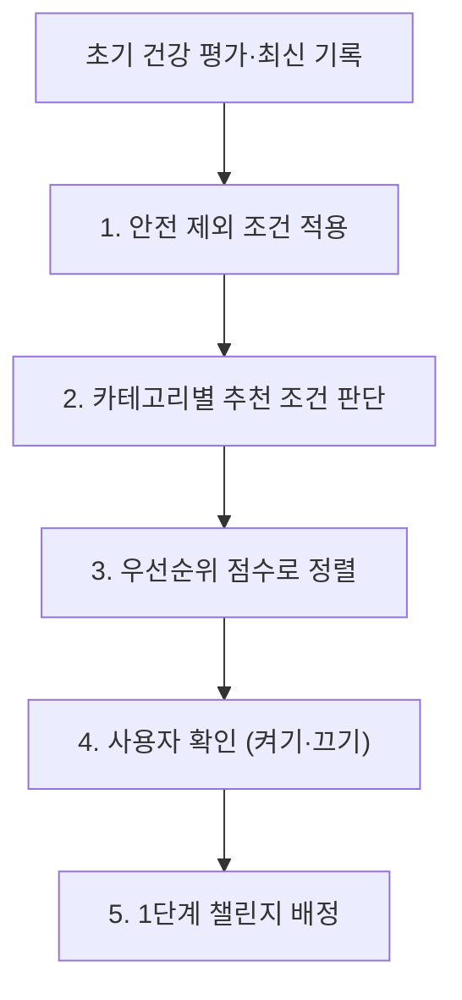
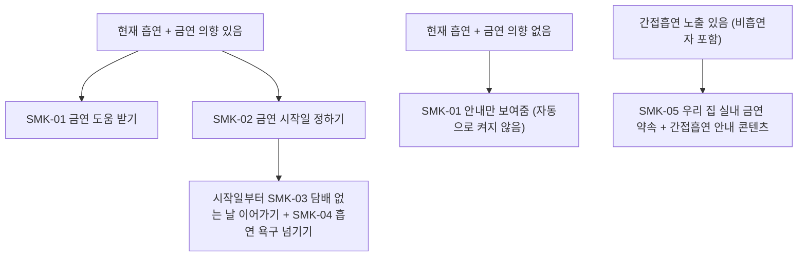

# WELLOOP 생활습관 챌린지 설계 v0.1

- 작성: 전은지 · 2026-11-24
- 기준 문서: [서비스 기획 개요 v2](../service_overview.md) (6장 생활습관 관리 영역, 13장 설계 시 주의사항), [「갱년기 여성의 고LDL콜레스테롤혈증 예방·완화를 위한 생활 습관 지침 및 주간 일상 관리 보고서」](https://docs.google.com/document/d/1pTlZZIlLzIDGHAZPPzbBdW2R2i2BJ1iofBOFJykocXs/edit?tab=t.0#heading=h.koph2a8yuw6x)
- 범위: 챌린지 카테고리, 챌린지 목록, 추천 조건, 목표 수치, 수행 주기, 달성 기준, 단계 조정, 안전 규칙
- 범위 밖: AI 모델 입력·재평가 규칙(AI 모델링 문서), 화면 구성(와이어프레임), 테이블·API 세부(ERD·API 명세서)

> 요구사항 정의서는 [v2.0](WELLOOP_요구사항정의서_v2.0.md), AI 모델링은 [설계 v0.2](WELLOOP_AI모델링_설계_v0.2.md)를 기준으로 맞췄다. ERD, API 명세서, 와이어프레임은 기획안 v2에 맞춰 다시 고칠 예정이다.
> 이 문서는 요구사항 v2.0이 챌린지 설계에 맡긴 미결 사항 **TBD-011~016**(챌린지 목록, 추천 조건, 목표·주기·달성 기준, SHAP 미제공 사용자 추천, 임상 안전 기준 세부, 게이미피케이션 기준)을 정의한다. 다른 문서에 반영할 내용은 [9장](#9-다른-문서에-반영할-내용)에 모았다.
>
> | 요구사항 v2.0 | 이 문서 |
> |---|---|
> | REQ-CHAL-001 건강관리 필요 영역 도출 · TBD-012 | 2장, 4.2 |
> | REQ-CHAL-002 맞춤형 챌린지 추천 · TBD-011, TBD-012 | 4장, 5장 |
> | REQ-CHAL-003 SHAP 미제공 사용자 추천 · TBD-014 | 4.1 |
> | REQ-CHAL-004 달성률 산정 · TBD-013 | 6장 |
> | REQ-LOG-001 실천 기록, REQ-LOG-002 건강지표 기록 | 5.2.1, 6.1, 8장 |
> | REQ-LOG-008 복용 이력 기록 | 4.4 |
> | REQ-DASH-002 달성률 추이, REQ-DASH-004 위험도 재평가 | 6.2, 7장 |
> | REQ-GAME-001~003 연속 기록·주간 목표·배지 · TBD-016 | 6.3, 6.4 |
> | SR-017~026 챌린지 임상 안전 기준 · TBD-015 | 1장, 1.1, 4.3, 5장 |

---

## 목차

- [1. 설계 원칙](#1-설계-원칙)
  - [1.1. 근거를 고른 기준](#11-근거를-고른-기준)
- [2. 카테고리 구성](#2-카테고리-구성)
- [3. 챌린지 정의 항목](#3-챌린지-정의-항목)
- [4. 추천 조건](#4-추천-조건)
- [5. 챌린지 목록](#5-챌린지-목록)
- [6. 수행 주기와 달성 기준](#6-수행-주기와-달성-기준)
- [7. 단계 조정](#7-단계-조정)
- [8. 건강 기록·검진 안내와의 구분](#8-건강-기록검진-안내와의-구분)
- [9. 다른 문서에 반영할 내용](#9-다른-문서에-반영할-내용)
- [10. 정해야 할 것](#10-정해야-할-것)
- [11. 근거 목록](#11-근거-목록)

---

## 1. 설계 원칙

1. **지침에 있는 행동만 챌린지로 만든다.** 목표 수치는 [11장](#11-근거-목록)의 진료지침·섭취기준에서 가져오고, 챌린지마다 근거 ID를 붙인다.
2. **LDL 관리에 직접 쓰이는 행동을 먼저 추천한다.** 식습관(포화지방·트랜스지방·식이섬유), 신체활동, 복부비만, 금연·절주가 핵심이다. 비타민 D·야외활동과 폐경 증상 관리는 **보조 항목**이다(기획안 13.1).
3. **처음부터 지침 목표를 요구하지 않는다.** 챌린지마다 1~3단계를 두고, 1단계는 "지금보다 조금 더"로 시작해서 3단계에서 지침 목표에 닿도록 한다.
4. **필요 없는 사람에게 추천하지 않는다.** 정상 체중이면 체중 감량 챌린지를 추천하지 않고, 비흡연자에게는 금연 챌린지를 추천하지 않는다.
5. **보충제·약은 챌린지로 만들지 않는다.** 오메가-3·비타민 D 보충제 복용, 약 복용 시작·중단은 챌린지 대상이 아니다. 필요하면 "전문가와 상담"으로만 안내한다.
6. **달성률은 실천 기록이다.** 챌린지 달성률로 예측 위험도를 낮추지 않고, LDL-C가 내려갔다고 표현하지 않는다(기획안 13.2).
7. **실패해도 탓하지 않는다.** 못 한 날은 "쉬어 가는 날"로 보여주고, 연속 기록은 주 단위로 센다([6.4](#64-연속-기록)).

### 1.1. 근거를 고른 기준

**문제:** "고LDL콜레스테롤혈증을 예방하려면 무엇을 얼마나 하라"는 예방 전용 지침은 국내외에 따로 없다. 쓸 수 있는 지침은 아래 세 종류이고, 모두 우리 서비스와 맞는 점과 안 맞는 점이 있다.

| 지침 종류 | 이 문서의 근거 | 대상 | 지키려는 결과 | 우리 서비스와 맞는 점 | 안 맞는 점 |
|---|---|---|---|---|---|
| 이상지질혈증 진료지침 | G1 | 운동요법 권고(주 150~300분 중강도 또는 75~150분 고강도)는 "모든 연령대의 성인", 운동처방표는 이상지질혈증 환자 | 지질 수치 관리 → 심혈관질환 예방 | LDL을 직접 다룸, 국내 지침, 유산소 권고는 일반 성인 대상(I, A) | 세부 운동처방표는 환자 대상, 저항성 운동은 지질 관리 권고에서는 빠짐 |
| 심혈관질환 1차 예방 지침 | G7 | 심혈관질환이 없는 성인 | 죽상경화성 심혈관질환(ASCVD) 예방 | 대상(질환 없음)이 같고, 고LDL 예방의 최종 목적(ASCVD 예방)과 같음 | 미국 지침, LDL 수치 자체를 목표로 하지 않음 |
| 일반 신체활동 지침 | G5, G6 | 모든 성인 | 사망·심혈관질환·당뇨·암 등 전반적 건강 | 대상이 같음, 한국 기준(G6) 있음 | LDL·지질에 특화되지 않음 |

**운동과 LDL에 대한 근거 (R6~R9, 본문 확인함):**

| 연구 | 대상 | LDL-C 변화 (운동군 − 대조군) | 이 문서에 주는 의미 |
|---|---|---|---|
| R7 성인 여성 유산소 운동 (41개 RCT, 1,715명) | 18세 이상 여성, 폐경 후 여성만 모은 연구 10개 포함 | −4.4 mg/dL (약 3%), 유의함. 폐경 전·후 차이 없음 | 여성에게도 효과는 있지만 작다 |
| R6 운동 전반 (148개 RCT, 8,673명) | 심혈관질환 없는 성인 | −7.2 mg/dL, 유의함. 예측구간 −23.5 ~ +9.1로 연구의 27.9%는 이득 없음 | 평균적으로 작은 효과, 사람·연구마다 차이가 큼 |
| R6 운동 종류별 | 위와 같음 | 유산소·복합 운동은 LDL 감소, **근력 운동 단독은 HDL만 개선** | LDL에는 유산소·복합 운동이 맞고, 근력 운동은 다른 이유(근육·뼈)로 권한다 |
| R8 과체중·비만 성인 유산소 운동 (13개 RCT, 613명) | BMI 25 이상 | −0.5 mg/dL, 유의하지 않음. **LDL 감소는 체중 감소와 관련**(r = 0.75) | 운동 자체보다 체중이 줄 때 LDL이 내려간다 → 허리둘레·체중 관리가 함께 가야 한다 |
| R9 유산소 운동 + 식사 조절 (6개 RCT, 559명) | 성인 | −9.2 mg/dL (약 7%), 유의함 | 식사(포화지방 10% 미만 등)를 함께 하면 효과가 커진다 |

정리하면 운동은 LDL-C를 조금 낮추지만 효과가 작고 사람마다 다르며, 체중 감소와 식사 조절이 함께할 때 커진다. 그래서 **"LDL을 낮추는 운동량"이라는 별도 기준은 근거상 만들 수 없고**, 운동 목표는 심혈관 건강을 지키는 권장량(G7·G5·G6)을 따르고, LDL 관리의 중심은 식습관·체중·허리둘레에 둔다.

**고른 순서:**

1. **대상이 같은 지침**을 먼저 쓴다. 예방 흐름 사용자는 질환이 없으므로 환자 대상 처방보다 일반 성인·1차 예방 지침이 우선이다.
2. 그중 **서비스 목적에 가까운 지침**을 쓴다. 고LDL 예방은 결국 심혈관질환 예방을 위한 것이므로, 심혈관질환 1차 예방 지침(G7)이 일반 건강 지침(G5·G6)보다 목적에 가깝다.
3. **국내 지침**이 있으면 함께 쓴다(한국인 기준 BMI·허리둘레, 한국 신체활동 지침).
4. 지침끼리 **수치가 다르면** 단계(1~3단계)로 나눠 낮은 값부터 시작하고, 지침 범위의 최소값을 3단계로 둔다.
5. **관찰 연구**는 "누구에게 추천할지"와 보조 항목 설명에만 쓰고, 챌린지 효과의 근거로 쓰지 않는다(기획안 13.1).

**영역별로 쓴 기준과 이유:**

| 영역 | 기본 근거 | 이유 |
|---|---|---|
| 식습관 | G1, G2 | LDL-C에 가장 직접 영향을 주는 생활습관이다. G1 식사 권고(포화지방·트랜스지방·식이섬유)는 일반 성인의 영양소 섭취기준(G2)과 같은 방향이라 질환이 없는 사람에게 써도 무리가 없다. |
| 신체활동 (예방 흐름) | G7, G5, G6 | 대상(질환 없는 성인)이 같고, G7은 목적(심혈관질환 예방)까지 같다. 유산소 목표는 세 지침 모두 "중강도 주 150분 또는 고강도 주 75분"으로 같다. 근력 운동(주 2일 이상)은 G7 예방 권고에는 없고 G5·G6·G1에 있다. G1은 같은 방향인지 확인하는 보조 근거로 쓴다. |
| 신체활동 (관리 흐름) | G1 | 이미 고LDL콜레스테롤혈증이 있는 사용자는 G1 운동처방의 대상과 같다([4.4](#44-이미-고ldl콜레스테롤혈증이-있는-사용자)). |
| 체중·허리둘레 | G1, G3 | 복부비만은 간의 LDL 합성과 연결되고(G1), 기준값은 한국인 비만 기준(G3)을 쓴다. 정상 체중인 사람에게는 감량을 권하지 않는다. |
| 금연·절주 | G1, G4 | 금연은 G1이 모든 사람에게 권고한다. 음주량은 G1과 G1이 인용한 여성 기준(G4)을 쓴다. |
| 야외활동·수면·휴식 (보조) | R3, R4, R5 | 관찰 연구라 LDL 예방 효과를 말하지 않고, 폐경 증상·삶의 질을 위한 보조 항목으로만 쓴다. |

**사용자에게 하는 말:** 운동 챌린지는 "콜레스테롤을 낮추는 처방"이 아니라 "심혈관 건강을 지키는 권장량"이라고 설명한다. LDL 관리에서 가장 중요한 것은 식습관과 체중·허리둘레 관리라는 점을 함께 알려준다.

---

## 2. 카테고리 구성

기획안 6장의 관리 영역 7개 중 **행동으로 실천할 수 있는 영역**만 챌린지 카테고리로 만든다. 건강지표 모니터링은 챌린지가 아니라 기록·검진 안내로 다룬다([8장](#8-건강-기록검진-안내와의-구분)).

| 코드 | 카테고리 | 기획안 관리 영역 | 역할 | 근거 |
|---|---|---|---|---|
| `DIET` | 식습관 | 영양 및 식습관 개선 | 핵심 | G1, G2 |
| `ACTIVITY` | 신체활동 | 신체활동 및 운동 | 핵심 | G7, G5, G6 (관리 흐름은 G1) |
| `WAIST` | 체중·허리둘레 | 체중 및 복부비만 관리 | 핵심 (해당자만) | G1, G3 |
| `SMOKING` | 금연 | 금연 및 절주 | 핵심 (흡연자, 간접흡연 노출자) | G1 |
| `ALCOHOL` | 절주 | 금연 및 절주 | 핵심 (음주자만) | G1, G4 |
| `OUTDOOR` | 야외활동 | 비타민 D 및 야외활동 관리 | 보조 | R3 |
| `REST` | 수면·휴식 | 폐경 관련 증상 관리 | 보조 (증상 있는 사람만) | R4, R5 |

- 금연과 절주는 추천 조건과 목표가 서로 달라서 카테고리를 나눴다.
- `OUTDOOR`, `REST`는 화면에서 "함께 하면 좋은 습관"처럼 핵심 카테고리와 구분해 보여준다.

---

## 3. 챌린지 정의 항목

관리자가 챌린지를 등록할 때 다음 항목을 채운다.

| 항목 | 설명 | 예시 |
|---|---|---|
| `code` | 챌린지 고유 코드 | `ACT-01` |
| `category` | 2장 카테고리 코드 | `ACTIVITY` |
| `title` | 화면에 보이는 이름 (20자 이내) | 빠르게 걷기 |
| `description` | 왜 하는지 한두 문장 | 숨이 조금 찰 정도로 걸으면 … |
| `goal_type` | 목표 유형 ([6.1](#61-목표-유형)) | `WEEKLY_TOTAL` |
| `levels` | 단계별 목표값 (1~3단계) | 60 / 100 / 150 |
| `unit` | 단위 | 분 |
| `period` | 수행 주기 | 주 (월~일) |
| `intensity` | 강도 `LIGHT`·`MODERATE`·`VIGOROUS`. 운동 기록의 체감 강도(5.2.1)와 같은 값을 쓴다. 지침 용어(중강도 moderate, 고강도 vigorous)와 맞추려고 ERD v1.3의 `HARD` 대신 `VIGOROUS`로 통일 | `MODERATE` |
| `recommend_rule` | 추천 조건 ID ([4.2](#42-카테고리별-추천-조건)) | `R-ACT` |
| `exclude_rule` | 제외 조건 | 운동 제한 있음 → `VIGOROUS` 제외 |
| `evidence` | 근거 ID ([11장](#11-근거-목록)) | G1 |
| `is_active` | 관리자 비활성화 여부 | true |

---

## 4. 추천 조건

### 4.1. 추천 순서



1. **안전 제외 조건**([4.3](#43-제외-조건과-안전-규칙))에 해당하는 챌린지를 먼저 뺀다.
2. **추천 조건**([4.2](#42-카테고리별-추천-조건))에 맞는 카테고리를 고른다.
3. **우선순위**를 정한다.
   - ① 흡연자는 금연을 맨 앞에 둔다(G1 "금연을 강력히 권고", I, A).
   - ② 그다음은 핵심 카테고리 중 지침 목표와의 차이가 큰 순서다.
   - ③ B 모델 사용자는 SHAP 기여도 중 **바꿀 수 있는 요인**과 연결되는 카테고리에 가산점을 준다. AI 모델링 v0.2(5.5.3절, 10-1절)에 따라 연결하는 요인은 두 개뿐이다.

     | SHAP 요인 | 연결 카테고리 | 비고 |
     |---|---|---|
     | 허리둘레 | `WAIST` 체중·허리둘레 | 모델에서 방향이 임상과 일치 |
     | 현재 흡연 | `SMOKING` 금연 | 모델에서 방향이 임상과 일치 |
     | 기저 LDL, 나이 | 연결하지 않음 | 바꿀 수 없는 요인 |
     | 운동 빈도, BMI, 포화지방 비율, 수축기 혈압, 폐경 증상 | 연결하지 않음 | 모델에서 방향이 뒤집히거나 불안정해 노출 금지 |

     식습관·신체활동 챌린지는 SHAP과 관계없이 임상 지침으로만 추천한다(SR-017, SR-027). 특히 운동 빈도는 SWAN 데이터에서 고LDL 발생을 예측하지 못했으므로(모델링 v0.2 5.5.1절) 모델 결과를 운동 챌린지 근거로 쓰지 않는다.
   - ④ 보조 카테고리는 핵심 카테고리 뒤에 둔다.
4. 사용자가 추천 카테고리를 켜고 끌 수 있다. 추천하지 않은 카테고리도 직접 켤 수 있지만, 해당 조건이 없는 사람에게 `WAIST` 감량 챌린지는 열지 않는다.
5. 처음 시작할 때는 모든 챌린지를 1단계로 배정한다.

**동시에 진행하는 챌린지 수:** 처음 2주는 최대 3개(핵심 2 + 보조 1)로 시작한다. 이후 주간 리뷰에서 하나씩 늘릴 수 있고, 최대 5개까지 둔다. 한 카테고리에서 동시에 진행하는 챌린지는 2개까지다.

> SHAP 결과가 없는 사용자(일반 건강관리 분기, A 모델 분기)도 같은 규칙으로 추천하고 SHAP 가산점만 빠진다(REQ-CHAL-003, TBD-014). A 모델의 SHAP 제공 여부(TBD-006)가 정해지면 같은 표를 적용한다.

### 4.2. 카테고리별 추천 조건

초기 건강 평가 문항이 아직 확정되지 않아서, 아래 표의 "필요한 입력"은 문진 설계 때 꼭 넣어야 할 항목 목록으로도 쓴다.

| 규칙 | 카테고리 | 추천 조건 (하나라도 해당하면 추천) | 필요한 입력 |
|---|---|---|---|
| `R-DIET` | 식습관 | 육류 지방 부위·가공육·튀김·빵·과자 섭취가 주 3회 이상 / 채소·통곡물 섭취가 하루 1회 이하 / 국·찌개 국물을 거의 다 먹음 / 등푸른 생선이 주 1회 미만 / LDL-C 검사값이 있고 130 mg/dL 이상 (G1 분류 "경계" 이상) | 식습관 간이 문진 5문항, LDL-C(선택) |
| `R-ACT` | 신체활동 | 중강도 이상 유산소 운동이 주 150분 미만 (고강도는 2배로 환산, [5.2.1](#521-운동-기록)) / 하루 대부분을 앉아서 보냄 | 주당 운동 일수·1회 시간·강도, 운동 제한 여부와 **의료진이 허용한 활동 범위** |
| `R-WAIST` | 체중·허리둘레 | BMI 25 이상 → 체중 감량 챌린지 포함 / BMI 23~24.9 → 기록과 식습관 개선 챌린지(WST-02·03)만 / BMI 18.5~22.9인데 허리둘레 85cm 이상 → 감량 챌린지 없이 식습관·신체활동 우선([4.3](#43-제외-조건과-안전-규칙)) | 키·체중·허리둘레 |
| `R-SMOKE` | 금연 | 현재 흡연 (SMK-01~04) / 간접흡연 노출 있음 (SMK-05, 비흡연자 포함) | 흡연 상태, 금연 의향, 간접흡연 노출 여부(가정·직장) |
| `R-ALC` | 절주 | 하루 1잔 넘게 마시는 날이 있음 / 주 2회 이상 음주 | 음주 빈도, 1회 음주량 |
| `R-OUT` | 야외활동 | 낮 시간 야외활동이 하루 15분 미만인 날이 많음 | 야외활동 시간 (간이) |
| `R-REST` | 수면·휴식 | 안면홍조·야간발한·수면 장애 중 하나 이상을 "불편함" 이상으로 기록 | 폐경 증상 기록 |

- 기준 수치는 G1·G3·G4 기준이다. BMI는 한국인 비만 기준(23 이상 비만 전단계, 25 이상 비만)을 쓴다.
- LDL-C 기준은 G1의 **LDL 콜레스테롤 분류**를 쓴다(확인함). 위험도별 치료 목표치는 쓰지 않는다. 위험도 분류(관상동맥질환·당뇨·위험인자 개수)는 의료진이 판단할 일이고, 서비스가 계산하면 진단·처방처럼 보일 수 있기 때문이다.

  | LDL-C (mg/dL) | G1 분류 | 챌린지 추천 | 화면 안내 |
  |---|---|---|---|
  | < 100 | 적정 | 문진 결과로만 추천 | 없음 |
  | 100~129 | 정상 | 문진 결과로만 추천 | 없음 |
  | 130~159 | 경계 | 식습관 우선순위를 맨 앞(금연 다음)으로 | "검사 결과를 참고해 식습관 챌린지를 먼저 추천했어요" |
  | 160~189 | 높음 | 위와 같음 | 위 문구 + "검사 결과는 의료진과 상의해 보세요" |
  | ≥ 190 | 매우 높음 | 위와 같음 | 위 문구 + "가까운 시일 안에 진료를 받아 보세요" |

  - 160 이상을 상담 안내 기준으로 잡은 근거: G1 치료 전략표에서 위험인자가 1개 이하인 저위험군도 LDL-C 160 이상이면 "생활습관 교정 + 약물 고려" 구간이다. 위험인자가 2개 이상(중등도 위험)이면 130부터 약물을 고려하지만, 서비스는 위험인자 개수를 판단하지 않으므로 가장 낮은 위험군 기준을 쓴다.
  - 190 이상은 G1이 "매우 높음"으로 분류하고, 가족성 고콜레스테롤혈증 진단 기준(Simon Broome: 성인 LDL-C > 190)에도 걸리는 값이라 진료 권유를 더 분명하게 한다.
  - 화면에는 "경계·높음" 같은 분류 이름을 판정처럼 보여주지 않는다. 위 표의 문구만 보여준다.
- 금연 의향이 "없음"이어도 금연 카테고리는 추천 목록에 보여준다. 다만 자동으로 켜지 않고, 금연 도움 받기 안내([SMK-01](#55-금연-smoking))만 먼저 보여준다.

### 4.3. 제외 조건과 안전 규칙

| 조건 | 처리 |
|---|---|
| 운동 제한(관절·심혈관 질환 등으로 의료진이 운동을 제한함)이 있다고 답함 | **의료진이 허용한 활동 범위를 먼저 따른다.** 허용 범위를 한 번 더 묻는다(가벼운 걷기 가능 / 앉아서 하는 운동만 가능 / 운동하지 말라고 함 / 잘 모름). ① 가벼운 걷기 가능 → `LIGHT` 챌린지(ACT-02·04·06·07)만, ② 앉아서만 가능 → ACT-04·07만, ③ 운동 금지 또는 ④ 잘 모름 → **신체활동 챌린지를 자동으로 추천하지 않고** "운동 범위를 의료진과 상의해 보세요"를 안내한다. 어느 경우든 `VIGOROUS` 챌린지와 `ACTIVITY` 3단계 목표는 쓰지 않는다. |
| **응급 의심 증상을 기록함** (혈압 기록, 운동 기록, 챌린지 체크, 메모, 증상 기록 등 어디서든) | **혈압 수치나 다른 조건과 관계없이** 그 자리에서 바로 119 안내를 보여준다. 재측정이나 증상이 나아지길 기다리라고 하지 않는다. 규칙 기반으로 처리하고 LLM 판단에 의존하지 않는다. 별도의 응급질환 선별·진단 기능이 아니라, 서비스 이용 중 생길 수 있는 응급 상황에 대한 최소한의 안전장치다. |
| BMI 23 미만, 허리둘레 85cm 미만 | `WAIST` 카테고리를 추천하지 않는다(기획안 13.1, SR-021). |
| BMI 18.5~22.9 (정상)인데 허리둘레 85cm 이상 | **체중 감량 챌린지(WST-01, ACT-05)는 추천하지 않는다.** 식습관(`DIET`)과 신체활동(ACT-01·03)을 우선 추천하고, WST-02·03(야식·단 음료)처럼 식습관 개선 성격의 챌린지만 쓴다. 허리둘레는 주 1회 기록한다. |
| BMI 18.5 미만 (저체중) | 체중 감량 목적 챌린지 WST-01·WST-02·ACT-05를 모두 제외한다. 신체활동 챌린지 설명에 체중 감량 문구를 쓰지 않는다. `WAIST` 카테고리는 추천하지 않는다. |
| 임신 가능성·특정 질환으로 식이 제한을 받는 중 | 식습관 챌린지는 "의료진 안내를 먼저 따르세요"를 함께 보여준다. |
| 지질저하제 복용 중 | 챌린지는 똑같이 제공한다. 약 복용은 챌린지에 넣지 않고 복용 기록으로만 남긴다. 관리 흐름 규칙([4.4](#44-이미-고ldl콜레스테롤혈증이-있는-사용자))을 함께 적용한다. |

**응급 의심 증상 목록** (위 표 첫 줄의 119 안내 기준. 질병관리청 조기증상(G16)을 기본으로 하고, 미국심장협회·미국뇌졸중협회(G14·G15) 내용으로 보완. 모두 원문 확인)

| 구분 | 증상 (화면 문구는 G16 표현을 그대로 사용) | 근거 |
|---|---|---|
| 뇌졸중 의심 | 갑자기 한쪽 얼굴, 팔, 다리에 힘이 빠진다 / 갑자기 말이 어눌해지거나, 다른 사람의 말을 이해하지 못한다 / 갑자기 한쪽 눈이 보이지 않거나, 양쪽 눈 시야의 반이 보이지 않거나, 물체가 두 개로 보인다 / 갑자기 어지럽거나 몸의 중심을 잡기 힘들다 / 갑자기 이제까지 경험하지 못한 심한 두통이 있다 | G16 (G15 B.E. F.A.S.T.와 같은 내용) |
| 심근경색 의심 | 갑자기 가슴에 심한 통증이나 압박감, 또는 짓누르는 느낌이 있다 / 갑자기 턱, 목 또는 등 부위에 심한 통증이나 답답함이 있다 / 갑자기 숨이 많이 찬다 / 갑자기 팔 또는 어깨에 통증이나 불편함이 느껴진다 | G16 (G14와 같은 내용) |
| 보완 (해외 자료) | 위 증상에 식은땀·메스꺼움·어지럼이 함께 나타남. 여성은 숨참·메스꺼움·구토·어깨·등·팔 통증·이례적인 피로 같은 증상이 나타날 수 있음 | G14 |

- 화면에서는 "지금 이런 증상이 있나요?" 형태로 위 증상을 보여주고, 하나라도 "예"면 119 안내로 바로 넘어간다.
- **119 안내 화면 문구** (G16 "조기증상 발생 시 대응요령"): 지체 없이 119에 도움을 요청하세요 / 환자가 직접 운전하는 것은 위험해요 / 가족이 올 때까지 기다리지 마세요 / 증상이 그냥 지나갈 거라고 생각하지 마세요 / 야간이나 주말이라고 외래 진료 시까지 기다리지 마세요.
- 서비스 대상이 40~50대 여성이라, 가슴 통증 외 증상(숨참, 턱·등·팔·어깨 통증)도 같은 무게로 보여준다(G14 여성 증상).

### 4.4. 이미 고LDL콜레스테롤혈증이 있는 사용자

이미 고LDL콜레스테롤혈증이 있는 사용자는 신규 발생 위험을 예측하지 않는다(기획안 13.3). 요구사항 v2.0의 분기(REQ-PRED-001~002)로는 **일반 건강관리 분기**에 속한다. 이 문서에서는 일반 건강관리 분기 중 이런 사용자에게 쓰는 화면·문구 규칙을 **관리 흐름**이라고 부른다. 새로운 분기가 아니다.

AI 모델링 v0.2(2.1절)도 기저 LDL-C 160 이상, 지질강하제 복용자를 학습 대상에서 뺐으므로 아래 판단 기준과 같다.

**판단 기준 (초기 건강 평가·검사 결과 입력 시)**

| 상황 | 처리 |
|---|---|
| 고콜레스테롤혈증·이상지질혈증 진단을 받았다고 답함 | 관리 흐름 |
| 지질저하제(스타틴 등)를 복용 중이라고 답함 | 관리 흐름. 복용 이력(REQ-LOG-008)에 **복용 시작·중단 시점**을 남긴다. 모델링 v0.2의 발생 정의가 "LDL-C 160 이상 또는 지질강하제 시작"이라, 예방 흐름 사용자가 나중에 약을 시작하면 그 시점도 기록해야 재평가와 라벨 정의가 어긋나지 않는다 |
| 진단은 없는데 LDL-C를 160 mg/dL 이상으로 입력함 | 서비스가 진단하지 않는다. "검사 결과는 의료진과 상의해 보세요"를 안내하고, 진료 여부를 다시 확인할 때까지 예측을 보류한다. 챌린지는 관리 흐름 규칙으로 제공한다. |
| LDL-C를 190 mg/dL 이상으로 입력함 | 위와 같고, "가까운 시일 안에 진료를 받아 보세요"로 더 분명하게 안내한다(G1 "매우 높음", 가족성 고콜레스테롤혈증 기준 LDL-C > 190). |

- 160은 G1에서 "높음"으로 분류하는 값이고, 위험인자가 가장 적은 저위험군도 생활습관 교정과 함께 약물을 고려하는 구간이다([4.2](#42-카테고리별-추천-조건)).
- 진료를 받아 예측을 보류한 사용자에게는 2주 뒤 "진료를 받아 보셨나요?"를 묻는다(진단받음 → 관리 흐름 유지 / 진단 없음 → **모델 적용 조건을 다시 판정**(REQ-PRED-005)하고 충족할 때만 예측 적용 / 아직 안 받음 → 2주 뒤 다시 물어봄). 진단을 받지 않았다고 해서 모델 적용 조건을 충족하는 것은 아니다. 예를 들어 LDL-C 160 이상이면 모델 학습 범위(AI 모델링 v0.2 2.1절)를 벗어나므로, 새 검사값으로 다시 판정하기 전까지 일반 건강관리 분기에 머문다. 시점과 횟수는 [10장](#10-정해야-할-것)에서 확정한다.

**챌린지 규칙**

1. **근거 지침:** 이상지질혈증 진료지침(G1)이 대상(환자)에 맞는 기본 근거다. 목표 수치는 예방 목적의 신체활동 권고와 거의 겹치므로 챌린지 목록은 그대로 쓰고, 근거 표기만 대상에 맞게 보여준다. G6도 "만성질환자도 일반 성인 및 노인과 동일한 신체활동에 참여할 수 있다"고 밝히고 있어, 같은 챌린지 목록을 쓰는 근거가 된다.
2. **식습관을 항상 맨 앞에:** 금연 대상자가 아니면 식습관 카테고리를 우선순위 1위로 둔다. LDL-C를 낮추는 데는 포화지방 제한과 체중 관리가 운동보다 직접적이다.
3. **식이 콜레스테롤 콘텐츠:** G1은 고콜레스테롤혈증 환자에게 콜레스테롤 섭취를 줄이라고 권고한다. 관리 흐름 사용자에게만 식이 콜레스테롤이 많은 식품을 안내하는 코칭 콘텐츠를 추가로 보여준다. 하루 섭취량 목표는 정하지 않는다(G1이 구체적 수치를 제시하지 않음).
4. **약 관련 안전 규칙:**
   - 약 복용은 복용 기록으로만 남기고 챌린지로 만들지 않는다.
   - "생활습관을 잘 지키면 약을 줄일 수 있어요"처럼 약 시작·중단·변경으로 읽힐 수 있는 문구는 쓰지 않는다. 문구는 "생활습관 관리는 약과 함께 하는 거예요" 방향으로 쓴다(기획안 13.1).
   - 스타틴 복용자가 운동 기록·메모·증상 기록에 이유 없는 근육통이나 근력 저하를 남기면, 단계 올리기 제안을 멈추고 "의료진과 상의하세요"를 안내한다(G1 스타틴 요약: 설명되지 않는 근육통·근력 저하 시 근육 효소 검사).
5. **목표 LDL-C를 서비스가 정하지 않음:** G1의 LDL-C 목표치는 위험도에 따라 55~160 mg/dL로 다르고, 위험도는 의료진이 판단한다. 사용자가 "의료진이 알려준 목표치"를 직접 입력하면 대시보드에 그 값을 기준선으로 보여주고, "직접 입력한 목표"라고 표시한다.

**화면·기록 규칙**

| 항목 | 예방 흐름 | 관리 흐름 |
|---|---|---|
| 홈 상단 | LDL 관리 필요 신호 | 관리 기록 (챌린지 달성률, 검사 수치 추이, 허리둘레 변화) |
| 예측·"만약에" 시뮬레이션 | 모델 적용 조건(REQ-PRED-001)과 서비스 활용 기준(REQ-PRED-008)을 충족할 때만 제공. 활용 기준은 PR #38에서 재검토 중 | 제공하지 않음 |
| 검사 결과 표현 | 수치 판정 없음 | 수치 판정 없음. "조절이 잘 되고 있어요/안 되고 있어요" 같은 의료 판단 표현을 쓰지 않음 |
| 검진 알림 | 마지막 지질검사 후 12개월 | 사용자가 입력한 다음 진료·검사 예정일 기준 (입력이 없으면 12개월) |
| 의료진 상담용 리포트 | 선택 기능 | 홈에서 바로 보이게 (진료 때 생활습관 기록과 검사 추이를 보여주는 용도) |

---

## 5. 챌린지 목록

표 읽는 법: **목표**는 1단계 → 2단계 → 3단계 순서다. 3단계가 지침 목표다. 주기 `일`은 매일 체크, `주`는 월~일 한 주 동안 채운다.

### 5.1. 식습관 `DIET`

| 코드 | 챌린지 | 유형 | 목표 (1 → 2 → 3단계) | 달성 기준 | 근거 |
|---|---|---|---|---|---|
| DIT-01 | 기름진 고기 대신 살코기·생선·콩 | `WEEKLY_DAYS` | 주 3일 → 4일 → 5일 | 그날 한 끼 이상 바꿨다고 체크 | G1 (포화지방 열량의 7% 미만, 붉은 고기·가공육 대신 생선·살코기·콩류) |
| DIT-02 | 튀김·과자·빵 쉬는 날 | `WEEKLY_DAYS` | 주 3일 → 4일 → 5일 | 그날 안 먹었다고 체크 | G1 (트랜스지방 1% 미만) |
| DIT-03 | 잡곡밥·통곡물 한 끼 | `WEEKLY_DAYS` | 주 3일 → 5일 → 7일 | 그날 한 끼 이상 | G1 (식이섬유) |
| DIT-04 | 끼니마다 채소 한 접시 | `WEEKLY_DAYS` | 주 3일 → 5일 → 7일 | 그날 두 끼 이상 채소 반찬 | G1 (식이섬유) |
| DIT-05 | 등푸른 생선 먹기 | `WEEKLY_COUNT` | 주 1회 → 2회 → 2회 | 먹은 날 체크, 주 횟수 합계 | G1 (등푸른 생선 주 2~3회, 표 3-2) |
| DIT-06 | 국물은 반만 | `WEEKLY_DAYS` | 주 3일 → 5일 → 7일 | 그날 국·찌개 국물을 반 이하로 | G2 (나트륨 2.3g 미만) |

- DIT-05는 오메가-3 보충제를 대신하지 않는다. "보충제는 전문가와 상담하세요"를 설명에 넣는다(기획안 13.1).
- 식단 사진 분석(P2)이 붙으면 DIT-01·02·04는 사진으로도 체크할 수 있게 한다. 달성 판정은 여전히 사용자 체크로 한다.
- 식이 콜레스테롤(하루 300mg 미만, G2)은 일상에서 세기 어려워 챌린지로 만들지 않는다. 코칭 콘텐츠로만 안내한다.

### 5.2. 신체활동 `ACTIVITY`

| 코드 | 챌린지 | 유형 | 목표 (1 → 2 → 3단계) | 달성 기준 | 강도 | 근거 |
|---|---|---|---|---|---|---|
| ACT-01 | 빠르게 걷기 | `WEEKLY_TOTAL` | 주 60분 → 100분 → 150분 | 하루 10분 이상 묶음만 합산 | `MODERATE` | G7 (중강도 주 150분 이상), G5 (주 150~300분), G1 (주 5일 이상, 하루 30~60분) |
| ACT-02 | 식후 10분 걷기 | `WEEKLY_DAYS` | 주 3일 → 5일 → 7일 | 그날 1회 이상 | `LIGHT` | G1 |
| ACT-03 | 근력 운동 (스쿼트·벽 밀기 등) | `WEEKLY_COUNT` | 주 1회 → 2회 → 3회 | 1회 10분 이상 | `MODERATE` | G5 (주요 근육군 주 2일 이상), G1 (주 2~3일) |
| ACT-04 | 앉아서 하는 운동 | `WEEKLY_DAYS` | 주 3일 → 5일 → 5일 | 1회 10분 | `LIGHT` | 운동 제한자용 대체 |
| ACT-05 | 체중 관리 걷기 | `WEEKLY_TOTAL` | 주 150분 → 200분 → 250분 | 하루 10분 이상 묶음만 합산 | `VIGOROUS` | G1 (체중 감량 시 주 5일 이상·주 250~300분, 하루 50~60분 이상) |
| ACT-06 | 스트레칭 | `WEEKLY_DAYS` | 주 2일 → 3일 → 3일 | 그날 5분 이상 | `LIGHT` | G1 (스트레칭 주 2~3일 이상, 확인함) |
| ACT-07 | 오래 앉아 있지 않기 | `WEEKLY_DAYS` | 주 3일 → 5일 → 5일 | 오래 앉아 있을 때 1시간에 한 번 일어나 움직였다고 체크 | `LIGHT` | G1 (좌식시간 줄이기 I, B), G5, 1시간은 행동 전략 |

**근거 지침을 사용자 흐름에 따라 나눈다.**

| 흐름 | 기본 근거 | 보조 근거 | 이유 |
|---|---|---|---|
| 예방 흐름 (고LDL콜레스테롤혈증 없음) | G7 심혈관질환 1차 예방 지침, G5 WHO 신체활동 지침, G6 한국인을 위한 신체활동 지침서 | G1 | 질환이 없는 성인 대상이고, G7은 심혈관질환 예방이라는 목적도 같음 ([1.1](#11-근거를-고른-기준)) |
| 관리 흐름 ([4.4](#44-이미-고ldl콜레스테롤혈증이-있는-사용자)) | G1 이상지질혈증 진료지침 운동처방 | G5, G6 | 이상지질혈증 환자 대상 처방 |

두 지침의 목표 수치가 겹치므로(유산소 주 150분 이상, 근력 주 2일 이상) 챌린지 목록과 단계는 하나로 쓰고, 챌린지 설명의 근거 표기만 흐름에 맞게 보여준다.

- ACT-01 3단계 150분은 G5의 중강도 권고(주 150~300분)의 최소값이고, G1의 "주 5일 이상 × 하루 30분 이상"과도 같다. 3단계를 넘어 더 하는 것은 운동 기록으로 그대로 보여준다.
- ACT-03은 G5 "주 2일 이상", G1 "주 2~3일" 모두에 2단계(주 2회)부터 들어간다. 다만 근력 운동만으로는 LDL-C가 내려가지 않았으므로(R6), 설명에 LDL 효과를 쓰지 않는다. G1 본문도 "저항성 운동은 이상지질혈증 관리 지침에 권고되지 않지만, 노화로 인한 근력 감소나 뼈 건강 개선을 위해 유산소 운동과 병행하는 것이 중요하다"고 쓴다(G1이 인용한 다른 메타분석은 저항성 운동의 LDL 감소를 약 6 mg/dL로 보고해, 연구마다 결과가 다르다). 유산소 운동과 함께 하는 복합 운동이 지질 개선에 가장 좋았다(R6).
- **폐경 이행기에 근력 운동을 핵심으로 두는 이유 (R10~R12):**

  | 근거 | 내용 | 이 문서에 주는 의미 |
  |---|---|---|
  | R10 SWAN 체성분 연구 (1,246명) | 마지막 월경 약 2년 전부터 제지방(근육 등)이 줄고 체지방 증가 속도가 빨라져, 마지막 월경 후 약 2년까지 이어짐 | 우리 서비스 대상 시기에 근육이 줄기 시작한다. 예측 모델과 같은 SWAN 코호트 결과다 |
  | R11 폐경 후 여성 근력 운동 메타분석 (24개 연구) | 근력 운동은 대퇴골 경부·요추 골밀도를 높임. 다만 **근력 운동에 체중 부하·충격 운동을 더한 복합 프로그램**만 유의했고, 근력 운동 단독은 유의하지 않았음 | 근력 운동(ACT-03)만 두지 말고 걷기 등 체중이 실리는 유산소 운동(ACT-01)과 함께 하도록 권한다 |
  | R12 대한골대사학회·한국운동생리학회 운동 지침 (50개 RCT) | 골다공증·골감소증 환자에게 근력 운동 주 2~3일(1RM의 50~85%, 세트당 5~12회), 충격 운동(줄넘기 등) 주 3일 이상을 권고. 건강한 성인에게는 체중 부하 유산소 운동 주 3~5일과 근력 운동 주 2~3일을 권한 ACSM 입장을 인용 | ACT-03의 주 1 → 2 → 3회 목표가 국내 지침 범위(주 2~3일)와 맞는다 |

  - 화면 설명은 "폐경 전후에는 근육과 뼈가 줄기 쉬워요. 근력 운동은 근육과 뼈를 지키는 데 도움이 돼요"처럼 쓴다. LDL 효과는 쓰지 않는다.
  - 줄넘기 같은 충격 운동은 R12에서 권하지만, 관절 질환이나 골절 위험이 있는 사람에게는 부담이 될 수 있어 별도 챌린지로 만들지 않는다. 운동 기록(줄넘기 종목)으로만 남긴다. 강도·세트(1RM의 50~85%, 2~4세트 8~12회)는 앱에서 측정할 수 없으므로 목표로 쓰지 않고, 설명에 "10~15번 반복하면 힘이 드는 정도"처럼 쉽게 풀어 쓴다.
- ACT-05는 BMI 25 이상으로 `R-WAIST`에 해당하고 ACT-01 3단계를 2주 이상 달성한 사람에게만 연다. 3단계 250분은 G1 본문의 체중 감량 권고 "주 5일 이상, 주당 250~300분"의 최소값이다.
  - [「갱년기 여성의 고LDL콜레스테롤혈증 예방·완화를 위한 생활 습관 지침 및 주간 일상 관리 보고서」](https://docs.google.com/document/d/1pTlZZIlLzIDGHAZPPzbBdW2R2i2BJ1iofBOFJykocXs/edit?tab=t.0#heading=h.koph2a8yuw6x)에는 "하루 60~90분"으로 되어 있었는데, G1 요약본에는 "하루 50~60분"으로 나와 보고서도 "하루 50~60분"으로 고쳤다(2026-11-24).
- ACT-06은 G1 운동처방표에 유산소·근력과 함께 들어 있는 스트레칭 권고(주 2~3일 이상, 부위당 10~30초 × 2~4회)를 챌린지로 만든 것이다. 스트레칭·체조 기록이 여기에 반영된다(요가는 G6 분류에 따라 근력 운동으로 반영).
- ACT-07은 G1이 "일상생활에서 좌식시간을 줄이고 자주 신체를 움직이는 생활양식"을 권고하고(I, B), "최소 하루 15분이라도 신체 움직임으로 오래 앉아 있는 것을 끊는 것"의 이점을 언급한 데 근거한다. G5도 "앉아 있는 시간을 줄이라"고 강하게 권고하지만 구체적인 시간 기준은 근거가 부족하다고 밝혀서, "1시간에 한 번"은 실천하기 쉬운 행동 전략으로 둔다. 가벼운 움직임이라도 앉아 있는 시간을 대신하면 도움이 된다는 G5 내용을 설명에 쓴다.
- 운동 제한이 있으면 의료진이 허용한 범위에 따라 추천한다([4.3](#43-제외-조건과-안전-규칙)). 허용 범위를 모르면 신체활동 챌린지를 자동으로 추천하지 않는다.
- **설명 문구 원칙:** 신체활동 챌린지 설명에 "콜레스테롤(LDL)을 낮춰요"라고 쓰지 않는다. 운동의 효과는 주로 중성지방·HDL, 체중·허리둘레 관리 쪽이고 LDL-C를 직접 낮추는 효과는 식습관·체중 감량보다 작다. "혈관 건강과 허리둘레 관리에 도움이 돼요", "근육과 뼈를 지키는 데 도움이 돼요"처럼 쓴다(기획안 13.1).
- 걸음 수 연동은 하지 않는다. 시간은 사용자가 직접 입력한다(빠른 입력: 10·20·30분 버튼).
- 운동 시간은 모두 **운동 기록**([5.2.1](#521-운동-기록))에 쌓이고, 신체활동 챌린지 달성은 운동 기록으로 계산한다. 챌린지에 없는 운동(등산·필라테스 등)도 같은 방식으로 반영된다.

#### 5.2.1. 운동 기록

챌린지로 정한 운동 외에 평소 하는 운동(등산, 러닝, 헬스, 필라테스, 요가 등)도 기록할 수 있게 한다. 신체활동 카테고리를 켜지 않은 사용자도 쓸 수 있다.

**입력 항목**

| 항목 | 필수 | 입력 방식 |
|---|---|---|
| 종목 | 필수 | 아래 목록에서 고르기, 없으면 "기타"로 직접 입력 |
| 시간 | 필수 | 분 (빠른 입력 10·20·30·60분, 1~300분) |
| 체감 강도 | 필수 | 3개 중 고르기 (아래 표) |
| 실외에서 했나요 | 선택 | 예 / 아니요 (기본 장소가 실외인 종목은 "예"가 기본값) |
| 식사 후에 했나요 | 선택 | 걷기 종목일 때만 보여줌 (ACT-02용) |
| 메모 | 선택 | 50자 이내 |

- 날짜는 오늘이 기본이고, 다른 기록과 똑같이 전날까지만 입력·수정할 수 있다([6.1](#61-목표-유형)).
- 하루에 여러 번 기록할 수 있다. 같은 종목을 두 번 해도 따로 저장한다.

**체감 강도** — 기구 없이 말하기로 판단하는 방법(talk test)을 쓴다.

| 값 | 화면 문구 | 해당 강도 |
|---|---|---|
| `LIGHT` | 편하게 말할 수 있어요 | 가벼움 |
| `MODERATE` | 말은 되지만 노래는 어려워요 | 중강도 (G6 토크 테스트, 운동자각도 5~6) |
| `VIGOROUS` | 몇 마디 하면 숨이 차서 멈춰야 해요 | 고강도 (G6 토크 테스트, 운동자각도 7~8) |

- 화면 문구는 G6의 토크 테스트 기준을 그대로 옮긴 것이다. G6은 심장질환자처럼 심박수를 쓰기 어려운 경우에도 토크 테스트나 운동자각도를 쓰라고 하므로, 관리 흐름 사용자에게도 같은 방식을 쓴다.

- 고강도는 챌린지 시간을 2배로 쳐 주므로, 고르기 전에 "숨이 차서 대화를 이어가기 어려운 정도"라는 설명을 한 번 더 보여준다(스스로 고르는 값이라 과대평가를 줄이기 위함).

**종목 목록 (초안)**

| 종목 | 분류 | 기본 체감 강도 | 기본 장소 |
|---|---|---|---|
| 걷기 | 유산소 | 가벼움 | 실외 |
| 빠르게 걷기 | 유산소 | 중강도 | 실외 |
| 등산 | 유산소 | 중강도 (높은 경사·무거운 배낭이면 고강도) | 실외 |
| 러닝·조깅 | 유산소 | 고강도 | 실외 |
| 자전거 | 유산소 | 중강도 | 실외 |
| 수영·아쿠아로빅 | 유산소 | 중강도 | 실내 |
| 댄스·에어로빅·줌바 | 유산소 | 중강도 | 실내 |
| 배드민턴·탁구·테니스 | 유산소 | 중강도 | 실내 |
| 골프 | 유산소 | 중강도 | 실외 |
| 헬스 – 근력 (기구·덤벨) | 근력 | 중강도 | 실내 |
| 맨몸 근력 (스쿼트·벽 밀기 등) | 근력 | 중강도 | 실내 |
| 필라테스 | 근력 | 중강도 | 실내 |
| 헬스 – 유산소 (러닝머신·사이클) | 유산소 | 중강도 | 실내 |
| 요가 | 근력 | 가벼움 | 실내 |
| 스트레칭·체조 | 유연성 | 가벼움 | 실내 |
| 기타 (직접 입력) | 사용자가 고름 | 사용자가 고름 | 사용자가 고름 |

- 분류와 기본 강도는 G6의 활동 예시(48·66쪽)를 따랐다. G6은 요가·필라테스를 근력 운동으로 분류하고, 요가·스트레칭의 강도는 저강도(2.5 METs)로 본다. 그래서 요가는 근력 운동 챌린지(ACT-03)에 반영되고, 스트레칭 챌린지(ACT-06)에는 스트레칭·체조만 반영된다.
- 고르면 기본 체감 강도와 장소가 미리 채워지고, 사용자가 바꿀 수 있다. 같은 등산이라도 사람마다 강도가 다르므로 **판정에는 사용자가 고른 체감 강도를 쓴다.**
- 종목 목록은 관리자가 추가·수정한다(챌린지와 같은 관리 화면).

**챌린지 반영 규칙**

| 운동 기록 | 반영되는 곳 |
|---|---|
| 분류 **"유산소"**, 체감 강도 중강도·고강도, 10분 이상 | ACT-01·ACT-05의 주간 분에 합산 (근력·유연성 운동 시간은 유산소 목표에 넣지 않음) |
| 분류 무관, 체감 강도 가벼움 | 운동 기록에만 남음 (ACT-01 합산 안 함) |
| 걷기 종목, 식사 후 기록 (사용자가 "식후"를 체크) | ACT-02 그날 달성 |
| 분류 "근력", 10분 이상 | ACT-03 1회 (같은 날 여러 번 해도 하루 1회만 인정) |
| 운동 제한 사용자의 기록 중 의료진이 허용한 범위의 운동, 10분 이상 | ACT-04 그날 달성 |
| 분류 "유연성"(스트레칭·체조), 5분 이상 | ACT-06 그날 달성 |
| 분류 무관, 10분 미만 | 운동 시간에는 합산하지 않고 "틈틈이 움직였어요"로 ACT-07 그날 달성 |
| "실외에서" + 15분 이상 | OUT-01 그날 달성 |

- **10분 기준은 지침 기준이 아니라 서비스 기준이다.** G5·G6은 최소 지속 시간을 두지 않지만, 다음 이유로 10분 이상만 운동 시간(ACT-01·ACT-05)에 합산한다.
  - 집 안 이동처럼 짧은 일상 걷기까지 넣으면 "빠르게 걷기" 챌린지의 의미가 흐려진다.
  - 걸음 수 연동 없이 직접 입력하므로, 짧은 기록을 여러 번 넣어 실제보다 부풀려지는 것을 막는다.
  - 빠른 입력 버튼(10·20·30·60분)과 맞아 입력 부담이 적다.
  - 대신 10분 미만 움직임도 버리지 않고 ACT-07(오래 앉아 있지 않기)에 반영해, 짧게 자주 움직이는 습관을 인정한다. G7·G6도 권장량에 못 미치는 활동이나 앉아 있는 시간을 줄이는 것 자체가 도움이 된다고 본다.
- 한 기록이 여러 챌린지에 동시에 반영될 수 있다. 예: 실외에서 중강도 등산 90분 → ACT-01에 90분, OUT-01 그날 달성.
- **고강도 1분은 중강도 2분으로 쳐서** ACT-01·ACT-05에 합산한다. G6 원문이 "고강도 유산소 신체활동 1분은 중강도 유산소 신체활동 2분과 같습니다"라고 명시하고, G7("중강도 주 150분 이상 또는 고강도 주 75분 이상, 또는 상응하는 조합")과 G5("중강도 주 150~300분 또는 고강도 주 75~150분, 또는 상응하는 조합")가 같은 비율을 쓰므로, 같은 효과를 내는 시간이 고강도는 중강도의 절반이다. (G1은 중강도~고강도를 한 구간으로 처방하고 환산 규정이 없다. 예방 흐름의 기본 근거인 G5를 따른다.)
  - 예: 러닝 30분(고강도) → ACT-01에 60분 반영
  - 대시보드에는 **실제로 운동한 시간**을 보여주고, 챌린지 진행 막대에만 환산 시간을 쓴다. 진행 막대 옆에 "고강도는 2배로 계산했어요"를 작게 보여준다.
- 챌린지에서 "빠르게 걷기 20분"을 체크하면 운동 기록이 한 건 생긴다. 체크와 운동 기록을 따로 저장하지 않아서 같은 운동이 두 번 합산되지 않는다.

**보여주는 방식**

- 칼로리는 보여주지 않는다. 시간·체감 강도만으로는 정확하게 계산할 수 없고, 체중 감량 압박을 줄 수 있기 때문이다.
- 대시보드에 "이번 주 운동 n분 (중강도 이상 n분)"과 종목별 시간을 보여준다. 주 150분 기준선은 G1 근거와 함께 보여준다.
- 가벼운 강도로 한 걷기처럼 주간 분에 합산되지 않는 운동도 "이번 주 한 운동" 목록에 똑같이 보여준다. "인정되지 않음" 같은 표현은 쓰지 않는다.

**안전**

- 운동 제한이 있는 사용자가 의료진이 허용한 범위를 넘는 강도(예: 앉아서만 가능한데 걷기·고강도)를 고르면 기록은 그대로 저장하고, "운동 범위는 의료진과 상의하세요"를 한 번 보여준다.
- 운동 기록·메모·증상 입력에서 응급 의심 증상이 확인되면 [4.3](#43-제외-조건과-안전-규칙)의 119 안내 규칙을 그대로 적용한다.

### 5.3. 체중·허리둘레 `WAIST`

| 코드 | 챌린지 | 유형 | 목표 (1 → 2 → 3단계) | 달성 기준 | 근거 |
|---|---|---|---|---|---|
| WST-01 | 저녁 한 숟가락 덜 먹기 | `WEEKLY_DAYS` | 주 3일 → 4일 → 5일 | 그날 체크 | G1 |
| WST-02 | 야식 쉬는 날 | `WEEKLY_DAYS` | 주 3일 → 5일 → 6일 | 저녁 식사 후 먹지 않음 | G1 |
| WST-03 | 단 음료 대신 물 | `WEEKLY_DAYS` | 주 3일 → 5일 → 7일 | 그날 단 음료 0잔 | G1 |

- 허리둘레·체중 측정은 챌린지가 아니라 **건강 기록**이다([8장](#8-건강-기록검진-안내와의-구분)). 이 카테고리를 켠 사용자에게는 "주 1회 허리둘레 재기" 알림만 함께 켠다.
- 목표 체중이나 감량 속도는 제시하지 않는다. 대시보드에서 허리둘레 85cm 기준선만 보여준다(G1).

### 5.4. 절주 `ALCOHOL`

| 코드 | 챌린지 | 유형 | 목표 (1 → 2 → 3단계) | 달성 기준 | 근거 |
|---|---|---|---|---|---|
| ALC-01 | 술 쉬는 날 | `WEEKLY_DAYS` | 주 4일 → 5일 → 6일 | 그날 술을 안 마심 | G1, G4 (가급적 금주) |
| ALC-02 | 마셔도 한 잔까지 | `EVENT_RATIO` | 마신 날의 50% → 75% → 100% | 마신 날 1잔(순수 알코올 10g) 이내였는지 체크 | G4 (여성 하루 1잔 이내), G8 (1잔 = 10g) |
| ALC-03 | 술자리는 1차만 | `EVENT_RATIO` | 술자리가 있었던 날의 50% → 75% → 100% | 술자리가 있었던 날 1차에서 끝냈는지 체크 | 행동 전략 |

- ALC-02·03은 `EVENT_RATIO`([6.1](#61-목표-유형))다. "마신 날"·"술자리가 있었던 날"만 분모로 세고, 그 주에 그런 날이 없으면 자동으로 달성 처리한다.
- **한 잔 = 순수 알코올 10g**으로 정한다(WHO 표준잔, G8).

  | 기준 | 1잔 = 순수 알코올 | 출처 |
  |---|---|---|
  | 한국 보건복지부 | 7g | 「음주폐해예방 실행계획(2018)」(G8에서 확인) |
  | WHO | **10g (채택)** | G8 |
  | 미국 식사권고안 | 14g | G4 |
  | 이상지질혈증 진료지침 | 정의 없음 ("하루 1~2잔 이하") | G1 |

  - 10g을 고른 이유: 생활 습관 지침 보고서가 여성 음주 기준으로 인용한 ESC/EAS 지침("하루 알코올 10g까지")과 갱년기 코호트 분석(R4, "하루 10g 이상 음주자 혈관운동증상 유병비 1.96배")이 모두 10g을 쓴다. 미국 기준 14g은 "1잔"이 너무 많아지고, 한국 기준 7g은 주로 위험음주 횟수를 세는 단위로 쓰여 "하루 1잔 이내" 권고와 연결되는 근거가 약하다.
  - 화면에는 "한 잔"이라는 말만 쓰지 않고, 아래처럼 술 종류별 양으로 풀어서 그림과 함께 보여준다. 계산식은 용량(ml) × 도수(%) × 0.7947 ÷ 100이다(G8).

  | 술 | 도수 (예시) | 10g에 해당하는 양 | 화면 표현 예시 |
  |---|---|---|---|
  | 소주 | 16~16.5% | 약 75~80ml | 소주잔(50ml) 1잔 반 |
  | 과일 소주 | 12~13% | 약 100ml | 소주잔 2잔 |
  | 맥주 | 4.5~5% | 약 250~280ml | 작은 캔(250ml) 1개 |
  | 와인 | 12~13% | 약 100ml | 와인 한 잔(150ml)의 3분의 2 |
  | 막걸리 | 6% | 약 210ml | 종이컵 1컵 가득 |
  | 위스키·양주 | 40% | 약 30ml | 샷잔 1잔 |

  - 도수는 제품마다 달라서 화면에 "도수에 따라 조금씩 달라요"를 함께 보여준다.
  - 그림은 위 "화면 표현 예시"를 기준으로 디자인에서 만든다.

### 5.5. 금연 `SMOKING`

**설계 원칙 (G1 금연 절):** 흡연은 줄이는 것이 아니라 **끊는 것**을 목표로 한다. G1은 금연을 강력히 권고하고(I, A), "흡연의 양을 줄이는 것은 향후 금연 가능성을 높이지 못하고, 오히려 금연을 어렵게 하여 권장되지 않는다"고 쓴다. 그래서 개비 수 줄이기, 첫 담배 미루기 같은 **줄이기 챌린지는 두지 않는다**(이전 초안의 SMK-01 "첫 담배 30분 미루기", SMK-02 "하루 개비 수 줄이기" 삭제).

| 코드 | 챌린지 | 유형 | 목표 | 달성 기준 | 근거 |
|---|---|---|---|---|---|
| SMK-01 | 금연 도움 받기 | `ONCE` | 금연상담전화(1544-9030), 보건소 금연클리닉, 금연길라잡이 중 하나 알아보기 | "알아봤어요" 또는 "등록했어요" 체크 | G1 (금연 강력 권고) |
| SMK-02 | 금연 시작일 정하기 | `ONCE` | 달력에서 금연 시작일 고르기 | 날짜 저장 | 행동 전략 |
| SMK-03 | 담배 없는 날 이어가기 | `WEEKLY_DAYS` | 금연 시작일부터 매주 7일 | 그날 담배를 피우지 않았다고 체크 | G1 (금연 강력 권고 I, A) |
| SMK-04 | 흡연 욕구 넘기기 | `TOOL` (달성률 없음) | 피우고 싶을 때 5분 버티기 (물 마시기, 심호흡, 자리 옮기기) | 쓴 날과 상황(스트레스·식후 등)만 기록 | 행동 전략 |
| SMK-05 | 우리 집 실내 금연 약속 | `ONCE` | 가족과 "집 안·차 안에서는 담배(전자담배 포함) 피우지 않기" 약속하기 | 약속했다고 체크 | G1 (간접흡연 피하기 I, B), G13 (가정·차량은 자발적 실천 필요), G12 (집·차 안 금연이 가장 좋은 보호 방법) |

**진행 순서**



- **SMK-01을 금연 카테고리 첫 화면에 항상 둔다.** 금연은 혼자 하는 것보다 상담·치료 도움을 받는 것이 효과적이다. 보건소 금연클리닉은 상담과 금연 보조제·약물 치료를 연결해 준다. 서비스는 약 이름이나 사용법을 안내하지 않고 상담으로만 연결한다.
- **SMK-03은 단계 조정을 하지 않는다.** 목표는 처음부터 "매일 피우지 않기"다. 대신 연속 금연 기간 이정표(1주, 4주, 12주)를 축하한다([6.4](#64-연속-기록) 배지와 연결).
- **다시 피운 날:** "실패"로 보여주지 않고 "다시 시작한 날"로 기록한다. 연속 금연 기간은 새로 세되, 지금까지 피우지 않은 날의 합계는 남겨 보여준다. 3일 이상 이어서 피웠다고 기록하면 SMK-01(상담 연결)을 다시 보여준다.
- **기록은 "피웠다 / 안 피웠다"만 받는다.** 개비 수는 목표로 쓰지 않는다(줄이기 목표처럼 보이지 않게).
- **SMK-04는 달성률에 넣지 않는다.** 욕구를 넘긴 횟수를 목표로 세면 욕구가 많을수록 점수가 오르는 구조가 되기 때문이다. 기록된 상황(스트레스, 식후, 술자리 등)은 "언제 피우고 싶어지는지" 패턴으로만 보여준다.
- **간접흡연은 매일 체크하는 챌린지로 만들지 않는다.** 간접흡연은 다른 사람이 피우는 담배라 사용자가 날마다 조절하기 어렵고, 본인 잘못이 아닌데 "달성 못 한 날"이 쌓이면 1장 원칙 7(탓하지 않기)과 어긋난다. 그래서 본인이 할 수 있는 한 번의 행동(SMK-05)과 읽을거리만 둔다.
- **SMK-05는 비흡연자에게도 추천한다.** G1은 간접흡연도 심혈관 위험을 높인다며 피하도록 권고한다(I, B). 가정·직장에서 담배 연기에 노출된다고 답한 사용자에게 추천한다. 가족이 약속을 지키는지는 기록하지 않는다.
- **간접흡연 안내 콘텐츠 (챌린지 아님):** 간접흡연 노출이 있는 사용자의 금연 카테고리 화면에 읽을거리로 보여준다.
  - G1 내용: 간접흡연도 심혈관 위험을 높이고, 비흡연자가 흡연자 배우자와 함께 살 때 심혈관 위험이 약 30% 높았다는 보고가 있다(G1 금연 절 인용).
  - 생활 요령 (국내 G13 질병관리청 보고서, 해외 G12 미국 질병통제예방센터 안내 기준):
    - 간접흡연은 안전한 양이 없다(G13 243쪽, G12).
    - 가장 좋은 방법은 집과 차 안에서 아무도 담배를 피우지 않게 하는 것이다(G12). 가정·차량은 법으로 규제하기 어려운 사적 공간이라 가족 스스로의 실천이 필요하다(G13 214쪽). SMK-05와 같은 내용이다.
    - 환기, 공기 여과, 흡연 구역 따로 두기로는 담배 연기를 막지 못한다(G13 243쪽, 담배규제기본협약 제8조 가이드라인 인용). 담배 한 개비 연기는 방 안에 몇 시간 남고, 창문 열기·선풍기·에어컨·공기청정기·방향제로 없어지지 않는다(G12).
    - 담배를 다 피운 뒤에도 연기 성분이 벽, 가구, 먼지, 옷, 차 안에 남았다가 다시 나온다(삼차흡연, G13 42쪽).
    - 화장실이나 다른 방에서 피워도 연기는 문틈, 벽 틈, 환기구, 배관을 타고 집 안에 퍼진다. 아파트에서는 다른 집으로도 퍼진다.
    - 식당 등에서 흡연석과 금연석을 나누는 것만으로는 간접흡연을 막지 못한다. 금연 장소를 고른다.
    - 전자담배도 집 안에서 쓰지 않도록 약속에 포함한다(전자담배 에어로졸에도 해로운 물질이 들어 있다).
    - 가족에게 금연을 권하고, 금연상담전화·보건소 안내를 알려 준다.
  - 가족이 금연하고 싶어 하면 SMK-01의 금연상담전화·보건소 안내를 알려 줄 수 있다는 안내.
- 상담전화 번호와 서비스 이름은 서비스 출시 전에 국가금연지원센터 공식 안내로 다시 확인한다.

### 5.6. 야외활동 `OUTDOOR` (보조)

| 코드 | 챌린지 | 유형 | 목표 (1 → 2 → 3단계) | 달성 기준 | 근거 |
|---|---|---|---|---|---|
| OUT-01 | 낮에 15분 실외 걷기 | `WEEKLY_DAYS` | 주 2일 → 3일 → 5일 | 그날 15분 이상 | R3 (하루 15~20분 야외 산책) |

- 비타민 D 수치 목표(30 ng/mL)는 챌린지 목표로 쓰지 않는다. 보충제 복용도 권하지 않는다(기획안 13.1).
- 자외선차단제를 쓰지 말라는 안내는 하지 않는다.
- 실외에서 한 운동은 운동 기록 하나로 OUT-01과 ACT-01에 함께 반영된다([5.2.1](#521-운동-기록)).

### 5.7. 수면·휴식 `REST` (보조)

| 코드 | 챌린지 | 유형 | 목표 (1 → 2 → 3단계) | 달성 기준 | 근거 |
|---|---|---|---|---|---|
| RST-01 | 1분 호흡 | `WEEKLY_DAYS` | 주 3일 → 5일 → 7일 | 타이머 1분 완료 | 보조 (R4, R5) |
| RST-02 | 자기 전 1시간 화면 끄기 | `WEEKLY_DAYS` | 주 2일 → 4일 → 5일 | 다음 날 아침 체크 | 보조 |
| RST-03 | 침실 시원하게 하기 | `WEEKLY_DAYS` | 주 3일 → 5일 → 7일 | 그날 체크 | 보조 (야간발한) |

- 이 카테고리는 LDL 관리가 아니라 폐경 증상과 삶의 질을 위한 보조 항목이다. 화면 설명에도 "콜레스테롤"을 쓰지 않는다.
- 증상 변화는 폐경 증상 기록으로 따로 본다. 챌린지 달성률과 섞지 않는다.

---

## 6. 수행 주기와 달성 기준

### 6.1. 목표 유형

| 유형 | 뜻 | 하루 기록 | 주간 달성 판정 |
|---|---|---|---|
| `WEEKLY_DAYS` | 주 N일 실천 | 했다 / 안 했다 | 실천한 날 수 ≥ N |
| `WEEKLY_COUNT` | 주 N회 실천 | 했다 / 안 했다 | 실천 횟수 ≥ N |
| `WEEKLY_TOTAL` | 주 N분 채우기 | 분 입력 (10분 이상만 인정) | 합계 ≥ N분 |
| `ONCE` | 한 번 하면 끝 | 했다 | 완료 시 카테고리 내 다음 챌린지 추천 |
| `EVENT_RATIO` | 해당 상황이 있었던 날 중 N% 지키기 | 상황이 있었나(예: 술을 마셨나) → 있었으면 지켰나 | (지킨 날 ÷ 상황이 있었던 날) ≥ N%. 그 주에 상황이 한 번도 없으면 달성 처리 (ALC-02·03) |
| `TOOL` | 필요할 때 쓰는 도구 | 쓴 날과 상황만 기록 | 판정하지 않음. 주간 달성률·연속 기록·단계 조정에서 모두 제외 (SMK-04) |

- 한 주는 **월요일 0시 ~ 일요일 24시**(사용자 기기 시간 기준)다.
- 기록은 **당일과 전날까지** 입력·수정할 수 있다. 그보다 지난 날은 수정할 수 없다(뒤늦게 몰아 쓰기를 막기 위함).
- 매일 체크하는 챌린지라도 주간 목표가 7일이 아니면, 못 한 날이 있어도 그 주는 달성할 수 있다. 그래서 하루 실패가 바로 "실패"로 보이지 않는다.

### 6.2. 달성률 계산

- **챌린지 주간 달성률** = min(실적 ÷ 주간 목표, 1) × 100
  - 예: ACT-01 1단계(주 60분)에 45분 → 75%
- **전체 주간 달성률** = 진행 중인 챌린지 주간 달성률의 평균. `ONCE`와 `TOOL` 챌린지는 평균에서 뺀다(아래 유형별 산정 방식).
- 주 중간에 시작한 챌린지는 남은 날 비율만큼 목표를 줄여서 계산한다(올림).
- **유형별 산정 방식** (ERD·API 구현 기준)

  | 유형 | 주간 달성률 | 비고 |
  |---|---|---|
  | `WEEKLY_DAYS` | min(실천한 날 ÷ 목표 일수, 1) | 하루에 여러 번 체크해도 1일 |
  | `WEEKLY_COUNT` | min(실천 횟수 ÷ 목표 횟수, 1) | **하루 최대 1회만 센다** (예: ACT-03 근력 운동을 같은 날 두 번 해도 1회, DIT-05 등푸른 생선도 같음) |
  | `WEEKLY_TOTAL` | min(유산소 합계 분 ÷ 목표 분, 1) | 10분 이상 기록만, 고강도는 2배 환산 |
  | `EVENT_RATIO` | min(실제 비율 ÷ 목표 비율, 1). 실제 비율 = 지킨 날 ÷ 상황이 있었던 날 | 예: ALC-02 2단계(목표 75%)에서 마신 날 4일 중 2일 지킴 → 실제 50% → 50 ÷ 75 = 67%. 그 주에 상황이 없으면 100% |
  | `ONCE` | **주간 달성률에 넣지 않음** | 완료 여부만 표시. 분모에도 넣지 않는다 (미완료라고 평균이 낮아지지 않게) |
  | `TOOL` | 주간 달성률에 넣지 않음 | 쓴 날과 상황만 기록 |

- **주 중간 변경·종료**
  - 단계 조정(7장)은 수락한 **다음 주 월요일**부터 새 목표를 적용한다. 수락한 주는 기존 목표로 계산한다.
  - 챌린지를 그만두면 그 주는 그만둔 날까지의 날 비율로 목표를 줄여 계산하고(시작할 때와 같은 방식), 다음 주부터 평균에서 뺀다.
  - 다른 챌린지로 바꾸면 기존 챌린지 종료 + 새 챌린지 시작으로 처리한다(두 챌린지 모두 날 비율로 계산).
  - 예: 목요일에 주 5일 챌린지 시작 → 남은 4일 × 5/7 = 2.86 → 이번 주 목표 3일
- 달성률은 대시보드의 실천 추이에만 쓰고, 예측 위험도·건강 점수에는 반영하지 않는다(기획안 13.2).

### 6.3. 주간 달성 판정

| 주간 달성률 | 표시 | 문구 예시 |
|---|---|---|
| 100% | 달성 | "이번 주 목표를 채웠어요." |
| 60~99% | 거의 달성 | "조금만 더 하면 닿았어요. 지난주보다 n일 늘었어요." |
| 1~59% | 시작함 | "시작한 것만으로도 충분히 의미 있어요." |
| 0% | 쉬어 간 주 | "이번 주는 쉬어 갔어요. 다음 주는 가볍게 다시 시작해요." |

- 빨간색, "실패" 같은 단어는 쓰지 않는다.

### 6.4. 연속 기록

- **연속 주**: 전체 주간 달성률이 60% 이상인 주가 이어진 횟수. 홈에 "n주째 이어가는 중"으로 보여준다.
- **연속 일**(선택 표시): 챌린지를 하나라도 체크했거나 운동 기록이 있는 날이 이어진 횟수. 주 1회까지는 하루를 쉬어도 끊기지 않는다("쉬는 날 1회").
- 연속 기록이 끊겨도 최고 기록은 남긴다.
- 배지(P2)는 연속 주 2·4·8·12주, 카테고리 첫 3단계 달성 시에 준다. 다른 사람과 비교하는 순위는 만들지 않는다(기획안 13.2).

---

## 7. 단계 조정

매주 월요일에 지난주 결과를 보고 **제안**만 한다. 단계는 사용자가 수락해야 바뀐다.

| 조건 | 제안 |
|---|---|
| 같은 챌린지에서 주간 달성률 100%가 2주 연속 | 다음 단계로 올리기 |
| 3단계 100%가 4주 연속 | "습관이 됐어요" → 유지 모드(주 1회 확인)로 바꾸고 새 챌린지 추천 |
| 주간 달성률 40% 미만이 2주 연속 | 한 단계 내리기 또는 같은 카테고리의 더 가벼운 챌린지로 바꾸기 |
| 1단계에서 40% 미만이 3주 연속 | 다른 카테고리 챌린지를 제안하고, 지금 챌린지는 잠시 쉬기 |
| 새 검사 결과·문진·증상 기록 입력 | 4.2 추천 조건을 다시 판단해 카테고리 추천을 갱신 |
| 운동 기록상 중강도 이상(고강도 2배 환산)이 주 150분 이상인 주가 4주 연속 | "지금처럼 이어가요" → 신체활동 챌린지는 유지 모드로 바꾸고 다른 카테고리를 먼저 추천 |

- 잠을 잘 못 잤다고 기록한 날은 그날만 `REST` 챌린지를 먼저 보여준다. 다른 챌린지 목표는 바꾸지 않는다.
- 챌린지 수행 결과로 예측 위험도를 다시 계산하지 않는다. 위험도 재평가는 새 검사·문진 값이 들어왔을 때만 AI 모델링 문서 기준으로 한다.

---

## 8. 건강 기록·검진 안내와의 구분

챌린지(행동)와 건강 기록(측정값)은 따로 저장하고 따로 보여준다(기획안 6장).

| 항목 | 종류 | 권장 주기 | 기준선 표시 | 근거 |
|---|---|---|---|---|
| 허리둘레 | 건강 기록 | 주 1회 | 85cm | G1, G3 |
| 체중·BMI | 건강 기록 | 주 1회 이상 (원할 때) | BMI 23 / 25 | G3 |
| 혈압 (가정혈압) | 건강 기록 | 혈압계가 있으면 아침·저녁 (아래 측정 방법) | 가정혈압 135/85 mmHg (주간 평균에만 표시) | G9, G10 |
| 지질검사 (총콜레스테롤·LDL·HDL·중성지방) | 검사 결과 입력 | 폐경 후 5년 동안 연 1회 이상 권장 | 화면에서 수치 판정 안 함 | R1, R2 |
| 폐경 증상 | 증상 기록 | 주 1회 또는 4주마다 설문 | 없음 | R4 |

**혈압 기록 규칙 (G9 대한고혈압학회 2022 개정 지침 기준)**

- **기준선은 가정혈압 135/85 mmHg 하나만 쓴다.** G9는 집에서 잰 혈압의 고혈압 기준을 수축기 135 이상 또는 이완기 85 이상으로 정하고, 이것이 진료실 혈압 140/90과 같은 수준이라고 밝힌다. 사용자가 집에서 재는 값이므로 진료실 기준(140/90)이 아니라 가정혈압 기준을 쓴다.
- **측정 방법 안내 (G9 표 5):**
  - 조용한 곳에서 5분 쉰 뒤, 등받이 있는 의자에 앉아 다리를 꼬지 않고 잰다. 재기 30분 전에는 흡연·음주·카페인·운동·목욕을 피하고, 재는 동안 말하지 않는다.
  - 팔뚝형 자동 혈압계를 쓰고, 커프는 심장 높이에 둔다(손목형·손가락형은 권하지 않음).
  - **측정 팔 (G18):** 처음에는 양팔을 모두 재고, 이후에는 높게 나온 팔로 잰다. 양팔 차이가 10 mmHg를 넘으면 반드시 높은 쪽 팔로 잰다. 앱은 처음 혈압을 기록할 때 양팔 값을 받아 "평소 재는 팔"을 정해 둔다.
  - 아침(소변 후·식사 전·약 먹기 전)과 저녁(잠들기 1시간 전)에 1분 간격으로 2번씩 잰다.
  - 최소 5일(처음 확인할 때는 7일) 재고, 첫날 값은 빼고 평균을 낸다.
  - 잰 값은 고르지 말고 모두 기록한다.
- **판정하지 않고 평균만 보여준다.** 한 번 잰 값에는 기준선 비교나 문구를 붙이지 않는다(단, 아래 "매우 높은 값"은 예외). 첫날을 뺀 5일 이상의 평균이 135/85 이상(둘 중 하나라도)이면 "집에서 잰 혈압 평균이 기준보다 높게 나왔어요. 진료 때 이 기록을 보여주세요"를 보여준다. "고혈압입니다" 같은 진단 표현은 쓰지 않는다.
- **챌린지 연결:** 위 평균이 135/85 이상이면 식습관 카테고리에서 DIT-06(국물은 반만, 나트륨)을 먼저 추천한다(G7 식사 권고: 나트륨 줄이기). 혈압 수치는 챌린지 달성률과 섞지 않는다.
- **정기 측정 안내:** G10은 40세 이상이면 해마다 혈압을 재라고 권한다. 혈압 기록이 12개월 동안 없으면 "가까운 보건소나 병원에서 혈압을 재 보세요"를 안내한다.
- **관리 흐름 사용자(4.4)와 혈압약 복용자:** 같은 기록 화면을 쓰되, 문구는 "의료진과 상의하세요"로 바꾸고 약 관련 판단은 하지 않는다.
- **매우 높은 값 (기준값 G17 대한고혈압학회 2026 지침, 행동 순서 G11 미국심장협회 안내):** 한 번 잰 값이라도 **수축기 180 이상 또는 이완기 110 이상**이면 평균을 기다리지 않고 아래 순서로 바로 안내한다. **응급 의심 증상을 가장 먼저 확인**하고, 증상이 있으면 다시 재기를 기다리지 않는다. 모든 단계는 규칙 기반이며 LLM을 쓰지 않는다.

  ```mermaid
  flowchart TD
      A["수축기 180 이상 또는 이완기 110 이상"] --> B{"응급 의심 증상이 있나요? (4.3 목록)"}
      B -->|하나라도 있음| C["지금 바로 119에 전화하세요. 다시 재거나 혈압이 내려가길 기다리지 마세요"]
      B -->|없음| D["바른 자세로 다시 재 보세요: 등받이 의자에 앉아 5분 쉬기, 팔은 심장 높이, 평소 재는 팔, 1분 이상 지나서"]
      D --> E{"다시 잰 값도 180/110 이상?"}
      E -->|예| F["지금 다니는 병원이나 의료진에게 바로 연락해 진료를 받으세요"]
      E -->|아니요| G["두 값 모두 기록했어요. 높게 나온 적이 있으니 의료진과 상담해 보세요"]
  ```

  - **기준값을 180/110으로 정한 이유:** 대한고혈압학회 2026 진료지침(G17)은 고혈압 응급(급성 장기손상 동반)과 급성중증고혈압(장기손상 없음)을 모두 "180/110 mmHg 이상"으로 정의한다. 미국심장협회 안내(G11)는 180/120 초과를 쓰지만, 국내 지침이 있고 이완기 기준이 더 낮아(더 많은 경우를 확인) 안전 쪽이므로 국내 기준을 따른다.
  - **흐름의 근거:** G17은 장기손상이 없는 급성중증고혈압에서는 급하게 혈압을 낮출 필요가 없고 오히려 해로울 수 있다고 본다. 그래서 증상(장기손상 의심)이 없으면 응급 대신 다시 재기와 의료진 연락으로 안내한다. 다시 재기 간격(1분 이상)은 G11과 G9(1분 간격 2회)를 따른다. 응급 의심 증상은 혈압이 매우 높을 때만 생기는 것이 아니므로, 혈압 수치와 관계없이 증상이 있으면 119를 안내하는 규칙([4.3](#43-제외-조건과-안전-규칙))이 이 흐름보다 먼저 적용된다.
  - 다시 재는 방법은 G9 표 5의 측정 방법(5분 휴식, 등받이 의자, 팔은 심장 높이, 팔뚝형 자동 혈압계)과 G18의 측정 팔 기준(평소 재는 팔 = 처음 양팔을 재서 높게 나온 팔)을 따른다.
  - "고혈압 위기입니다", "급성중증고혈압입니다" 같은 진단 표현은 쓰지 않는다.
  - 다시 재기 전후의 값은 모두 기록한다(G9 "값을 고르지 말고 모두 기록"). 주간 평균 계산에서도 빼지 않는다.

- 마지막 지질검사가 12개월을 넘으면 "검진 시기예요" 알림을 보낸다. 검사 주기는 "의료진 권고가 있으면 그에 따르세요"를 함께 안내한다(기획안 13.1).
- 검사 결과 입력 화면에서는 AI 예측값과 실제 검사값을 다른 색·다른 영역에 보여준다.

---

## 9. 다른 문서에 반영할 내용

요구사항 정의서·ERD·API·와이어프레임을 기획안 v2로 고칠 때 아래를 함께 검토해 주세요.

**요구사항 정의서**

요구사항 정의서 v2.0 기준이다.

- **TBD-011~016 상태 갱신:** 이 문서를 참조하도록 갱신한다. 아직 팀 논의가 필요한 사항(MVP 범위 TBD-026, 10장 남은 항목)은 요구사항 정의서의 기존 TBD 상태 체계로 관리한다(요구사항 담당 확인, 2026-11-24).
- **REQ-CHAL-002:** 동시에 진행하는 챌린지 수(처음 2주 최대 3개, 이후 최대 5개)와 단계 조정 제안(7장)을 상세 요구사항 또는 비고에 추가한다.
- **REQ-LOG-001:** 실천 기록에 운동 기록(5.2.1: 종목·시간·체감 강도, 신체활동 챌린지 달성에 자동 반영)을 포함한다. 기록 입력·수정은 전날까지만 허용한다(6.1).
- **REQ-LOG-002:** 가정혈압 측정 방법 안내와 주간 평균 기준선(135/85), 매우 높은 값의 규칙 기반 안내(8장)를 반영한다. 매우 높은 값 안내는 SR(응급 대응)·TBD-031과도 연결한다.
- **REQ-LOG-008:** 우선순위 TBD → 최소한 **지질강하제 복용 여부와 시작·중단 시점**은 P0로 올리는 안을 제안한다. AI 모델링 v0.2(3.3절)의 발생 정의에 "지질강하제 시작"이 들어가고, 4.4 관리 흐름 판단과 모델 적용 조건 재판정에도 쓰인다(요구사항 담당 동의, 2026-11-24). 일반 약물의 상세 복용 이력 관리는 범위를 따로 검토한다.
- **REQ-PRED-001~002 (분기):** 4.4 "관리 흐름"은 일반 건강관리 분기 안에서 진단·복약·LDL-C 160 이상인 사용자에게 쓰는 화면·문구 규칙이다. 새로운 분기를 추가하는 것이 아니다.
- **REQ-GAME-001~003:** 연속 기록은 주 단위(전체 주간 달성률 60% 이상인 주), 배지는 연속 주 2·4·8·12주와 카테고리 첫 3단계 달성, 금연은 연속 금연 1·4·12주(6.4, 5.5)로 정의한다. 순위 비교는 만들지 않는다.
- **SR-020·021 (TBD-015):** 운동 강도 차등 기준은 4.3과 5.2(운동 제한 시 `VIGOROUS` 제외, 대체 챌린지), BMI·복부비만 기준값과 출처는 G3(대한비만학회 2022 지침)로 정의했다.
- **신규 제안:** 금연은 "줄이기"가 아니라 "끊기" 중심으로 구성한다(5.5, G1 금연 절). 간접흡연 노출자에게는 "우리 집 실내 금연 약속"과 안내 콘텐츠만 제공한다.

**ERD**

- `Challenge_category` enum: `DIET`, `ACTIVITY`, `WAIST`, `SMOKING`, `ALCOHOL`, `OUTDOOR`, `REST`
- `challenges`에 `code`, `title`, `goal_type`, `unit`, `level_targets`(JSON: 1~3단계 목표), `is_core`, `evidence`, `exclude_rule` 추가 검토
- `daily_challenges`(하루 배정 방식)를 `user_challenges`(사용자별 진행 챌린지: 현재 단계, 시작일, 상태) + `challenge_logs`(날짜별 기록: 완료 여부·입력값)로 나누는 안 검토
- 주간 결과는 `challenge_logs`로 계산하거나, 월요일 배치로 `weekly_challenge_results`에 저장
- 사용자 건강 상태에 `care_track`(`PREVENTION`·`MANAGEMENT`·`PENDING_VISIT`), `dyslipidemia_diagnosed`, `lipid_lowering_med`, `target_ldl_c`(사용자 입력, nullable), `next_visit_date`(nullable) 추가 검토
- `exercise_types`(종목: 이름, 분류 `AEROBIC`·`STRENGTH`·`FLEXIBILITY`, 기본 체감 강도, 기본 장소, 활성 여부)와 `exercise_logs`(사용자, 날짜, 종목, 기타 종목명, 분, 체감 강도, 실외 여부, 식후 여부, 메모) 추가. 신체활동 챌린지의 분·횟수는 `exercise_logs`에서 계산

**API**

- 추천 조회, 카테고리 켜기·끄기, 오늘 할 일 조회, 기록 입력·수정(전날까지), 주간 결과 조회, 단계 조정 제안 수락·거절
- 운동 종목 목록 조회, 운동 기록 추가·수정·삭제(전날까지), 주간 운동 요약 조회(총 분, 중강도 이상 분, 종목별 분)
- 사용자 흐름(예방·관리·예측 보류) 조회, 진료 여부 재확인 응답, 목표 LDL-C·다음 진료 예정일 입력·수정

**와이어프레임 v2** (2026-11-24 2차 확인. 수정된 와이어프레임 PDF(화면 30개)의 글자 내용 전체를 이 문서와 비교. 화면 배치·시각 요소는 확인하지 않음)

1차 확인 때 요청한 수정 중 **반영된 것**:

| 화면 | 반영 내용 |
|---|---|
| 04 생활습관 | 금연 의향, 간접흡연 노출 장소(가정·직장·기타), 국물 섭취, 등푸른 생선 빈도, 낮 시간 야외활동, 운동 강도(중강도 이상 여부) 문항 추가. 추천 전용 정보는 예측·SHAP 입력에 쓰지 않는다고 명시 |
| 05 복용 확인 | 지질저하제 복용 시작 시점(연·월, 기억나지 않음) 추가 |
| 08 B 결과 | "바꿀 수 있는 요인: 허리둘레·흡연", 식습관·운동 챌린지는 임상 지침에 따라 추천한다고 명시 |
| 10 일반 건강관리 | 진단·복약자용 "진료 준비" 영역(다음 진료 예정일, 의사가 알려준 목표 LDL-C, 의료진 상담 리포트 홈 노출) 추가 |
| 14 건강 기록 | 가정혈압 측정 방법(30분 전 흡연·카페인·운동 피하기, 5분 휴식, 위팔 혈압계, 1분 간격 2회, 7일), 주간 평균 135/85로만 판정, 매우 높은 값 안내, 허리둘레 주 1회 권장 추가 |
| 16 대시보드 | 가정혈압 주간 평균(135/85 기준선), 허리둘레 85cm 기준선, 이번 주 운동 시간(중강도 이상 실제 분) 추가 |
| 28 검사값 재확인 | LDL-C 160 이상 "의료진과 상의", 190 이상 "진료 권유" 반영 |

**아직 맞출 것** (일부는 와이어프레임 수정 뒤에 이 문서가 바뀐 부분):

| 화면 | 지금 | 맞출 내용 | 근거 |
|---|---|---|---|
| 14 건강 기록 | "수축기 180 또는 이완기 120 mmHg 초과 시 ① 1분 뒤 다시 재기 ② 증상 확인 ③ 증상 있으면 119" (심한 증상이면 재측정 없이 119 문구 별도) | 기준을 **180/110 이상**으로 바꾸고(대한고혈압학회 2026, G17), **증상 확인을 맨 앞**에 둠. 처음 기록할 때 **양팔을 재고 높은 팔**을 평소 재는 팔로 정하는 안내 추가(G18) (**안전 관련, 우선**) | 8장 |
| 04 생활습관 | "운동 제한/불편" 문항만 있음 | 운동 제한이 있으면 **의료진이 허용한 활동 범위**(가벼운 걷기 가능 / 앉아서만 / 운동 금지 / 모름) 문항 추가. 금지·모름이면 신체활동 챌린지 자동 추천 보류 | 4.3 |
| 13 챌린지 상세 | 걷기 목표 "10분 이내로 편안하게 걸어요", 통증이 생기면 "중단하고 상담" | "10분 이상만 운동 시간에 합산" 규칙에 맞게 문구 조정(예: "식사 후 10분 걷기"). 실천 중 응급 의심 증상이 있으면 상담이 아니라 **바로 119** 안내 | 4.3, 5.2.1 |

MVP 범위나 담당자 협의가 필요한 것은 [10장](#10-정해야-할-것) "와이어프레임 v2와 맞추기"에 정리했다.

---

## 10. 정해야 할 것

| 항목 | 내용 | 담당 (안) |
|---|---|---|
| 초기 건강 평가 문항 | 4.2 "필요한 입력"을 문진에 모두 넣을지, 식습관 간이 문진 5문항 구성 | 기획 |
| 한 잔 그림 | ALC-02에서 보여줄 술 종류별 한 잔 그림 (5.4 "화면 표현 예시" 기준) | 디자인 |
| MVP 범위 | 7개 카테고리, 28개 챌린지 중 MVP에 넣을 범위 (안: 핵심 5개 카테고리 + 보조 1개, 카테고리당 2~3개) | 전체 |
| 운동 종목 목록 | 5.2.1 초안(15개)을 팀에서 검토해 확정. 40~50대 여성이 많이 하는 종목을 기본 목록에 더 넣을지 결정. 후보 중 **G6(한국인을 위한 신체활동 지침서) 활동 예시에 있는 종목**: 집안일(걸레질·청소기·욕실 청소, 중강도, 48쪽), 계단 오르기(근력, 48쪽), 장보기 등 짐 옮기기(근력, 48쪽), 탄력밴드 운동(근력, 48쪽), 줄넘기(고강도, 68쪽), 수중 걷기·수중 에어로빅(고강도, 66쪽), K-pop 댄스 따라 하기(중강도, 66쪽). **G6에 없는 종목**: 홈트레이닝(영상 따라 하기), 파크골프, 태극권·기공·국선도 (넣으면 분류·기본 강도를 따로 정해야 함). "기타"로 직접 입력된 종목을 관리자 화면에서 모아 보고 나중에 목록에 추가하는 방식도 검토 | 기획·디자인 |
| 알림 | 챌린지별 기본 알림 시간, 주간 리뷰 알림 | 백엔드·기획 |
| 관리 흐름 세부 | 관리 흐름 사용자에게 예측 화면을 완전히 숨길지, 진료 여부 재확인 시점·횟수(안: 2주 뒤, 최대 3회), 이 그룹을 서비스 지표에 포함할지 | 기획·AI 모델링 |
| 와이어프레임 v2와 맞추기 | **진행 시점:** PR #38 → #37(요구사항 정의서 v2.0 수정)이 머지되어 요구사항이 확정된 뒤, 9장 "아직 맞출 것"과 그때 새로 생긴 차이를 모아 와이어프레임 담당자께 한 번에 제안한다(같은 화면을 여러 번 고치지 않도록). ① **처음 시작하는 챌린지 수:** 와이어프레임 11번은 "한 가지부터 시작", 이 문서 4.1은 "처음 2주 최대 3개". 사용자 부담을 고려해 둘 중 하나로 정하고, 와이어프레임 쪽으로 정하면 4.1을 고침. 챌린지 이름도 5장 목록과 맞춤 ② **MVP에 넣을지에 따라 화면이 바뀌는 것:** 13번 주간 진행 표시(이번 주 2/3일, 45/60분)와 시간 입력·전날 기록 수정, 13번 연속 기록을 주 단위로 표시(6.4), 운동 기록 화면 신설(5.2.1), 금연 흐름 화면(금연 시작일, 다시 시작한 날, 간접흡연 안내, 5.5). 바로 반영할 화면 수정은 [9장](#9-다른-문서에-반영할-내용) 참고 | 와이어프레임·기획 |

**해결한 항목 (2026-11-24)**

| 항목 | 결론 | 반영한 곳 |
|---|---|---|
| 근력 운동 근거 | 근력 운동 주 2~3일, 1RM의 50~85%, 2~4세트 8~12회. ACT-03 목표를 1 → 2 → 3회로 조정 | 5.2 ACT-03 |
| 고강도 환산 | 고강도 1분 = 중강도 2분으로 환산 (처음 1:1 결론에서 변경). G1에는 환산 규정이 없지만, G6 원문이 이 환산을 명시하고 G5·G7도 "중강도 150분 = 고강도 75분" 비율을 씀 | 5.2.1 |
| 운동 근거 지침 | 고LDL 예방 전용 운동 지침이 없어서, 예방 흐름은 심혈관질환 1차 예방 지침(G7)과 일반 신체활동 지침(G5·G6), 관리 흐름은 G1을 기본 근거로 사용. 목표 수치는 하나로 유지 | 1.1, 5.2 |
| 앉아 있는 시간 | G5 권고에 따라 ACT-07 추가 | 5.2 ACT-07 |
| 10분 기준 | 10분 이상만 운동 시간에 합산하고, 10분 미만은 ACT-07에 반영. 지침 기준이 아니라 기록 신뢰도·입력 편의를 위한 서비스 기준임을 명시 | 5.2.1 |
| G6 원문 확인 (2026-11-24) | 성인 권고 수치가 2차 자료와 같음을 확인. 원문에 "고강도 1분 = 중강도 2분"이 명시되어 있어 2배 환산의 국내 근거가 됨. 요가는 근력 운동, 골프는 중강도로 종목 분류 수정. 발행일은 2023년 12월이 아니라 2023년 3월(복지부 게시일이 12월) | 5.2.1, 11장 G6 |
| 생활 습관 지침 보고서 수정 | [「갱년기 여성의 고LDL콜레스테롤혈증 예방·완화를 위한 생활 습관 지침 및 주간 일상 관리 보고서」](https://docs.google.com/document/d/1pTlZZIlLzIDGHAZPPzbBdW2R2i2BJ1iofBOFJykocXs/edit?tab=t.0#heading=h.koph2a8yuw6x) 2장 2)를 고침: 과체중 운동량 "하루 60~90분" → "하루 50~60분"(G1), "신체활동은 LDL 감소 효과가 있다" → 운동만의 LDL 효과는 작고 체중·식사와 함께 할 때 커진다는 내용으로 바꾸고 참고 문헌 12~15번(R6~R9) 추가 | 1.1, 5.2 |
| 폐경기 근력·뼈 건강 근거 | SWAN 체성분 연구(R10), 폐경 후 여성 근력 운동 메타분석(R11), 대한골대사학회 운동 지침(R12)으로 보완. 근력 운동은 체중 부하 유산소 운동과 함께 권하고, 충격 운동은 챌린지로 만들지 않음 | 5.2 ACT-03 |
| SHAP 연결 | AI 모델링 v0.2에 따라 허리둘레 → 체중·허리둘레, 현재 흡연 → 금연만 연결. 운동 빈도·BMI 등은 방향 문제로 연결하지 않음. 모델링 쪽 변수 구성 확정(v0.2 10장 2번)과 PR #38 결과·팀 결정 후 요구사항 정의서와 함께 최종 반영 | 4.1 |
| 요구사항 v2.0·모델링 v0.2 반영 | 요구사항 ID를 v2.0으로 바꾸고 TBD-011~016 대응표 추가, 관리 흐름을 일반 건강관리 분기 안의 규칙으로 정리, 지질강하제 시작·중단 기록 연결, 비만 기준 출처(G3) 원문 확인 | 머리말, 4.1, 4.4, 9장, 11장 G3 |
| 금연 챌린지 재구성 | G1 본문이 흡연량 줄이기를 권장하지 않아, 줄이기 챌린지 2개(첫 담배 미루기, 개비 수 줄이기)를 빼고 "끊기" 중심으로 다시 구성: 금연 도움 받기 → 금연 시작일 정하기 → 담배 없는 날 이어가기, 흡연 욕구 넘기기(도구), 우리 집 실내 금연 약속(한 번, 비흡연자 포함). 간접흡연은 사용자가 매일 조절하기 어려워 매일 체크하는 챌린지 대신 안내 콘텐츠로 둠. 다시 피운 날은 "다시 시작한 날"로 기록. `DAILY_QUANTITY` 목표 유형 삭제 | 5.5, 4.2, 6.1 |
| G1 한국어 본문 확인 | 216쪽 본문에서 운동·식사·금연 권고와 등급 확인. 유산소 권고가 "모든 연령대 성인"에 주 150~300분(I, A)으로 예방 지침과 같음. 체중 감량 운동량은 주 250~300분으로 ACT-05 3단계(250분)와 맞음. 등푸른 생선 주 2~3회. 허리둘레·BMI 기준은 G1에 없어 G3 사용. 흡연량 줄이기 비권장 내용을 발견해 금연 챌린지 재구성을 새 항목으로 추가 | 1.1, 5.1, 5.2, 5.5, 11장 G1 |
| 응급 의심 증상 국내 기준 | 질병관리청 뇌졸중·심근경색 조기증상과 대응요령(G16)을 4.3 기본 목록과 119 안내 문구로 사용. 해외 자료(G14·G15)는 보완용 | 4.3 |
| 매우 높은 혈압 값 | 한 번이라도 180/110 이상이면 응급 의심 증상 먼저 확인 → 있으면 119, 없으면 다시 재기 → 그래도 높으면 의료진 바로 연락, 낮아지면 두 값 기록 후 상담 안내. 기준값은 대한고혈압학회 2026 지침(G17), 행동 순서는 미국심장협회 안내(G11) | 8장 |
| 혈압 응급 기준 국내 확인 | 기준값을 AHA 180/120에서 국내 지침 180/110으로 변경(G17). 측정 팔은 처음 양팔을 재고 높은 팔 사용, 양팔 차이 10 mmHg 초과 시 높은 팔(G18) | 8장, 11장 G17·G18 |
| 혈압 기준 | 가정혈압 기준 135/85 mmHg를 주간 평균에만 표시하고, 한 번 잰 값은 판정하지 않음. 측정 방법은 대한고혈압학회 지침(G9) 표 5를 따름. 평균이 기준 이상이면 진료 때 기록을 보여주라고 안내하고 DIT-06을 먼저 추천 | 8장 |
| 표준 잔 정의 | 1잔 = 순수 알코올 10g(WHO 기준). 보고서가 인용한 ESC/EAS 지침과 갱년기 코호트 분석이 모두 10g을 써서 채택. 술 종류별 양과 화면 표현 예시 정리 | 5.4 ALC-02 |
| LDL 기준 | 위험도별 목표치가 아니라 LDL 분류(경계 130, 높음 160, 매우 높음 190)를 추천·안내 기준으로 사용 | 4.2 |
| 체중 감량 운동량 | "하루 60~90분"이 아니라 "하루 50~60분". ACT-05 목표를 150 → 200 → 250분으로 조정 | 5.2 ACT-05 |
| 스트레칭 | G1 운동처방에 스트레칭 주 2~3일 이상이 있어 ACT-06 추가 | 5.2 ACT-06 |

---

## 11. 근거 목록

**진료지침·섭취기준 (G)**

| ID | 출처 | 이 문서에서 쓴 내용 |
|---|---|---|
| G1 | 한국지질·동맥경화학회 진료지침위원회 (2022). 이상지질혈증 진료지침 제5판. [한국어 본문 PDF](https://www.lipid.or.kr/uploaded/board/guideline/_ce93749f6bdf94453c23ace0baa9c8421.pdf) (216쪽), 영문 요약본 [Korean Guidelines for the Management of Dyslipidemia 5th](https://lipid.or.kr/eng/pub/images/guidlines_2022.pdf) | **한국어 본문 확인함 (3장 생활요법, 본문 55~76쪽):** 식사 — 적정체중 에너지(I, A), 총지방 30% 이내(IIa, B), 포화지방 7% 이내(I, A), 불포화지방 대체(IIa, B), 트랜스지방 피하기(I, A), 고콜레스테롤혈증이면 콜레스테롤 줄이기(IIa, B), 식이섬유 25g 이상(I, A), 알코올 하루 1~2잔 이내·가급적 금주(I, B), 통곡·채소·콩·생선 식사(I, A), 등푸른 생선 주 2~3회(표 3-2). 운동 — 중강도 주 150~300분(하루 30~60분) 또는 고강도 75~150분(하루 25~30분)을 모든 연령대 성인에게(I, A), 좌식시간 줄이기(I, B), 위험인자가 많거나 질환자는 운동 전 의학적 판단(I, A), 웨어러블 등 생활양식 중재(IIa, B), 체중 감량 목적 주 5일 이상·주 250~300분, 저항성 운동 주 2~3회(지질 관리 권고에는 없으나 근력·뼈 건강 위해 병행), 유연성 운동 주 2~3일 이상, 스타틴 복용자 운동 중 근육통 지속 시 전문가 상의. 유산소 운동 효과 HDL +1~2, 중성지방 −4~12, LDL −3~4 mg/dL(메타분석 인용). 금연 — 금연 강력 권고(I, A), 간접흡연 피하기(I, B), **흡연량 줄이기는 금연을 어렵게 해 권장되지 않음**. 허리둘레·BMI 기준은 본문에 없음(G3 사용). **영문 요약본에서 확인한 내용:** LDL 분류(적정 <100, 정상 100~129, 경계 130~159, 높음 160~189, 매우 높음 ≥190), 위험도별 LDL 목표치와 치료 전략표, 포화지방 열량의 7% 미만, 트랜스지방 피하기, 식이섬유 25g 이상, 붉은 고기·가공육 대신 생선·살코기·콩류, 알코올 하루 1~2잔 이하, 유산소 주 5일 이상·하루 30~60분·여유심박수 40~75%(체중 감량 시 하루 50~60분), 근력 주 2~3일·1RM 50~85%·2~4세트 8~12회, 스트레칭 주 2~3일 이상 |
| G2 | 보건복지부·한국영양학회 (2020). 한국인 영양소 섭취기준 | 식이 콜레스테롤 하루 300mg 미만, 나트륨 하루 2.3g 미만 |
| G3 | Kim KK, Haam JH, Kim BT, et al. (2023). Evaluation and Treatment of Obesity and Its Comorbidities: 2022 Update of Clinical Practice Guidelines for Obesity by the Korean Society for the Study of Obesity. J Obes Metab Syndr, 32(1), 1–24. doi:10.7570/jomes23016 ([PMC10088549](https://pmc.ncbi.nlm.nih.gov/articles/PMC10088549/)) — 대한비만학회 비만 진료지침 2022(8판) | **본문 확인함:** 성인 BMI 분류 — 저체중 < 18.5, 정상 18.5~22.9, 비만 전단계 23~24.9, 1단계 비만 25~29.9, 2단계 30~34.9, 3단계 ≥ 35. 한국 성인 비만 기준 BMI 25 이상(IIa, B). 복부비만 허리둘레 남성 90cm 이상, 여성 85cm 이상(IIa, B). 모든 성인은 해마다 BMI 측정 권고(I, B) |
| G4 | 미국인 식사권고안(2020), G1에서 인용 | 여성 하루 1잔 이내 (이 지침의 1잔은 14g) |
| G9 | Kim HL, Lee EM, Ahn SY, Kim KI, et al. (2023). The 2022 focused update of the 2018 Korean Hypertension Society Guidelines for the management of hypertension. Clin Hypertens, 29, 11. doi:10.1186/s40885-023-00234-9 ([PMC9930285](https://pmc.ncbi.nlm.nih.gov/articles/PMC9930285/)) | **본문 확인함:** 고혈압 진단 기준 진료실 140/90, 가정혈압 135/85(진료실 140/90과 같은 수준). 가정혈압 측정 권고(I, A). 표 5 측정 방법: 5분 휴식, 30분 전 흡연·음주·카페인·운동·목욕 금지, 팔뚝형 자동 혈압계, 아침(소변 후·식사 전·약 복용 전)·저녁(취침 1시간 전) 1분 간격 2회, 최소 5일(처음 진단 시 7일)·첫날 제외 평균, 모든 값 기록 |
| G10 | Lee HY, et al. (2019). 2018 Korean Society of Hypertension Guidelines for the management of hypertension: part II-diagnosis and treatment of hypertension. Clin Hypertens, 25, 20. doi:10.1186/s40885-019-0124-x | **본문 확인함:** 40세 이상·비만·고혈압 가족력이 있으면 해마다 혈압 측정, 고혈압 전단계(130~139/80~89)도 해마다 측정. 혈압 상승·고혈압 전단계에는 생활습관 교정 안내(I, B) |
| G11 | American Heart Association. [When To Call 911 About High Blood Pressure](https://www.heart.org/en/health-topics/high-blood-pressure/understanding-blood-pressure-readings/when-to-call-911-for-high-blood-pressure) (최종 검토 2025-08-14) | **원문 확인함:** 혈압 180/120 초과 시 최소 1분 기다렸다 다시 측정. 다시 잰 값도 높으면 증상(가슴 통증, 숨참, 등 통증, 저림, 힘 빠짐, 시야 변화, 말하기 어려움) 확인. 증상 있으면 911(저절로 내려가길 기다리지 말 것), 증상 없으면 대개 입원은 필요 없지만 가능한 한 빨리 의료진에게 연락 |
| G17 | Lee EM, Cho IJ, Kang HT, Kim KI, et al. (2026). Highlights of the 2026 Korean Society of Hypertension guidelines for the management of hypertension: what's new and what has changed. Clin Hypertens, 32(1), e31. doi:10.5646/ch.2026.32.e31 ([원문](https://doi.org/10.5646/ch.2026.32.e31)) — 대한고혈압학회 2026 제6판 고혈압 진료지침 요약 | **원문 확인함 ("Incorporating a new section on hypertensive emergencies"):** 고혈압 응급 = 혈압 180/110 mmHg 이상 + 뇌·심장·신장·대동맥의 급성 장기손상. 급성중증고혈압 = 180/110 mmHg 이상이지만 장기손상 없음. "고혈압성 긴급" 용어는 더 이상 쓰지 않음. 급성중증고혈압에서는 급한 혈압 강하가 필요 없고 해로울 수 있음. 장기손상이 확인되지 않은 급성중증고혈압에 즉시 정맥 강압제는 권고하지 않음(III, C) |
| G18 | Ihm SH, Park JH, Kim JY, et al. (2022). Home blood pressure monitoring: a position statement from the Korean Society of Hypertension Home Blood Pressure Forum. Clin Hypertens, 28, 38. doi:10.1186/s40885-022-00218-1 ([PMC9526300](https://pmc.ncbi.nlm.nih.gov/articles/PMC9526300/)) | **원문 확인함:** 처음에는 양팔 혈압을 재고 이후에는 높게 나온 팔로 측정. 양팔 차이가 유의하면(10 mmHg 초과) 높은 팔로 측정하도록 교육. 측정 30분 전 흡연·카페인·운동 피하기, 5분 이상 휴식, 등받이 의자에 바로 앉기 |
| G16 | 질병관리청. [심뇌혈관질환 대국민 인식 개선](https://kdca.go.kr/kdca/3363/subview.do) (질병관리청 누리집) | **원문 확인함:** 뇌졸중 조기증상 5가지(한쪽 얼굴·팔·다리 힘 빠짐, 말 어눌함·이해 못 함, 한쪽 눈 안 보임·시야 반 안 보임·겹쳐 보임, 어지럼·중심 잡기 어려움, 경험하지 못한 심한 두통), 심근경색 조기증상 4가지(가슴 심한 통증·압박감·짓누름, 턱·목·등 심한 통증·답답함, 숨이 많이 참, 팔·어깨 통증·불편함), 대응요령(지체 없이 119, 급성기 치료 가능한 병원, 직접 운전 위험, 가족 기다리지 말기, 증상이 지나갈 거라 생각하지 말기, 야간·주말에도 외래까지 기다리지 말기). 함께 실린 "심뇌혈관질환 예방관리 9대 생활수칙"(금연, 가급적 금주, 통곡물·채소·콩·생선, 매일 30분 이상 운동·앉아 있는 시간 줄이기, 적정 체중·허리둘레, 정기적 혈압·혈당·콜레스테롤 측정 등)도 이 문서의 챌린지 방향과 같음 |
| G14 | American Heart Association. [Warning Signs of a Heart Attack](https://www.heart.org/en/health-topics/heart-attack/warning-signs-of-a-heart-attack) (최종 검토 2024-12-12) | **원문 확인함:** 가슴 가운데 불편감(몇 분 넘게 가거나 사라졌다 다시 옴, 압박·조임·통증), 팔·등·목·턱·명치의 통증이나 불편감, 숨참, 식은땀·메스꺼움·어지럼 등. 증상이 있으면 911. 여성은 숨참·메스꺼움·구토·어깨·등·팔 통증·이례적인 피로 같은 증상이 함께 나타날 수 있음 |
| G15 | American Stroke Association. [Stroke Symptoms and Warning Signs](https://www.stroke.org/en/about-stroke/stroke-symptoms) | **원문 확인함:** B.E. F.A.S.T. — 갑작스러운 균형 잃음, 시야 변화, 한쪽 얼굴 처짐, 한쪽 팔 힘 빠짐, 말하기 어려움, 바로 911. 그 밖에 갑작스러운 한쪽 얼굴·팔·다리 저림이나 힘 빠짐, 혼란·말 이해 어려움, 이유 없는 심한 두통 |
| G12 | U.S. Centers for Disease Control and Prevention. [Preventing Exposure to Secondhand Smoke in the Home](https://www.cdc.gov/tobacco/secondhand-smoke/home.html) (2024-05-15) | **원문 확인함:** 간접흡연은 안전한 양이 없음. 가장 좋은 보호는 집·차 안에서 아무도 피우지 않게 하는 것. 담배 한 개비 연기는 방에 몇 시간 남고, 창문·선풍기·에어컨·공기청정기·방향제·환기 장치로 없어지지 않음. 다른 방에서 피워도 문틈·벽 틈·전선·환기구·배관으로 퍼지고 아파트에서는 다른 집으로 퍼짐. 흡연석 분리는 보호가 안 됨. 집 안 전자담배 금지도 권함 |
| G13 | 질병관리청 (2025). 2025 담배폐해 기획보고서: 간접흡연. [질병관리청 누리집 PDF](https://www.kdca.go.kr/bbs/kdca/263/304510/download.do) (283쪽, 담배폐해통합지식센터 집필) | **본문 확인함:** 42쪽 — 담배연기 성분이 실내 표면·먼지·직물·차량 내부에 오래 남았다가 다시 나오는 삼차흡연도 위해 요인. 214쪽 — 가정·차량 같은 사적 공간은 법 규제가 미치기 어려워 커뮤니케이션을 통한 자발적 실천이 함께 필요. 224쪽 — 행동 변화 중재로 가정 내 간접흡연 노출이 줄었다는 연구(자기보고 측정 등 한계). 243쪽(표 7-3, 담배규제기본협약 제8조 가이드라인) — 담배연기 노출에는 안전한 수준이 없고, 환기·공기 여과·지정 흡연구역은 효과가 없으며 공학적 방법으로는 보호하지 못함 |
| G8 | 한국건강증진개발원 절주온. [표준잔(Standard drink)이란?](https://www.khepi.or.kr/board/view?pageNum=1&rowCnt=8&menuId=MENU00645&maxIndex=99999999999999&minIndex=99999999999999&schType=0&schText=&searchType=&categoryId=&continent=&country=&upDown=0&boardStyle=Gallery&no1=5&linkId=999370) (2019) | **확인함:** WHO 1표준잔 = 순수 알코올 10g, 보건복지부 「음주폐해예방 실행계획(2018)」 1표준잔 = 7g, 순수 알코올량(g) = 용량(ml) × 도수(%) × 0.7947 ÷ 100 |
| G5 | World Health Organization (2020). WHO guidelines on physical activity and sedentary behaviour. 요약: Bull FC et al. (2020). Br J Sports Med, 54(24), 1451–1462. [PMC7719906](https://pmc.ncbi.nlm.nih.gov/articles/PMC7719906/) | **확인함:** 성인 중강도 주 150~300분 또는 고강도 주 75~150분 또는 상응하는 조합(강한 권고), 주요 근육군 근력 운동 주 2일 이상(강한 권고), 앉아 있는 시간 줄이기(강한 권고, 시간 기준은 근거 부족), 강도 기준(중강도 3~6 METs·힘든 정도 5~6, 고강도 6 METs 이상·7~8), 65세 이상 균형·근력 복합 운동 주 3일 이상 |
| G7 | Arnett DK et al. (2019). 2019 ACC/AHA Guideline on the Primary Prevention of Cardiovascular Disease. Circulation, 140(11), e596–e646. 확인한 판: Executive Summary, J Am Coll Cardiol 2019;74(10):1376–1414 ([PMC8344373](https://pmc.ncbi.nlm.nih.gov/articles/PMC8344373/)) | **확인함 (Executive Summary 3.1·3.2·4.1절, 2.2절):** 18세 이상 성인의 심혈관질환 1차 예방 대상. 신체활동: 상담(I, B-R), 중강도 주 150분 이상 또는 고강도 주 75분 이상 또는 상응하는 조합(I, B-NR), 권장량에 못 미쳐도 일부 활동은 도움(IIa, B-NR), 앉아 있는 시간 줄이기(IIb, C-LD). 강도: 가벼움 1.6~2.9 METs, 중강도 3.0~5.9 METs(빠르게 걷기, 활동적인 요가 등), 고강도 6 METs 이상(조깅·러닝 등). 근력 운동 권고는 없음. 식사: 채소·과일·콩류·견과·통곡물·생선 중심(I, B-R), 포화지방을 불포화지방으로 대체(IIa, B-NR), 콜레스테롤·나트륨 줄이기(IIa, B-NR), 가공육·정제 탄수화물·단 음료 줄이기(IIa, B-NR), 트랜스지방 피하기(III-Harm, B-NR). 과체중·비만은 체중 감량(I, B-R), 허리둘레 측정(IIa, B-NR). **조기 폐경**을 심혈관 위험을 높이는 요인으로 언급 |
| G6 | 보건복지부·한국건강증진개발원 (2023). 한국인을 위한 신체활동 지침서 (개정판). 발행 2023년 3월, 관리번호 사업-05-2023-004-15. [보건복지부 발간자료](https://www.mohw.go.kr/board.es?mid=a10411010100&bid=0019&act=view&list_no=1479208) | **원문 확인함 (8·34·38·48·50·66쪽):** 성인(만 19~64세) 중강도 유산소 주 150~300분 또는 고강도 주 75~150분, **"고강도 1분은 중강도 2분과 같다"**, 300분 이상은 추가 이점. 근력 운동 주 2일 이상(신체 각 부위, 한 세트 8~12회). 앉아 있는 시간 최소화. 노인(만 65세 이상)은 같은 권고에 평형성 운동 주 3일 이상 추가. 강도 기준: 토크 테스트(말은 되지만 노래는 못 함 = 중강도, 숨이 차서 몇 마디 이상 말하기 어려움 = 고강도), 운동자각도 1~10 중 5~6 중강도·7~8 고강도. 만성질환자도 일반 성인과 같은 신체활동에 참여할 수 있음. 활동 예시: 등산 낮은 경사·골프·라켓 연습·수영 연습 = 중강도, 달리기·등산 높은 경사·라켓 시합 = 고강도, 요가·필라테스·맨몸운동·계단 오르기 = 근력 운동, 스트레칭·요가 2.5 METs = 저강도 |

**연구 근거 (R)** — 관찰 연구는 챌린지의 예방 효과 근거로 쓰지 않고 대상 선정·보조 항목 설명에만 쓴다.

| ID | 출처 | 이 문서에서 쓴 내용 |
|---|---|---|
| R1 | 정인숙 외 (2022). 폐경 후 이상지질혈증 발생양상과 위험요인. 한국간호과학회지, 52(2) | 폐경 후 수년 이내 이상지질혈증 발생이 많음 → 검진 안내 주기 (LDL을 뺀 정의라는 점 주의) |
| R2 | [「갱년기 여성의 고LDL콜레스테롤혈증 예방·완화를 위한 생활 습관 지침 및 주간 일상 관리 보고서」](https://docs.google.com/document/d/1pTlZZIlLzIDGHAZPPzbBdW2R2i2BJ1iofBOFJykocXs/edit?tab=t.0#heading=h.koph2a8yuw6x) 2장 6) 선제적 혈중 지질 패널 모니터링 | 폐경 후 5년 동안 연 1회 이상 지질검사 |
| R3 | 박윤진 (2025). 폐경기 여성의 25(OH)D3와 이상지질혈증. 한국응용과학기술학회지, 42(4) | 비타민 D는 HDL·중성지방과 관련, LDL과는 관련 없음 → 보조 항목 |
| R4 | 남궁선주 외 (2021). 갱년기 여성의 주요 신체변화와 증상: 갱년기 코호트. 주간 건강과 질병, 14(20) | 비만·음주와 혈관운동증상의 관련 (단면 분석) |
| R5 | Kim et al. (2014). BMC Women's Health, 14, 122 | 신체활동과 폐경 증상의 관련 |
| R6 | Smart N, Downes D, van der Touw T, et al. (2025). The Effect of Exercise Training on Blood Lipids: A Systematic Review and Meta-analysis. Sports Med, 55(1), 67–78. doi:10.1007/s40279-024-02115-z ([PMC11787149](https://pmc.ncbi.nlm.nih.gov/articles/PMC11787149/)) | **본문 확인함:** 148개 RCT, 8,673명(심혈관질환 등 제외). LDL-C −7.22 mg/dL(95% CI −9.08 ~ −5.35), 예측구간 −23.54 ~ 9.10, 연구의 27.9%는 이득 없음. 유산소·복합 운동은 LDL 감소, 근력 운동 단독은 HDL만 개선. 복합 운동이 가장 좋음. ※ 초록의 "4분의 1 연구에서만 개선" 문장은 본문 수치(27.9% 이득 없음)와 맞지 않아 인용하지 않음 |
| R10 | Greendale GA, Sternfeld B, Huang M, et al. (2019). Changes in body composition and weight during the menopause transition. JCI Insight, 4(5), e124865. doi:10.1172/jci.insight.124865 ([PMC6483504](https://pmc.ncbi.nlm.nih.gov/articles/PMC6483504/)) | **본문 확인함:** SWAN 1,246명(기저 평균 47.1세, 마지막 월경 평균 52.2세). 체지방은 늘고 제지방은 줄어드는 변화가 마지막 월경 약 2년 전부터 빨라져 약 2년 뒤까지 이어짐. 체중은 폐경 이행기에 가속되지 않음 |
| R11 | Zhao R, Zhao M, Xu Z (2015). The effects of differing resistance training modes on the preservation of bone mineral density in postmenopausal women: a meta-analysis. Osteoporos Int, 26(5), 1605–1618. doi:10.1007/s00198-015-3034-0 ([PubMed 25603795](https://pubmed.ncbi.nlm.nih.gov/25603795/)) | **초록 확인함:** 24개 연구. 근력 운동 전체로는 대퇴골 경부(SMD 0.303)·요추(SMD 0.311) 골밀도 유의하게 증가. 근력 운동 + 충격·체중 부하 운동 복합 프로그램은 유의(경부 0.411, 요추 0.431), 근력 운동 단독은 유의하지 않음 |
| R12 | Bae S, Lee S, Park H, Ju Y, et al. (2023). Position Statement: Exercise Guidelines for Osteoporosis Management and Fall Prevention in Osteoporosis Patients. J Bone Metab, 30(2), 149–165. doi:10.11005/jbm.2023.30.2.149 ([PMC10345999](https://pmc.ncbi.nlm.nih.gov/articles/PMC10345999/)) | **본문 확인함:** 대한골대사학회·한국운동생리학회 지침, 50개 RCT. 골다공증·골감소증 환자에게 근력 운동(주요 근육군, 1RM 50~85%, 세트당 5~12회, 주 2~3일, 3~12개월)과 충격 운동(줄넘기 등 회당 50회, 주 3일 이상, 6개월 이상) 권고. 건강한 성인의 뼈 건강을 위해 체중 부하 유산소 주 3~5일·근력 운동 주 2~3일을 권한 ACSM(2004) 입장 인용 |
| R7 | Kelley GA, Kelley KS, Tran ZV (2004). Aerobic exercise and lipids and lipoproteins in women: a meta-analysis of randomized controlled trials. J Womens Health, 13(10), 1148–1164. doi:10.1089/jwh.2004.13.1148 ([PMC2447858](https://pmc.ncbi.nlm.nih.gov/articles/PMC2447858)) | **본문 확인함:** 18세 이상 여성 41개 RCT, 1,715명(폐경 후 여성만 모은 연구 10개). 평균 주 3.7회·회당 36분·21.8주. LDL-C −4.4 mg/dL(95% CI −6.5 ~ −2.2, 약 3%), 폐경 전·후 차이 없음 |
| R8 | Kelley GA, Kelley KS, Vu Tran Z (2005). Aerobic exercise, lipids and lipoproteins in overweight and obese adults: a meta-analysis of randomized controlled trials. Int J Obes, 29(8), 881–893. doi:10.1038/sj.ijo.0802959 ([PMC2443827](https://pmc.ncbi.nlm.nih.gov/articles/PMC2443827/)) | **본문 확인함:** BMI 25 이상 13개 RCT, 613명. LDL-C −0.5 mg/dL(95% CI −3.0 ~ 2.0) 유의하지 않음, 중성지방만 유의하게 감소. LDL 감소는 체중 감소와 관련(r = 0.75) |
| R9 | Kelley GA, Kelley KS, Roberts S, Haskell W (2011). Efficacy of aerobic exercise and a prudent diet for improving selected lipids and lipoproteins in adults: a meta-analysis of randomized controlled trials. BMC Med, 9, 74. doi:10.1186/1741-7015-9-74 ([PMC3141539](https://pmc.ncbi.nlm.nih.gov/articles/PMC3141539/)) | **본문 확인함:** 6개 RCT, 559명. 유산소 운동 + 식사 조절(포화·트랜스지방 열량 10% 미만, 콜레스테롤 300mg 미만, 식이섬유 여성 25g 이상 등). LDL-C −9.2 mg/dL(95% CI −12.7 ~ −5.8, 약 7%) |

> 목표 수치는 원문의 권고 수준을 확인한 뒤 v0.2에서 확정한다. 확인이 끝난 항목은 표에 "확인함"을 표시한다.
