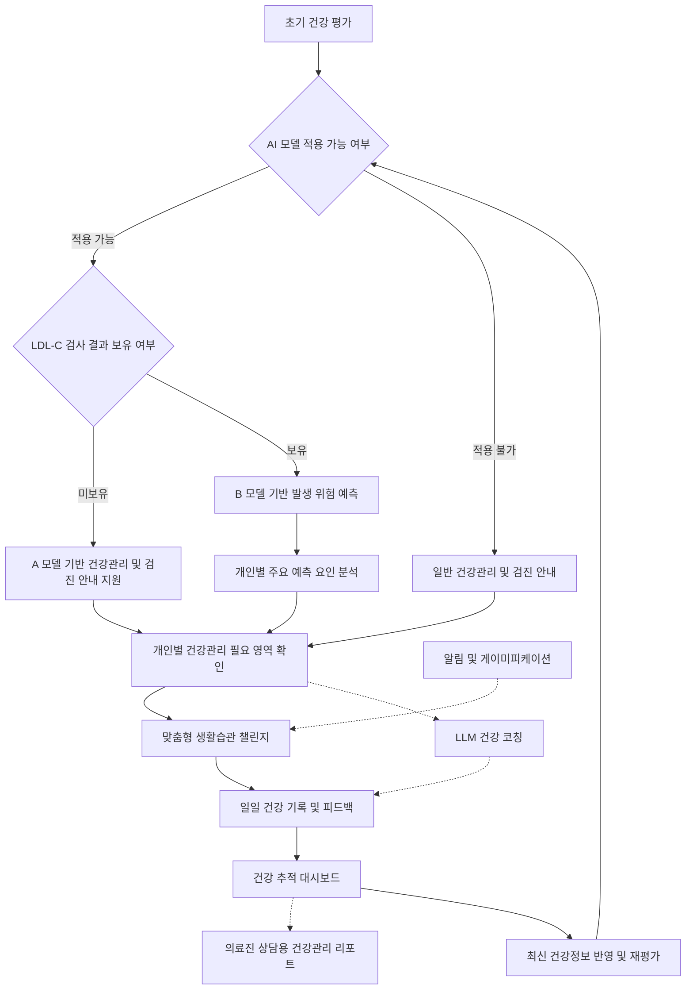

# WELLOOP — 서비스 기획 개요

> 폐경 이행기 여성의 고LDL콜레스테롤혈증 예방을 위한
> AI 기반 맞춤형 건강관리 플랫폼

## 목차

- [1. 서비스 주제](#1-서비스-주제)
- [2. 기획 배경](#2-기획-배경)
- [3. 핵심 타깃](#3-핵심-타깃)
- [4. 서비스 목적](#4-서비스-목적)
- [5. 주요 서비스 내용](#5-주요-서비스-내용)
- [6. 생활습관 관리 영역](#6-생활습관-관리-영역)
- [7. 핵심 데이터 및 AI 기술](#7-핵심-데이터-및-ai-기술)
- [8. 서비스 이용 흐름](#8-서비스-이용-흐름)
- [9. 비즈니스 모델](#9-비즈니스-모델)
- [10. 서비스 차별화 요소](#10-서비스-차별화-요소)
- [11. 기대 효과](#11-기대-효과)
- [12. 핵심 가치](#12-핵심-가치)
- [13. 서비스 설계 시 주의사항](#13-서비스-설계-시-주의사항)
  - [13.1. 생활습관 관리 영역](#131-생활습관-관리-영역)
  - [13.2. AI 및 챌린지 연계](#132-ai-및-챌린지-연계)
  - [13.3. 데이터 및 임상적 타당성](#133-데이터-및-임상적-타당성)
- [14. 참고 문헌 (References)](#14-참고-문헌-references)

## 1. 서비스 주제

**폐경 이행기 여성의 고LDL콜레스테롤혈증 예방을 위한 AI 기반 맞춤형 건강관리 플랫폼**

## 2. 기획 배경

폐경 이행기에 나타나는 호르몬 및 지질 대사 변화는 LDL 콜레스테롤 상승 및 심혈관질환 발생 위험 증가와 관련이 있다.

폐경 전후 여성의 지질 건강 변화에 대응하기 위해서는 현재 건강 상태에 대한 평가뿐만 아니라 향후 발생 위험에 대한 인식과 지속적인 생활습관 관리가 필요하다.

실제 종단 코호트 데이터를 기반으로 고LDL콜레스테롤혈증 발생 위험을 사전에 예측하고, 개인 맞춤형 생활습관 개선과 지속적인 건강관리 서비스를 제공하고자 한다.

## 3. 핵심 타깃

### Primary Target (주요 사용자)

- 폐경을 앞두고 있거나 폐경 이행기에 있는 여성
- 현재 고LDL콜레스테롤혈증이 없으나 예방적 관리가 필요한 여성
- 폐경으로 인한 신체적·대사적 변화를 체계적으로 관리하고자 하는 여성

서비스 이용 대상과 AI 예측 모델 적용 대상은 구분한다.

AI 예측 모델은 실제 학습 및 검증 데이터의 특성과 적용 조건을 고려하여 제공하며, 모델 적용 조건을 충족하지 않는 사용자에게도 생활습관 챌린지, 건강 기록 및 검진 안내 등의 건강관리 기능을 제공한다.

### Secondary Target (기업 고객)

- 여성 특화 보험상품을 운영하는 보험사
- 가입 고객 대상 예방적 건강관리 서비스를 제공하고자 하는 보험사 및 헬스케어 기업

## 4. 서비스 목적

- 고LDL콜레스테롤혈증 발생 위험 조기 예측
- 개인별 주요 예측 요인 및 건강관리 필요 영역 분석
- 임상적 근거 기반의 생활습관 개선 지원
- 지속적인 실천 동기 부여 및 건강 모니터링
- 정기검진 및 의료진 상담 지원
- 예방 중심의 건강관리 서비스 제공

## 5. 주요 서비스 내용

### 5.1. 주요 기능

| 핵심 기능 | 세부 내용 |
|---|---|
| 초기 건강 평가 | 기본 건강정보, 폐경 단계, 생활습관, 신체계측, 검사 결과, 수술 및 호르몬 요법 관련 정보 수집 |
| AI 모델 적용 조건 확인 | LDL-C 검사 결과 보유 여부 및 사용자의 건강 상태에 따른 모델 적용 가능 여부 확인 |
| AI 발생 위험 예측 | SWAN 종단 코호트 데이터 기반 고LDL콜레스테롤혈증 발생 위험 예측 및 검진 안내 지원 |
| 개인별 예측 요인 분석 | SHAP 기반 주요 예측 요인 분석 및 설명 |
| 맞춤형 생활습관 챌린지 | 개인별 개선 필요 항목에 따른 일간·주간 챌린지 제공 |
| 일일 건강 기록 | 생활습관 실천 여부 및 주요 건강지표 기록 |
| 폐경 관련 증상 기록 | 안면홍조, 야간발한, 수면 장애 등 폐경 관련 증상의 빈도 및 불편 정도 기록 |
| 건강 추적 대시보드 | 예측 결과, 건강지표, 챌린지 달성률 및 변화 추이 시각화 |
| LLM 건강 코칭 | 임상적 근거와 사용자 정보를 기반으로 개인 맞춤형 생활습관 안내 및 피드백 제공 |
| 식단 이미지 분석 | 식품 인식 및 LDL 관리에 적합한 식습관 개선 피드백 제공 |
| 게이미피케이션 | 연속 실천 기록, 목표 달성 배지, 주간 목표 등 지속적인 참여 유도 |
| 맞춤형 알림 | 챌린지 실천 독려, 건강 기록, 주간 리포트 및 정기검진 안내 |
| 의료진 상담용 건강관리 리포트 | 누적된 검사 결과, 건강지표, 폐경 증상, 복용 이력 및 생활습관 기록을 기간별로 요약 |
| 관리자 기능 | 사용자 현황, 챌린지 참여율 및 달성률, LLM 사용량 및 비용, 시스템 운영 현황 모니터링 |

### 5.2. AI 모델 구성 및 사용자 분기

LDL-C 검사 결과 보유 여부에 따라 다음과 같은 A/B 모델 구조를 고려한다.

| 구분 | 적용 대상 | 주요 활용 목적 |
|---|---|---|
| A 모델 | LDL-C 검사 결과를 보유하지 않은 사용자 중 모델 적용 조건을 충족하는 대상자 | 문진 및 신체계측 정보를 기반으로 건강관리 및 검진 안내 지원 |
| B 모델 | LDL-C 검사 결과를 보유한 사용자 중 모델 적용 조건을 충족하는 대상자 | 문진, 신체계측 및 LDL-C 정보를 기반으로 고LDL콜레스테롤혈증 발생 위험 예측 |
| 일반 건강관리 | AI 모델 적용 조건을 충족하지 않는 사용자 | 생활습관 챌린지, 건강 기록 및 검진·의료진 상담 안내 |

- LDL-C 검사 결과가 없는 사용자도 서비스를 이용할 수 있도록 설계한다.
- A 모델은 구체적인 개인별 발생 확률 제공보다는 건강관리 및 검진 안내 지원을 우선적으로 고려한다.
- A 모델의 성능이 활용 기준을 충족하지 못하는 경우 일반적인 건강관리 및 검진 안내를 제공한다.
- 검사 결과를 추가로 입력한 경우 B 모델의 적용 조건을 재확인한다.
- 모델별 세부 적용 조건, 예측 결과 제공 방식 및 활용 기준은 추가 분석 및 성능 검증 후 확정한다.

### 5.3. 기능별 구현 우선순위 (안)

| 우선순위 | 구분 | 주요 기능 |
|---|---|---|
| P0 | 필수 기능 | 회원가입 및 로그인, 초기 건강 평가, 모델 적용 조건 확인, A/B 모델 분기, AI 발생 위험 예측, SHAP 분석, 맞춤형 생활습관 챌린지, 일일 건강 기록, 건강 추적 대시보드 |
| P1 | 우선 확장 기능 | LLM 건강 코칭, 연속 실천 기록, 폐경 증상 기록, 웹 내부 알림, 의료진 상담용 건강관리 리포트, 관리자 대시보드 |
| P2 | 선택 확장 기능 | RAG, 식단 이미지 분석, 외부 Push 알림, 성취 배지, 건강관리 리포트 PDF 다운로드 |
| P3 | 향후 사업 확장 | 보험사 연계 B2B2C 서비스 |

> 위 우선순위는 개발 범위 설정을 위한 초안이며, 최종 구현 범위는 개발 일정, 역할 분담 및 기술적 구현 가능성을 고려하여 확정한다.
>
> 개인정보 보호 및 의료·AI 안전장치는 우선순위와 관계없이 관련 기능 구현 시 필수적으로 적용한다.

## 6. 생활습관 관리 영역

| 관리 영역 | 주요 관리 내용 |
|---|---|
| 영양 및 식습관 개선 | 포화지방·트랜스지방 섭취 제한, 통곡물·채소·과일 등 식이섬유 섭취 증진, 등푸른 생선 및 불포화지방 섭취, 나트륨 섭취 조절 |
| 신체활동 및 운동 | 주 150분 이상 중강도 유산소 운동을 목표로 하며, 근력 운동 및 일상 속 신체활동 증진 |
| 체중 및 복부비만 관리 | 건강 상태에 적합한 체중 유지 및 BMI·허리둘레 기록을 통한 신체 변화 모니터링 |
| 금연 및 절주 | 금연 실천 및 유지, 간접흡연 예방, 음주 빈도와 섭취량 감소 |
| 비타민 D 및 야외활동 관리 | 규칙적인 야외활동 권장 및 필요 시 의료진 상담을 통한 비타민 D 영양 상태 관리 |
| 폐경 관련 증상 관리 | 안면홍조, 야간발한, 수면 장애 등 폐경 관련 증상의 빈도 및 불편 정도 기록 |
| 건강지표 모니터링 | LDL-C, HDL-C, 총콜레스테롤, 중성지방 및 혈압 등 주요 건강지표 기록과 정기검진 안내 |

각 관리 영역을 기반으로 개인별 건강 상태와 생활습관에 적합한 일간·주간 챌린지를 제공하며, 실천 달성률과 건강지표의 변화를 지속적으로 추적한다.

### 생활습관 챌린지 및 건강 기록 구분

| 구분 | 주요 내용 |
|---|---|
| 생활습관 챌린지 | 식습관 개선, 운동, 금연 및 절주 등 사용자가 실천할 수 있는 행동 |
| 건강지표 기록 | 체중, 허리둘레, 혈압, 혈중 지질검사 결과 등 |
| 폐경 증상 기록 | 안면홍조, 야간발한, 수면 장애 등의 발생 여부, 빈도 및 불편 정도 |
| 복용 이력 기록 | 기존 복용약, 호르몬제 및 영양제 등의 복용 정보 |

생활습관 챌린지는 모든 사용자에게 동일하게 제공하기보다는 개인별 건강 상태 및 개선 필요 영역을 고려하여 제공한다.

건강지표 및 증상 기록은 챌린지 달성률과 구분하여 관리하며, 누적된 건강 기록은 건강 추적 대시보드 및 의료진 상담용 건강관리 리포트와 연계한다.

> 생활습관 관리 영역별 주의사항은
> [13.1. 생활습관 관리 영역](#131-생활습관-관리-영역) 참고.
>
> 세부 챌린지별 추천 조건, 목표 수치, 수행 주기 및 달성 기준은 별도의 챌린지 설계 문서에서 구체화한다.

## 7. 핵심 데이터 및 AI 기술

| 기술 | 활용 목적 |
|---|---|
| Dataset | SWAN(Study of Women's Health Across the Nation) 종단 코호트 데이터 기반 예측 모델 개발 |
| Machine Learning | 고LDL콜레스테롤혈증 발생 위험 예측 및 검진 안내 지원 |
| XAI (SHAP) | 개인별 주요 예측 요인 분석 및 설명 |
| Rule-based Recommendation | 임상적 근거 기반 맞춤형 생활습관 챌린지 추천 |
| LLM | 근거 기반의 맞춤형 건강 코칭 및 피드백 생성 |
| RAG | 검증된 임상 지침 및 건강관리 자료를 활용한 LLM 응답의 근거 보완 |
| Computer Vision | 식단 이미지 기반 식품 인식 및 분석 |

> RAG 및 Computer Vision 등 확장 기술의 적용 여부는 개발 일정 및 구현 범위에 따라 결정한다.

## 8. 서비스 이용 흐름

- 초기 건강 평가를 통해 사용자의 건강 상태 및 AI 모델 적용 가능 여부를 확인한다.
- 모델 적용 조건을 충족하지 않는 사용자도 일반 건강관리 기능을 이용할 수 있도록 설계한다.
- 새로운 검사 결과 및 건강정보가 입력되면 모델 적용 조건을 재확인하고, 검증된 모델 활용 범위 내에서 재평가를 진행한다.
- 점선으로 표시된 기능은 확장 기능으로, 최종 구현 범위에 따라 적용한다.

## 9. 비즈니스 모델

### 보험사 연계 B2B2C 모델

보험사와 제휴하여 여성 특화 보험상품 가입 고객에게 WELLOOP을 예방적 건강관리 부가 서비스로 제공한다.

| 이해관계자 | 기대 효과 |
|---|---|
| 보험사 | 고객 건강관리 지원, 보험상품 차별화, 고객 만족도 향상 및 장기적 보험금 지급 부담 감소 기대 |
| 사용자 | AI 기반 개인 맞춤형 예방적 건강관리 서비스 이용 |
| WELLOOP | 기업 제휴를 통한 사용자 확보 및 구독형·라이선스형 수익 창출 |

### 수익모델 후보

- **B2B2C 구독형:** 보험사가 가입 고객 수에 따라 플랫폼 이용료 지불
- **기업 라이선스:** 보험사에 플랫폼 이용권 제공
- **B2C 프리미엄:** 일반 사용자를 대상으로 심화 건강관리 기능 제공

개인의 민감한 건강정보는 보험 가입 심사 및 보험료 산정 등 불이익을 초래하는 목적으로 활용되지 않도록 보호한다.

서비스 내 보험상품의 직접적인 권유 및 판매는 진행하지 않으며, 건강관리 지원 서비스로서의 독립성을 유지한다.

> 보험사 연계는 향후 사업 확장 방향이며, 실제 보험금 지급 감소 및 손해율 개선 효과는 장기적인 검증이 필요하다.
>
> 상용화 및 기업 제휴 추진 시 데이터 이용 조건, 개인정보 보호 및 관련 법적 요건을 별도로 검토한다.

## 10. 서비스 차별화 요소

| 차별화 요소 | 세부 내용 |
|---|---|
| 여성 특화 | 폐경 이행기의 생리적·대사적 변화 및 폐경 관련 증상 반영 |
| 예방 중심 | 현재 질환 여부 판단이 아닌 미래 고LDL콜레스테롤혈증 발생 위험 예측 |
| 종단 데이터 기반 | 동일인의 시간에 따른 건강 변화를 추적한 실제 코호트 데이터 활용 |
| 사용자별 맞춤 관리 | LDL-C 검사 결과 보유 여부 및 모델 적용 조건에 따라 건강관리 기능 제공 |
| 설명 가능한 AI | 단순 예측 결과 제공을 넘어 개인별 주요 예측 요인 설명 |
| 근거 기반 개인화 | 임상 지침과 AI를 활용한 맞춤형 생활습관 관리 및 건강 코칭 |
| 지속적인 참여 유도 | 게이미피케이션 및 개인 맞춤형 알림을 통한 건강관리 습관 형성 |
| 건강 기록 활용 | 누적된 건강정보를 기반으로 정기검진 및 의료진 상담 지원 |
| 사업 확장성 | 보험사 연계 B2B2C 비즈니스 모델 |
| 순환형 건강관리 | 건강 평가 → 예측 및 관리 안내 → 실천 → 기록 → 재평가로 이어지는 지속적인 건강관리 구조 |

## 11. 기대 효과

- 폐경 이행기 여성의 지질 건강 인식 향상
- 고LDL콜레스테롤혈증 발생 위험 및 건강관리 필요 영역의 조기 파악 지원
- 개인별 건강 상태에 적합한 생활습관 개선 행동 유도
- 지속 가능한 건강관리 습관 형성
- 누적된 건강 기록을 활용한 정기검진 및 의료진 상담 지원
- 사용자 건강관리 서비스 만족도 및 참여율 향상
- 보험사 연계를 통한 예방적 헬스케어 서비스 확대

## 12. 핵심 가치

**Prediction · Prevention · Engagement · Tracking**

| 핵심 가치 | 정의 |
|---|---|
| Prediction (예측) | AI 기반 개인별 질환 발생 위험 예측 |
| Prevention (예방) | 임상적 근거 기반 맞춤형 생활습관 개선 지원 |
| Engagement (참여) | 챌린지, 알림 및 게이미피케이션을 통한 지속적인 실천 유도 |
| Tracking (추적) | 건강지표 및 생활습관 변화 모니터링 |

AI 기반 질환 발생 위험 예측을 실질적인 생활습관 개선 행동으로 연결하고, 지속적인 참여와 건강관리를 지원하는 폐경 이행기 여성 특화 플랫폼.

## 13. 서비스 설계 시 주의사항

### 13.1. 생활습관 관리 영역

| 관리 영역 | 주의사항 |
|---|---|
| 영양 및 식습관 | 단순 칼로리 제한보다는 포화지방 감소, 불포화지방 대체 및 식이섬유 섭취 증진 등 LDL 관리와 직접적으로 관련된 식습관 개선에 집중 |
| 오메가-3 | 주로 중성지방(TG) 감소에 효과가 있으므로 고LDL콜레스테롤혈증 예방을 위한 필수 보충제 복용 챌린지로 설정하지 않으며, 생선 등 식품을 통한 섭취를 우선적으로 고려 |
| 신체활동 및 운동 | 개인의 건강 상태와 운동 능력에 따라 운동 강도 및 목표를 차등 설정 |
| 체중 및 복부비만 | 한국인 기준 BMI 및 복부비만 기준 적용. 정상 체중인 사용자에게 불필요한 체중 감량을 권장하지 않음 |
| 비타민 D | 이상지질혈증과의 연관성이 비타민 D 보충을 통한 LDL-C 감소 효과를 의미하지 않으므로 보조적 건강관리 항목으로 설정. 일률적인 혈중 농도 목표 및 보충제 복용을 권장하지 않음 |
| 야외활동 | 비타민 D 합성을 목적으로 자외선차단제 미사용을 권장하지 않음 |
| 폐경 관련 증상 | 안면홍조, 야간발한, 수면 장애 등은 LDL-C의 직접적인 개선 항목보다는 폐경 특화 보조 관리 항목으로 활용하며, 증상의 빈도 및 불편 정도를 함께 고려 |
| 건강지표 모니터링 | 실제 혈액검사 결과와 AI 예측 결과를 명확히 구분하며, 검사 주기는 개인별 건강 상태 및 의료진 권고에 따라 안내 |
| 복용 이력 | 기존 복용약, 호르몬제 및 영양제의 복용 정보를 기록하되, 서비스에서 임의로 복용 시작·중단 또는 용량 변경을 권장하지 않음 |

생활습관 챌린지 및 건강관리 목표는 검증된 임상 지침을 기반으로 설정하며, 관찰 연구에서 확인된 연관성을 직접적인 질환 예방 효과로 해석하지 않는다.

### 13.2. AI 및 챌린지 연계

- **SHAP 해석**
  - 모델의 주요 예측 요인이 실제 질환 발생의 인과적 위험요인임을 의미하지 않음.
  - 챌린지 추천 시 모델의 예측 결과뿐만 아니라 임상 가이드라인을 함께 고려.
  - 변경 가능한 건강관리 영역과 변경하기 어려운 개인적 특성을 구분하여 안내.

- **위험도 재평가**
  - 챌린지 달성률에 따라 예측 위험도를 임의로 감소시키지 않음.
  - 모델의 학습 변수 정의와 일치하는 최신 사용자 정보를 기반으로 위험도 재평가.
  - 예측 위험도 감소를 실제 LDL-C 감소 또는 질환 예방 효과로 해석하지 않음.
  - 반복적인 위험도 재평가는 해당 모델의 검증된 활용 범위 내에서 제공.

- **LLM 건강 코칭**
  - 검증된 임상 지침을 기반으로 생활습관 개선 방향을 안내.
  - 질환 진단, 약물 처방 및 변경을 권고하지 않도록 제한.
  - 질환 예방을 목적으로 호르몬 요법의 시작·중단 및 변경을 임의로 권고하지 않음.
  - 부정확한 의학 정보 생성(Hallucination)을 최소화하기 위한 안전장치 마련.
  - 흉통, 호흡곤란 등 응급상황이 의심되는 경우 일반적인 LLM 건강 코칭보다 119 신고 및 응급실 방문 안내를 우선 제공.
  - 응급상황 대응은 LLM 판단에만 의존하지 않고 별도의 규칙 기반 안전장치를 적용.

- **알림 및 게이미피케이션**
  - 과도한 실천 압박이나 죄책감을 유발하지 않도록 설계.
  - 사용자가 알림 활성화 여부, 알림 시간 및 빈도를 직접 설정할 수 있도록 구현.
  - 경쟁보다는 개인의 성취감과 지속적인 건강관리 습관 형성에 집중.
  - 건강지표 및 증상 기록과 생활습관 챌린지의 달성률을 구분하여 관리.

- **식단 이미지 분석**
  - 이미지 기반 분석만으로 정확한 영양소 섭취량을 산출하기 어려움.
  - 정밀 영양소 계산보다는 식품 인식 및 LDL 관리에 적합한 식습관 개선 피드백에 집중.
  - 실제 기능 구현 여부에 따라 활용 가능한 음식 이미지 데이터셋 및 분석 모델을 검토.

### 13.3. 데이터 및 임상적 타당성

- **데이터 적합성**
  - SWAN의 Visit별 변수 구성, 결측치, 추적 기간 및 신규 발생 표본 수 확인.
  - 임상적 근거를 기반으로 예측 기간 및 신규 발생 정의의 후보 기준 설정.
  - 후보 기준별 발생자 수, 추적 기간, 중도탈락 및 데이터 활용 가능성 검토.
  - 추가 EDA 결과를 바탕으로 예측 기간과 신규 발생 정의를 확정하며, 세부 기준은 별도의 AI 모델링 문서에서 정의.
  - 동일 참여자의 데이터를 학습 및 평가 데이터에 중복 포함하지 않도록 데이터 누수 방지.

- **데이터 이용 조건**
  - SWAN 데이터의 연구 목적 이용, 재배포 제한 및 상업적 이용 관련 약관 확인.
  - 원본 데이터 및 가공 데이터 공유 시 데이터 제공기관의 이용 조건 준수.
  - 향후 서비스 상용화 및 보험사 연계 추진 시 별도의 데이터 이용 허가 필요 여부 검토.

- **모델 적용 대상 및 제외 조건**
  - 서비스 이용 대상과 AI 예측 모델 적용 대상을 구분.
  - 실제 학습 및 검증 데이터의 연령 범위와 임상적 특성을 고려하여 모델 적용 조건 설정.
  - 초기 건강 평가 시 자궁절제 및 난소절제 여부, 수술 시기, 호르몬 요법 관련 정보를 확인할 수 있도록 설계.
  - 자궁절제·난소절제 및 호르몬 요법 관련 대상자는 모델 적용 제한 대상으로 우선 고려하며, 세부 기준은 학습 데이터의 특성에 따라 확정.
  - 기존 고LDL콜레스테롤혈증 환자 및 지질저하제 복용자는 신규 발생 위험 예측 대상과 구분.
  - 모델 적용 조건을 충족하지 않는 사용자에게도 생활습관 챌린지, 건강 기록 및 검진 안내 기능 제공.
  - 학습 데이터의 제외 및 중도절단 기준은 별도의 AI 모델링 문서에서 구체적으로 정의.

- **모델 성능 및 활용 기준**
  - LDL-C 검사 결과 보유 여부에 따른 A/B 모델의 성능 및 활용 가능성 검토.
  - 기저 LDL-C 단독 예측 모델과 B 모델의 성능을 비교하여 추가 변수 활용에 따른 예측 성능 개선 여부 확인.
  - 기저 LDL-C 구간별 모델 성능 및 예측 결과의 신뢰성 평가.
  - 모델 성능이 서비스 활용 기준을 충족하지 못하는 경우 개별 발생 확률을 제공하지 않고 일반적인 건강관리 및 검진 안내로 대체.
  - 모델별 세부 평가 지표 및 성능 목표는 AI 모델링 단계에서 확정.

- **모델 일반화 가능성**
  - SWAN은 미국 기반 다인종 여성 코호트이므로 한국 여성에게 적용할 경우 인구집단 간 차이를 고려.
  - 국민건강영양조사(KNHANES)를 활용하여 국내 여성의 건강지표 및 생활습관 분포를 비교 검토.
  - 미국 국민건강영양조사(NHANES)를 활용하여 미국 여성의 폐경 및 LDL-C 관련 특성을 비교 검토.
  - 국민건강영양조사 및 NHANES는 참고 분석 데이터로 활용하며, 횡단면 데이터 기반의 특성 비교를 미래 발생 위험 예측 모델의 직접적인 외부 검증으로 해석하지 않음.
  - 국내 대상자에 대한 적절한 외부 검증 없이 한국 여성 대상 모델의 임상적 유효성을 단정하지 않음.

- **임상적 근거 검증**
  - 참고 문헌의 연구 대상, 연구 설계, 세부 수치 및 권고 수준 확인.
  - 고LDL콜레스테롤혈증과 이상지질혈증 전체를 대상으로 한 연구의 결과를 구분하여 해석.
  - 임상 가이드라인을 기반으로 챌린지 목표와 달성 기준 확정.
  - 폐경 단계 및 관련 증상 평가 시 검증된 연구 기준을 참고.

- **개인정보 보호**
  - 민감한 건강정보의 수집 및 활용에 대한 적절한 사용자 동의 확보.
  - 서비스 제공에 필요한 범위 내에서 건강정보를 수집하고 접근 권한을 제한.
  - 보험사와 연계하는 경우 개인별 건강정보 및 예측 결과에 대한 접근 범위 제한.
  - 개인의 건강정보가 보험 가입 심사, 보험료 산정 등 사용자에게 불이익을 초래하는 목적으로 활용되지 않도록 설계.

- **서비스 활용 범위 및 사용자 안내 문구**
  - 본 서비스는 의료적 진단이나 치료를 대체하지 않는 건강관리 지원 서비스임을 명시.
  - 내부 기획 및 모델링 문서에서는 '발생 위험 예측'이라는 표현을 사용하되, 사용자에게 노출되는 화면에서는 'LDL 관리 필요 신호', '검진 권장 단계' 등 건강관리 중심의 표현을 우선적으로 고려.
  - 사용자 안내 문구가 의료적 진단이나 확정적인 질환 발생 판단으로 오인되지 않도록 설계.
  - 이상 소견 확인 시 의료기관 방문 및 전문가 상담 안내.
  - 의료진 상담용 건강관리 리포트는 사용자가 기록한 건강정보 및 변화 추이를 요약하는 참고 자료로 제공하며, 의료적 진단 결과로 활용하지 않음.
  - 실제 서비스 제공 범위와 사용자 안내 문구는 관련 법령 및 비의료 건강관리서비스 가이드라인을 검토하여 확정.

## 14. 참고 문헌 (References)

### 14.1. 폐경 이행기 및 지질 대사

- **Matthews et al. (2009). Are Changes in Cardiovascular Disease Risk Factors in Midlife Women Due to Chronological Aging or to the Menopausal Transition?**
  - Journal of the American College of Cardiology, 54(25), 2366–2373.
  - [논문 원문](https://pmc.ncbi.nlm.nih.gov/articles/PMC2856606/)
  - [DOI](https://doi.org/10.1016/j.jacc.2009.10.009)
  - 활용 목적: 폐경 이행기에 따른 LDL-C 변화 분석 및 예측 모델 주제 선정 근거

- **정인숙, 윤혜선, 김묘성, 황윤선 (2022). 폐경 후 이상지질혈증 발생양상과 위험요인.**
  - Journal of Korean Academy of Nursing, 52(2), 214–227.
  - [DOI](https://doi.org/10.4040/jkan.21188)
  - 활용 목적: 국내 폐경 여성의 이상지질혈증 발생 양상 및 관련 위험요인 검토

- **El Khoudary et al. (2019). The menopause transition and women's health at midlife: A progress report from the Study of Women's Health Across the Nation (SWAN).**
  - Menopause, 26(10), 1213–1227.
  - [DOI](https://doi.org/10.1097/GME.0000000000001424)
  - 활용 목적: SWAN 연구 대상 및 폐경 이행기 여성의 건강 변화에 대한 이해

### 14.2. 폐경 단계 및 관련 증상

- **Harlow et al. (2012). Executive summary of the Stages of Reproductive Aging Workshop + 10: Addressing the unfinished agenda of staging reproductive aging.**
  - Journal of Clinical Endocrinology & Metabolism, 97(4), 1159–1168.
  - [DOI](https://doi.org/10.1210/jc.2011-3362)
  - 활용 목적: 폐경 단계 분류 및 초기 건강 평가 문항 설계

- **구슬, 신지연 (2026). 폐경 이행기 여성의 폐경 관련 증상 유병률과 중증도 변화에 관한 종단 연구.**
  - HIRA Research, 6(2), e6.
  - [DOI](https://doi.org/10.52937/hira.26.6.2.e6)
  - 활용 목적: 폐경 관련 증상 기록 및 건강관리 기능 설계

- **남궁선주 외 (2021). 갱년기 여성의 주요 신체변화와 증상: 갱년기 코호트.**
  - 주간 건강과 질병, 14(20), 1352–1362.
  - 활용 목적: 국내 갱년기 여성의 신체적 변화 및 폐경 관련 증상 특성 검토

- **질병관리본부 국립보건연구원 (2016). 폐경기 여성의 건강지표 및 교육자료 개발.**
  - 연구보고서, 2012-NG63001-00.
  - 활용 목적: 국내 폐경기 여성 대상 건강관리 및 교육 콘텐츠 설계

### 14.3. 생활습관 관리 및 임상 가이드라인

- **한국지질·동맥경화학회 진료지침위원회 (2022). 이상지질혈증 진료지침 제5판.**
  - [한국지질·동맥경화학회](https://www.lipid.or.kr/)
  - 활용 목적: LDL 관리 관련 영양, 신체활동 및 생활습관 챌린지 설계

- **Kim et al. (2014). Association between physical activity and menopausal symptoms in perimenopausal women.**
  - BMC Women's Health, 14, 122.
  - [DOI](https://doi.org/10.1186/1472-6874-14-122)
  - 활용 목적: 신체활동과 폐경 관련 증상 간의 연관성 검토

- **박윤진 (2025). 폐경기 여성의 25-hydroxyvitamin D3와 이상지질혈증.**
  - 한국응용과학기술학회지, 42(4), 553–561.
  - [DOI](https://doi.org/10.12925/jkocs.2025.42.4.553)
  - 활용 목적: 비타민 D와 지질 건강 간의 연관성 및 보조적 건강관리 영역 검토

### 14.4. 호르몬 요법 및 의료 안전

- **US Preventive Services Task Force (2022). Hormone therapy for the primary prevention of chronic conditions in postmenopausal persons: US Preventive Services Task Force recommendation statement.**
  - JAMA, 328(17), 1740–1746.
  - [DOI](https://doi.org/10.1001/jama.2022.18625)
  - 활용 목적: 호르몬 요법 관련 건강관리 안내 및 LLM 안전 기준 설계

- **Rossouw et al. (2025). Menopausal hormone therapy and cardiovascular diseases in women with vasomotor symptoms: A secondary analysis of the Women's Health Initiative randomized clinical trials.**
  - JAMA Internal Medicine, 185(11), 1330–1339.
  - [DOI](https://doi.org/10.1001/jamainternmed.2025.4510)
  - 활용 목적: 폐경 증상, 호르몬 요법 및 심혈관질환 관련 근거 검토

- **Honigberg, Trinder, & Natarajan (2022). Lipoprotein(a), menopausal hormone therapy, and risk of coronary heart disease in postmenopausal individuals.**
  - JAMA Cardiology, 7(5), 565–568.
  - [DOI](https://doi.org/10.1001/jamacardio.2022.0716)
  - 활용 목적: 폐경 여성의 지질 관련 지표와 호르몬 요법 및 심혈관질환 위험에 관한 참고 근거

### 14.5. 데이터 출처

#### 모델 학습 데이터

- **SWAN (Study of Women's Health Across the Nation)**
  - [공식 웹사이트](https://www.swanstudy.org/)
  - [Data Access](https://www.swanstudy.org/swan-research/data-access/)
  - [ICPSR SWAN Series 253](https://www.icpsr.umich.edu/sites/icpsr/view/collections/253)
  - 데이터 유형: 종단 코호트 데이터
  - 활용 목적: 폐경 이행기 여성의 고LDL콜레스테롤혈증 발생 위험 예측 모델 개발 및 평가

#### 참고 분석 데이터

- **KNHANES (Korea National Health and Nutrition Examination Survey)**
  - [국민건강영양조사 공식 웹사이트](https://knhanes.kdca.go.kr/)
  - 데이터 유형: 횡단면 데이터
  - 활용 목적: 국내 여성의 건강지표 및 생활습관 특성 비교 검토

- **NHANES (National Health and Nutrition Examination Survey)**
  - [CDC NHANES 공식 웹사이트](https://www.cdc.gov/nchs/nhanes/)
  - 데이터 유형: 횡단면 데이터
  - 활용 목적: 미국 여성의 폐경 및 LDL-C 관련 특성 비교 검토

> 참고 문헌의 세부 서지정보 및 임상적 근거는 원문 확인 후 보완하며, 모델링 및 기능 설계 과정에서 추가되는 참고 문헌은 관련 상세 설계 문서에 반영한다.

---

[목차로 돌아가기](#목차)