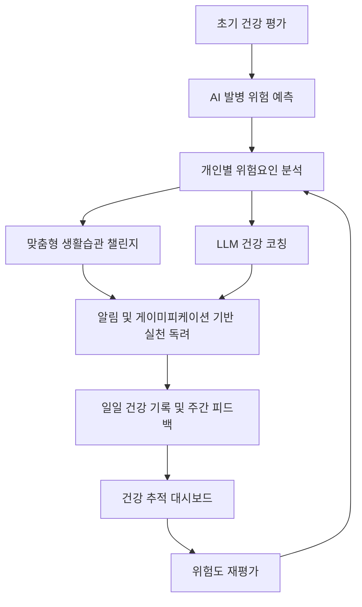

# WELLOOP — 서비스 기획 개요

> 폐경 이행기 여성의 고LDL콜레스테롤혈증 예방을 위한
> AI 기반 맞춤형 건강관리 플랫폼

## 목차

- [1. 서비스 주제](#1-서비스-주제)
- [2. 기획 배경](#2-기획-배경)
- [3. 핵심 타깃](#3-핵심-타깃)
- [4. 서비스 목적](#4-서비스-목적)
- [5. 주요 서비스 내용](#5-주요-서비스-내용)
- [6. 생활습관 관리 영역](#6-생활습관-관리-영역)
- [7. 핵심 데이터 및 AI 기술](#7-핵심-데이터-및-ai-기술)
- [8. 서비스 이용 흐름](#8-서비스-이용-흐름)
- [9. 비즈니스 모델](#9-비즈니스-모델)
- [10. 서비스 차별화 요소](#10-서비스-차별화-요소)
- [11. 기대 효과](#11-기대-효과)
- [12. 핵심 가치](#12-핵심-가치)
- [13. 서비스 설계 시 주의사항](#13-서비스-설계-시-주의사항)
  - [13.1. 생활습관 관리 영역](#131-생활습관-관리-영역)
  - [13.2. AI 및 챌린지 연계](#132-ai-및-챌린지-연계)
  - [13.3. 데이터 및 임상적 타당성](#133-데이터-및-임상적-타당성)
- [14. 참고 문헌 (References)](#14-참고-문헌-references)

## 1. 서비스 주제

**폐경 이행기 여성의 고LDL콜레스테롤혈증 예방을 위한 AI 기반 맞춤형 건강관리 플랫폼**

## 2. 기획 배경

폐경 이행기에 나타나는 호르몬 및 지질 대사 변화로 인해 LDL 콜레스테롤 상승과 심혈관질환 발생 위험이 증가한다.

실제 종단 코호트 데이터를 기반으로 고LDL콜레스테롤혈증 발생 위험을 사전에 예측하고, 개인 맞춤형 생활습관 개선과 지속적인 건강관리 서비스를 제공하고자 한다.

## 3. 핵심 타깃

### Primary Target (주요 사용자)

- 폐경을 앞두고 있거나 폐경 이행기에 있는 40~50대 여성
- 현재 고LDL콜레스테롤혈증이 없으나 예방적 관리가 필요한 여성
- 폐경으로 인한 신체적·대사적 변화를 체계적으로 관리하고자 하는 여성

### Secondary Target (기업 고객)

- 여성 특화 보험상품을 운영하는 보험사
- 가입 고객 대상 예방적 건강관리 서비스를 제공하고자 하는 보험사 및 헬스케어 기업

## 4. 서비스 목적

- 고LDL콜레스테롤혈증 발생 위험 조기 예측
- 개인별 주요 위험요인 분석
- 임상적 근거 기반의 생활습관 개선 지원
- 지속적인 실천 동기 부여 및 건강 모니터링
- 예방 중심의 건강관리 서비스 제공

## 5. 주요 서비스 내용

| 핵심 기능 | 세부 내용 |
|---|---|
| 초기 건강 평가 | 기본 건강정보, 폐경 단계, 생활습관, 신체계측 및 검사 결과 수집 |
| AI 발병 위험 예측 | SWAN 종단 코호트 데이터 기반 고LDL콜레스테롤혈증 발생 위험 예측 |
| 개인별 위험요인 분석 | SHAP 기반 주요 예측 요인 분석 및 설명 |
| 맞춤형 생활습관 챌린지 | 개인별 개선 필요 항목에 따른 일간·주간 챌린지 제공 |
| LLM 건강 코칭 | 임상적 근거와 사용자 정보를 기반으로 개인 맞춤형 생활습관 안내 및 피드백 제공 |
| 식단 이미지 분석 | 식품 인식 및 LDL 관리에 적합한 대체 식품 추천 |
| 게이미피케이션 | 연속 실천 기록, 목표 달성 배지, 주간 목표 등 지속적인 참여 유도 |
| 맞춤형 알림 | 챌린지 실천 독려, 건강 기록, 주간 리포트 및 정기검진 안내 |
| 건강 추적 대시보드 | 예측 위험도, 건강지표, 챌린지 달성률 및 변화 추이 시각화 |

## 6. 생활습관 관리 영역

| 관리 영역 | 주요 관리 내용 |
|---|---|
| 영양 및 식습관 개선 | 포화지방·트랜스지방 섭취 제한, 통곡물·채소·과일 등 식이섬유 섭취 증진, 등푸른 생선 및 불포화지방 섭취, 나트륨 섭취 조절 |
| 신체활동 및 운동 | 주 150분 이상 중강도 유산소 운동을 목표로 하며, 근력 운동 및 일상 속 신체활동 증진 |
| 체중 및 복부비만 관리 | 적정 체중 유지, BMI 및 허리둘레 기록을 통한 신체 변화 모니터링 |
| 금연 및 절주 | 금연 실천 및 유지, 간접흡연 예방, 음주 빈도와 섭취량 감소 |
| 비타민 D 및 야외활동 관리 | 규칙적인 야외활동 권장, 필요 시 의료진 상담을 통한 비타민 D 영양 상태 관리 |
| 폐경 관련 증상 관리 | 안면홍조, 야간발한, 수면 장애 등 폐경 관련 증상 기록 및 생활습관 관리 |
| 건강지표 모니터링 | LDL-C, HDL-C, 총콜레스테롤, 중성지방 및 혈압 등 주요 건강지표 기록과 정기검진 안내 |

각 관리 영역을 기반으로 개인별 건강 상태와 생활습관에 적합한 일간·주간 챌린지를 제공하며, 실천 달성률과 건강지표의 변화를 지속적으로 추적한다.

> 생활습관 관리 영역별 세부 설계 기준은
> [13.1. 생활습관 관리 영역](#131-생활습관-관리-영역) 참고.

## 7. 핵심 데이터 및 AI 기술

| 기술 | 활용 목적 |
|---|---|
| Dataset | SWAN(Study of Women's Health Across the Nation) 종단 코호트 데이터 |
| Machine Learning | 고LDL콜레스테롤혈증 발생 위험 예측 |
| XAI (SHAP) | 개인별 주요 예측 요인 분석 및 설명 |
| Rule-based Recommendation | 임상적 근거 기반 맞춤형 생활습관 챌린지 추천 |
| LLM / RAG | 근거 기반의 맞춤형 건강 코칭 및 피드백 생성 |
| Computer Vision | 식단 이미지 기반 식품 인식 및 분석 |

## 8. 서비스 이용 흐름

## 9. 비즈니스 모델

### 보험사 연계 B2B2C 모델

보험사와 제휴하여 여성 특화 보험상품 가입 고객에게 WELLOOP을 예방적 건강관리 부가 서비스로 제공한다.

| 이해관계자 | 기대 효과 |
|---|---|
| 보험사 | 고객 건강관리 지원, 보험상품 차별화, 고객 만족도 향상 및 장기적 보험금 지급 부담 감소 기대 |
| 사용자 | AI 기반 개인 맞춤형 예방적 건강관리 서비스 이용 |
| WELLOOP | 기업 제휴를 통한 사용자 확보 및 구독형·라이선스형 수익 창출 |

### 수익모델 후보

- **B2B2C 구독형:** 보험사가 가입 고객 수에 따라 플랫폼 이용료 지불
- **기업 라이선스:** 보험사에 플랫폼 이용권 제공
- **B2C 프리미엄:** 일반 사용자를 대상으로 심화 건강관리 기능 제공

개인의 민감한 건강정보는 보험 가입 심사 및 보험료 산정 등 불이익을 초래하는 목적으로 활용되지 않도록 보호한다.

> 보험사 연계는 향후 사업 확장 방향이며, 실제 보험금 지급 감소 및 손해율 개선 효과는 장기적인 검증이 필요하다.

## 10. 서비스 차별화 요소

| 차별화 요소 | 세부 내용 |
|---|---|
| 여성 특화 | 폐경 이행기의 생리적·대사적 변화 반영 |
| 예방 중심 | 현재 질환 여부 판단이 아닌 미래 고LDL콜레스테롤혈증 발생 위험 예측 |
| 종단 데이터 기반 | 동일인의 시간에 따른 건강 변화를 추적한 실제 코호트 데이터 활용 |
| 설명 가능한 AI | 단순 예측 위험도 제공을 넘어 개인별 주요 예측 요인 설명 |
| 근거 기반 개인화 | 임상 지침과 LLM을 활용한 맞춤형 생활습관 관리 및 건강 코칭 |
| 지속적인 참여 유도 | 게이미피케이션 및 개인 맞춤형 알림을 통한 건강관리 습관 형성 |
| 사업 확장성 | 보험사 연계 B2B2C 비즈니스 모델 |
| 순환형 건강관리 | 예측 → 실천 → 기록 → 재평가로 이어지는 지속적인 건강관리 구조 |

## 11. 기대 효과

- 폐경 이행기 여성의 지질 건강 인식 향상
- 고LDL콜레스테롤혈증 고위험군 조기 파악 지원
- 개인별 건강 상태에 적합한 예방 행동 유도
- 지속 가능한 건강관리 습관 형성
- 사용자 건강관리 서비스 만족도 및 참여율 향상
- 보험사 연계를 통한 예방적 헬스케어 서비스 확대

## 12. 핵심 가치

**Prediction · Prevention · Engagement · Tracking**

| 핵심 가치 | 정의 |
|---|---|
| Prediction (예측) | AI 기반 개인별 질환 발생 위험 예측 |
| Prevention (예방) | 임상적 근거 기반 맞춤형 생활습관 개선 |
| Engagement (참여) | 알림 및 게이미피케이션을 통한 지속적인 실천 유도 |
| Tracking (추적) | 건강지표 및 생활습관 변화 모니터링 |

AI 기반 질환 발생 위험 예측을 실질적인 예방 행동으로 연결하고, 지속적인 참여와 건강관리를 지원하는 폐경 이행기 여성 특화 플랫폼.

## 13. 서비스 설계 시 주의사항

### 13.1. 생활습관 관리 영역

| 관리 영역 | 주의사항 |
|---|---|
| 영양 및 식습관 | 단순 칼로리 제한보다는 포화지방 감소, 불포화지방 대체 및 식이섬유 섭취 증진에 집중 |
| 오메가-3 | 주로 중성지방(TG) 감소에 효과가 있으며, 고LDL콜레스테롤혈증 예방을 위한 필수 복용 챌린지로 설정하지 않음 |
| 신체활동 및 운동 | 개인의 건강 상태와 운동 능력에 따라 운동 강도 및 목표를 차등 설정 |
| 체중 및 복부비만 | 한국인 기준 BMI 및 복부비만 기준 적용. 정상 체중인 사용자에게 불필요한 체중 감량을 권장하지 않음 |
| 비타민 D | 이상지질혈증과의 연관성이 비타민 D 보충을 통한 LDL-C 감소 효과를 의미하지 않으므로 보조적 건강관리 항목으로 설정 |
| 야외활동 | 비타민 D 합성을 목적으로 자외선차단제 미사용을 권장하지 않음 |
| 폐경 관련 증상 | 안면홍조, 야간발한, 수면 장애 등은 LDL-C의 직접적인 개선 항목보다는 폐경 특화 보조 관리 항목으로 활용 |
| 건강지표 모니터링 | 실제 혈액검사 결과와 AI 예측 위험도를 명확히 구분하며, 검사 주기는 개인별 건강 상태에 따라 설정 |

### 13.2. AI 및 챌린지 연계

- **SHAP 해석**
  - 모델의 주요 예측 요인이 실제 질환 발생의 인과적 위험요인임을 의미하지 않음.
  - 챌린지 추천 시 모델의 예측 결과뿐만 아니라 임상 가이드라인을 함께 고려.

- **위험도 재평가**
  - 챌린지 달성률에 따라 예측 위험도를 임의로 감소시키지 않음.
  - 모델의 학습 변수 정의와 일치하는 최신 사용자 정보를 기반으로 위험도 재평가.
  - 예측 위험도 감소를 실제 LDL-C 감소 또는 질환 예방 효과로 해석하지 않음.

- **LLM 건강 코칭**
  - 검증된 임상 지침을 기반으로 생활습관 개선 방향을 안내.
  - 질환 진단, 약물 처방 및 변경을 권고하지 않도록 제한.
  - 부정확한 의학 정보 생성(Hallucination)을 최소화하기 위한 안전장치 마련.

- **알림 및 게이미피케이션**
  - 과도한 실천 압박이나 죄책감을 유발하지 않도록 설계.
  - 사용자가 알림 활성화 여부, 알림 시간 및 빈도를 직접 설정할 수 있도록 구현.
  - 경쟁보다는 개인의 성취감과 지속적인 건강관리 습관 형성에 집중.

- **식단 이미지 분석**
  - 이미지 기반 분석만으로 정확한 영양소 섭취량을 산출하기 어려움.
  - 정밀 영양소 계산보다는 식품 인식 및 LDL 관리에 적합한 식습관 개선 피드백에 집중.

### 13.3. 데이터 및 임상적 타당성

- **데이터 적합성**
  - SWAN의 Visit별 변수 구성, 결측치, 추적 기간 및 신규 발생 표본 수 확인.
  - EDA 결과를 기반으로 예측 기간과 타깃 라벨 정의 확정.
  - 동일 참여자의 데이터를 학습 및 평가 데이터에 중복 포함하지 않도록 데이터 누수 방지.

- **모델 일반화 가능성**
  - SWAN은 미국 기반 다인종 여성 코호트이므로 한국 여성에게 적용할 경우 인구집단 간 차이를 고려.
  - 국내 대상자에 대한 외부 검증 없이 한국 여성 대상 모델의 임상적 유효성을 단정하지 않음.

- **임상적 근거 검증**
  - 참고 문헌의 연구 대상, 연구 설계, 세부 수치 및 권고 수준 확인.
  - 임상 가이드라인을 기반으로 챌린지 목표와 달성 기준 확정.

- **개인정보 보호**
  - 민감한 건강정보의 수집 및 활용에 대한 사용자 동의 확보.
  - 보험사와 연계하는 경우 개인별 건강정보 및 예측 결과에 대한 접근 범위 제한.

- **서비스 활용 범위**
  - 본 서비스는 의료적 진단이나 치료를 대체하지 않는 예방적 건강관리 지원 서비스임을 명시.
  - 이상 소견 확인 시 의료기관 방문 및 전문가 상담 안내.

## 14. 참고 문헌 (References)

### 폐경 이행기 및 지질 대사

- Are Changes in Cardiovascular Disease Risk Factors in Midlife Women due to Chronological Aging or to the Menopausal Transition?
  - [논문 원문](https://pmc.ncbi.nlm.nih.gov/articles/PMC2856606/)
  - 활용 목적: 폐경 이행기에 따른 LDL-C 변화 분석 및 예측 모델 주제 선정 근거

### 생활습관 관리 및 임상 가이드라인

- 참고 문헌 추가 예정

### 데이터 출처

- **SWAN (Study of Women's Health Across the Nation)**
  - [공식 웹사이트](https://www.swanstudy.org/)
  - [Data Access](https://www.swanstudy.org/swan-research/data-access/)
  - 활용 목적: 폐경 이행기 여성의 고LDL콜레스테롤혈증 발생 위험 예측 모델 개발

---

[목차로 돌아가기](#목차)
